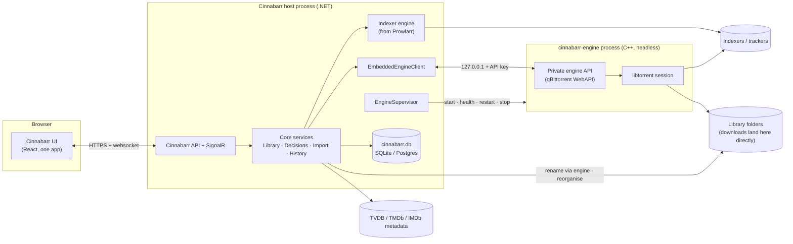

# Cinnabarr — Architecture & Roadmap

> Name: the product is **Cinnabarr** (the working name was Embarr). The UI strings, the engine (`cinnabarr-engine`) and these docs use the final name; the GitHub repositories are still named EmbarrPre1 to EmbarrPre4 until the owner renames them, and the AppData folder, service name, executable and project names change with the Phase 7 migration (§4.7). This document says Cinnabarr throughout, including in Phase 1, which describes work that shipped under the old name.

> Status: **Phase 0 — design proposal.** No code has changed yet. This document is the agreed starting point for the work that follows; update it as decisions change.

Cinnabarr is a single application that combines four upstream projects:

| Repo | Upstream | Role in Cinnabarr |
| --- | --- | --- |
| **Cinnabarr** (repo still named EmbarrPre1 until the owner renames it) | Sonarr | **Home repo.** Base host, data layer, frontend, TV support |
| EmbarrPre2 | Radarr | Source of movie support (ported in) |
| EmbarrPre4 | Prowlarr | Source of the indexer engine (ported in) |
| EmbarrPre3 | qBittorrent | Source of the built-in torrent engine (forked, headless) |

Path references: `Cinnabarr:path` is this repo; `Pre2:`, `Pre3:` and `Pre4:` are EmbarrPre2–4.

---

## 1. Vision and UX principles

Cinnabarr is **one app with one mental model**, not four tools sharing a browser tab.

1. **One library.** Movies and series live in the same Library. Media type is a filter, not a separate app.
2. **One queue.** The download queue *is* the download client. There is no separate "client" view, no "open in qBittorrent" link, no second list of torrents.
3. **One search.** Searching indexers, grabbing a release and linking it to a library item happen in one flow.
4. **One settings tree.** Each setting exists once. Nothing is "synced" between components (no Prowlarr → Sonarr app sync, no download-client connection settings).
5. **No outbound UIs.** No page links to or embeds another tool's interface.
6. **Torrent-only.** Usenet indexers and Usenet download clients are removed.
7. **State is always true.** Every fact has exactly one owner (§4.4). Torrents are never lost or seeding out of sight.
8. **Download straight to the final place.** No download folder, no import copy (§4.8).
9. **Only video and subtitle files ever reach disk** (§4.8).
10. **The library is flat and consistently named.** No torrent folders are left behind (§4.11).
11. **Seeding is optional and never costs you a file** (§4.10).

What the user should never have to think about: which component owns a setting, remote path mappings, API keys between components, categories that tell a download client which app a torrent belongs to.

---

## 2. Source map

### Kept as the base (Cinnabarr / Sonarr)

- Host and infrastructure: `Cinnabarr:src/NzbDrone.Host`, `Cinnabarr:src/NzbDrone.Common`, `Cinnabarr:src/NzbDrone.SignalR`, `Cinnabarr:src/Sonarr.Http`
- Core services: `Cinnabarr:src/NzbDrone.Core/Datastore`, `Cinnabarr:src/NzbDrone.Core/Messaging`, `Cinnabarr:src/NzbDrone.Core/Jobs`, `Cinnabarr:src/NzbDrone.Core/ThingiProvider`
- Shared domain (becomes media-type aware): `Cinnabarr:src/NzbDrone.Core/Profiles`, `Cinnabarr:src/NzbDrone.Core/CustomFormats`, `Cinnabarr:src/NzbDrone.Core/Qualities`, `Cinnabarr:src/NzbDrone.Core/Queue`, `Cinnabarr:src/NzbDrone.Core/History`, `Cinnabarr:src/NzbDrone.Core/Blocklisting`, `Cinnabarr:src/NzbDrone.Core/RootFolders`, `Cinnabarr:src/NzbDrone.Core/Tags`, `Cinnabarr:src/NzbDrone.Core/Notifications`, `Cinnabarr:src/NzbDrone.Core/ImportLists`
- TV domain: `Cinnabarr:src/NzbDrone.Core/Tv`, `Cinnabarr:src/NzbDrone.Core/SeriesStats`
- Download pipeline (kept, but made media-type-aware in Phase 4 — today it is episode-only: `TrackedDownload` holds a `RemoteEpisode` and completion calls `IDownloadedEpisodesImportService`): `Cinnabarr:src/NzbDrone.Core/Download/TrackedDownloads`, `Cinnabarr:src/NzbDrone.Core/Download/CompletedDownloadService.cs`, `Cinnabarr:src/NzbDrone.Core/Download/FailedDownloadService.cs`, `Cinnabarr:src/NzbDrone.Core/Download/Pending`
- API: `Cinnabarr:src/Sonarr.Api.V5` is the pattern for the Cinnabarr API
- Frontend: `Cinnabarr:frontend` (Vite, TypeScript, Zustand, TanStack Query, React Router 7, lucide icons)

### Ported in from EmbarrPre2 / Radarr

- Movie domain: `Pre2:src/NzbDrone.Core/Movies` (incl. `Movies/Collections`, `Movies/Credits`, `Movies/AlternativeTitles`, `Movies/Translations`), `Pre2:src/NzbDrone.Core/MovieStats`
- Movie-specific parts of: `Pre2:src/NzbDrone.Core/MediaFiles`, `Pre2:src/NzbDrone.Core/Organizer`, `Pre2:src/NzbDrone.Core/DecisionEngine`, `Pre2:src/NzbDrone.Core/ImportLists`, `Pre2:src/NzbDrone.Core/MetadataSource`, `Pre2:src/NzbDrone.Core/Parser`
- Screens to **rebuild** (not copy) on Cinnabarr's frontend patterns: `Pre2:frontend/src/Movie`, `Pre2:frontend/src/AddMovie`, `Pre2:frontend/src/Collection`, `Pre2:frontend/src/DiscoverMovie`

### Ported in from EmbarrPre4 / Prowlarr

- Indexer engine: `Pre4:src/NzbDrone.Core/Indexers` (incl. `Indexers/Definitions` and `Indexers/Definitions/Cardigann`)
- `Pre4:src/NzbDrone.Core/IndexerProxies` (FlareSolverr, HTTP, SOCKS4/5)
- `Pre4:src/NzbDrone.Core/IndexerSearch`, `Pre4:src/NzbDrone.Core/IndexerStats`, `Pre4:src/NzbDrone.Core/IndexerVersions`
- **Dropped:** `Pre4:src/NzbDrone.Core/Applications` (app sync). The indexers run inside Cinnabarr, so there's nothing to sync to.
- **Dropped:** Usenet definitions such as `Pre4:src/NzbDrone.Core/Indexers/Definitions/Newznab`, `Pre4:src/NzbDrone.Core/Indexers/Definitions/NzbIndex.cs`, `Pre4:src/NzbDrone.Core/Indexers/Definitions/BinSearch.cs`

### Forked from EmbarrPre3 / qBittorrent

- **Kept:** `Pre3:src/base/bittorrent` (libtorrent session), `Pre3:src/base` support code, `Pre3:src/webui/api` controllers (becomes the private engine API), `Pre3:src/app` (process entry point)
- **Removed:** `Pre3:src/gui` (Qt desktop UI), `Pre3:src/webui/www` (web UI), `Pre3:src/base/rss` (RSS auto-downloader; Cinnabarr does RSS sync), `Pre3:src/base/search` and `Pre3:src/searchengine` (Python search plugins; replaced by the indexer engine), the Lua plugin engine (`PLUGINS` CMake option)

---

## 3. System architecture



### Engine lifecycle (`EngineSupervisor`)

- **Start:** Cinnabarr starts `cinnabarr-engine` as a child process at boot:
  `cinnabarr-engine --profile=<AppData>/engine --webui-port=<random free port>`. The API key is generated by Cinnabarr on first run, written into the engine profile and sent on every request as `X-API-Key` (qBittorrent already supports this, see `Pre3:src/webui/webapplication.cpp`).
- **Binding:** the engine API listens on `127.0.0.1` only. It's never exposed to the network, so the user never sees a second port or login.
- **Health:** poll `app/version` every few seconds. Report status in System → Status and as a health check.
- **Restart:** on crash or failed health checks, restart with backoff (1s, 2s, 4s … max 60s) and raise a health warning after repeated failures.
- **Shutdown:** on Cinnabarr shutdown call `app/shutdown`, wait for resume data to flush, then kill after a timeout.
- **Docker:** one container, one image. Both processes run in it; the supervisor is the only thing that starts the engine.

### Licensing and naming

- Sonarr, Radarr and Prowlarr are GPLv3. qBittorrent is GPLv2-or-later with an OpenSSL exception. The combined distribution is **GPLv3**. The engine stays a separate executable, which keeps its licence boundary clear.
- Keep all upstream copyright notices. Don't use the Sonarr, Radarr, Prowlarr or qBittorrent names or logos in the product, only in attribution.

---

## 4. Backend merge design

### 4.1 Media types

- Add `MediaType { Series, Movie }` to shared entities: History, Blocklist, TrackedDownload / Queue items, PendingRelease and RootFolder.
- Quality profiles, custom formats, delay profiles, release profiles, tags and notifications are **shared** across media types. A profile can be used by a series or a movie.
- **Series/Episode and Movie stay as separate tables.** Their shapes are too different to merge usefully.
- A **`LibraryItem` read model** (database view or query projection) returns both as one list with common fields (title, year, poster, monitored, status, size on disk, quality profile, tags, root folder, added date). The merged Library page reads from it.
- **Calendar and Wanted can't use `LibraryItem`.** They list individual episodes and movie releases, and one series can have many calendar events and episodes in different Wanted states. Add an episode + movie-release projection for Calendar and an episode + movie projection for Wanted. `LibraryItem` only supplies the parent metadata (title, poster, profile).
- **Version slots** (see §4.9):
  - Today an episode or movie has exactly one file: `Episode.EpisodeFileId` (`Cinnabarr:src/NzbDrone.Core/Tv/Episode.cs`) and `Movie.MovieFileId` (`Pre2:src/NzbDrone.Core/Movies/Movie.cs`).
  - Add a `VersionSlot`: Id, owner (series or movie), Label (e.g. "4K", "HD", "Remastered"), quality profile, custom-format rules, monitored.
  - Files link to (episode or movie, slot) instead of the single file id.
  - Every series and movie gets a default slot, so single-version users notice nothing.
  - Wanted, cutoff and upgrades are worked out per slot.
  - Editions (Remastered, Director's Cut, …) come from Radarr's parser (`Pre2:src/NzbDrone.Core/Parser/Parser.cs`).

### 4.2 Parsing and decisions

- Keep both parsers (`Cinnabarr:src/NzbDrone.Core/Parser`, `Pre2:src/NzbDrone.Core/Parser`). Rename them by domain (e.g. `SeriesParser`, `MovieParser`).
- **Searches** know their media type, so they use the right parser directly.
- **RSS sync** doesn't know the media type. Try series matching first, then movies, then mark the release as unmatched.
- **DecisionEngine:** shared specifications (quality, custom format score, size, blocklist, seeders, delay) run for both. Type-specific specifications (season packs, episode numbering, movie availability) are registered per media type.

### 4.3 Indexers

- Prowlarr's indexer engine replaces Sonarr's own indexer module (`Cinnabarr:src/NzbDrone.Core/Indexers`).
- An adapter maps Sonarr search criteria (series, season, episode, anime) and Radarr search criteria (movie, IMDb/TMDb id) to Prowlarr's TV and movie search criteria. Results come back as Cinnabarr release models.
- Indexer health, rate limits and stats come from Prowlarr's existing services.
- **Indexer definitions:** Prowlarr downloads Cardigann definitions from Prowlarr's servers (`Pre4:src/NzbDrone.Core/IndexerVersions/IndexerDefinitionUpdateService.cs`). Cinnabarr needs its own fork of the definitions repository and its own update source (see §8).

### 4.4 Engine integration and single source of truth

**Why.** Today's Sonarr/Radarr ↔ qBittorrent state bugs come from two apps each keeping their own state, joined by categories, path mappings and polling. Merging removes that join. The engine is still a separate process with its own state, so these rules are required:

1. **The info-hash is the only key.** Never match on name or path.
2. **Cinnabarr owns intent; the engine owns facts.** Intent: linked item, version slot, seeding rule. Facts: progress, state, files.
3. **Reconcile at startup and on every poll.**
   - A torrent in the engine with no Cinnabarr record is adopted as **Unlinked** and shown in Downloads.
   - An Cinnabarr record whose torrent is gone is shown as **Missing from engine**, with **Re-add** (sends the stored release back to the engine, which re-checks any data already at the target) and **Dismiss** (records the grab as ignored; nothing is deleted).
4. **Reconcile never deletes anything.** It only flags.
5. **Link intent is also stored next to the engine's state.** At grab time Cinnabarr writes a small sidecar file per torrent in the engine profile (`<AppData>/engine/cinnabarr/<info-hash>.json`). It holds the media type, the item's **external ids** (TVDB/TMDb, not database ids), season and episode numbers, slot label and seeding rule. If Cinnabarr's database is restored from a backup taken before a grab, reconcile rebuilds the record from the sidecar instead of leaving the torrent Unlinked. Torrents with no sidecar (added by hand, or from before the sidecar existed) are adopted as Unlinked. This recovery guarantee covers only what the sidecar holds. The slot label and seeding rule fields are added with §4.9 and §4.10; until then the sidecar holds the media type, TVDB id, season and episode numbers, release title and indexer.

**Visibility is separate from processing.** Today `DownloadMonitoringService.DownloadIsTrackable` drops Imported, Failed and Ignored downloads, so a torrent that is still seeding disappears from the queue. In Cinnabarr, every engine torrent is always listed. Only automatic import and failure handling are limited to eligible downloads.

**Media-type-aware pipeline.** Tracking, completion and failure handling dispatch on `MediaType`: a series handler (the existing code) and a movie handler (ported from Radarr). Done in Phase 4.

**Download clients:**
- Remove every external download client and the Usenet client base: `Cinnabarr:src/NzbDrone.Core/Download/Clients` (except the qBittorrent code it starts from), `Cinnabarr:src/NzbDrone.Core/Download/UsenetClientBase.cs`, `Cinnabarr:src/NzbDrone.Core/Download/NzbValidationService.cs`.
- Add **`EmbeddedEngineClient`**, a single non-configurable `IDownloadClient`. Start it from `Cinnabarr:src/NzbDrone.Core/Download/Clients/QBittorrent/QBittorrentProxyV2.cs`, which already speaks the qBittorrent WebAPI.
- **No categories for routing.** Links live in Cinnabarr's database, backed up by the engine tag (rule 5).
- **No remote path mappings.** The engine and Cinnabarr share a filesystem, so `Cinnabarr:src/NzbDrone.Core/RemotePathMappings` is removed.
- Built so far (2h-1):
  - **Removed clients.** Every external download client is removed (`Download/Clients/*` except qBittorrent, which the engine uses). Saved definitions for removed clients are deleted on the next start, by the existing missing-implementation cleanup.
  - **Engine only.** Cinnabarr only ever loads its built-in engine's client. Any other definition left in the database, such as a user's own qBittorrent, is never loaded or touched, so a user's own clients and Cinnabarr don't interact.
  - **No adding clients.** Adding a download client is refused (v3 and v5 `POST downloadclient`). The settings page no longer offers Add or Clone.
- Built so far (2h-2):
  - **Removed Usenet code.** The Usenet indexers (Newznab, Fanzub) and the Usenet client code (`UsenetClientBase`, `NzbValidationService`) are removed. Saved Usenet indexer definitions are deleted on the next start, as with the removed clients.
  - **Kept for Torznab.** Newznab's shared capabilities, request and parsing code stays, because Torznab uses it.
  - **Leftovers.** The `Usenet` protocol value and Usenet settings, such as delay profile delays, remain until the indexer engine replaces indexers (Phase 3). With no Usenet indexer or client they never apply.
- Built so far (2h-3):
  - **What's removed.** Remote path mappings are removed: the service, the v3 and v5 APIs, the health check and the settings section. The engine's paths are used as they are.
  - **What stays.** The `RemotePathMappings` table stays in the database, because migrations don't change, but nothing reads it.

### 4.5 Database

- Start a **fresh Cinnabarr migration chain**. Migration 1 creates the merged schema (Sonarr's current schema + movie tables + indexer tables + `MediaType` columns) instead of replaying three upstream histories (Sonarr is at migration 240, see `Cinnabarr:src/NzbDrone.Core/Datastore/Migration`).
- Both SQLite and Postgres stay supported.
- Importers from existing Sonarr, Radarr and Prowlarr databases, and from a qBittorrent `BT_backup` folder (to keep seeding torrents), come in Phase 6.

### 4.6 API

- One Cinnabarr API (`/api/v1`) built on `Cinnabarr:src/Sonarr.Api.V5` patterns. Series, movie, library, queue, indexer, search and engine resources all live under one API and one API key.
- Remove `Cinnabarr:src/Sonarr.Api.V3` from the Cinnabarr build once the frontend no longer uses it.
- **Optional, later:** Sonarr v3 and Radarr v3 compatibility shims so request tools (Overseerr, Jellyseerr) can talk to Cinnabarr as if it were Sonarr and Radarr.

### 4.7 Naming in code

- Keep the `NzbDrone.*` namespaces and project names during Phases 1–4. That keeps cherry-picking upstream fixes from Sonarr, Radarr and Prowlarr possible while the merge is under way.
- Rename user-visible strings and the product name in Phase 1. Phase 1c did most of this, but the brand text in the page header and sidebar (`frontend/src/Components/Page/Header/PageHeader.tsx`, `frontend/src/Components/Page/Sidebar/PageSidebar.tsx`) still renders "Sonarr" and remains outstanding Phase 1 work.
- **External contracts keep their Sonarr names until Phase 7**, where one migration renames them together (see Phase 7). External contracts are the database file, AppData folder, service and binary names, default port, `SONARR__` environment variables and custom-script variables. This timing rule covers branding-related contracts only. The `/api/v3` surface is governed by §4.6 instead: it is removed once the frontend no longer uses it, and compatibility shims stay optional (Phase 7).

### 4.8 Downloading to the final location

There is no separate download folder and no import copy. Each file is written straight to its final library path.

**Flow for every grab:**
1. Add the torrent with the engine's `MetadataReceived` stop condition (`Pre3:src/base/bittorrent/torrent.h`). A magnet fetches its metadata, then stops before any file data is downloaded. A `.torrent` file already has metadata, so it is added stopped.
2. Apply the file whitelist (below). Every other file gets priority 0 and is never downloaded.
3. Run the pre-download checks (below).
4. Map each kept file to its library target and version slot (§4.11).
5. Set the torrent's save path to the lowest common library folder (the series, season or movie folder).
6. `renameFile` each kept file to a hidden **pending name** next to its final path, e.g. `.{final name}.pending`. This also flattens any folders inside the torrent.
7. Start the torrent.

**File whitelist.**
- Video: `mkv`, `mp4`, `m4v`, `avi`, `ts`, `m2ts`, `webm`.
- Subtitles: `srt`, `ass`, `ssa`, `vtt`, `sub`, `idx`, `sup`.
- Only the real final extension counts, so `movie.mkv.exe` is excluded.
- A torrent with no video file, or only archives (`rar`, `zip`, …), is rejected, blocklisted, and searched again.

**Import is per file, after validation.** While a file downloads it has its hidden pending name plus the engine's `.!qB` suffix, so media servers never see it. When the engine reports that one file is complete, Cinnabarr runs a **per-file import** for it straight away, without waiting for the rest of the torrent:
1. Run the post-completion checks (below) on that file.
2. If they pass, `renameFile` the file from its pending name to its final name. This is an instant rename in the same folder, and the engine keeps seeding.
3. Record the file against its episode or movie and slot, and emit the normal import events (history, notifications, media-server refresh).

This per-file import is idempotent. It's keyed by info-hash plus the file's index in the torrent, so a repeated completion event or a restart never imports a file twice. A season pack's episodes therefore appear in the library one by one, and each one only after it has been checked. This is new work in Phase 2. Today's completion handler (`Cinnabarr:src/NzbDrone.Core/Download/CompletedDownloadService.cs`) waits for the whole torrent.

**Checks:**
- **Before any data downloads** (from metadata only): file names, extensions, file sizes, a sample check by name and size only, and the parsed episode or movie matching the target.
- **After each video file completes:** media info (resolution, codecs, languages, runtime) and the full runtime-based sample check. That check reuses `Cinnabarr:src/NzbDrone.Core/MediaFiles/EpisodeImport/DetectSample.cs`, which needs the file's runtime, so it can only run once the file is on disk.
- **On video rejection:** delete that file (it was never published under its final name), blocklist the release, search again.

**Subtitles are validated separately.** They have no resolution or runtime, and `DetectSample` would treat a zero runtime as a sample, so the video checks never run on them.
- **Subtitle checks:** extension, a sensible size, text subtitles parse as text, and the language and forced/SDH flags read from the file name.
- **Registration:** a subtitle is attached to the video it belongs to, in the same slot, and renamed to match that video's final name (§4.11). If the video hasn't been imported yet, the subtitle stays under its pending name until it is. If the video is rejected, its subtitles are deleted with it.
- **On subtitle rejection:** only that subtitle is discarded. A bad subtitle never blocklists the release.

**Name already taken.** For an upgrade in the same slot, the new file waits under its pending name. When it passes its checks it replaces the old file, and the old file is removed from its own torrent using the steps in §4.10. Old files and their subtitles go through the recycle bin, as any upgrade does: they are kept there when a recycle bin is configured (Media Management) and deleted outright when none is. A torrent left with no videos is removed from the engine without its data.

**Part files.** libtorrent stores pieces that overlap unwanted files in a hidden `.parts` file in the save folder. The engine deletes it when the torrent is removed (`delete_partfile`), and orphan cleanup (§4.13) catches leftovers. The engine's "unwanted folder" option is forced off.

**Optional staging folder.** One setting (Settings → Download Clients → Staging Folder) turns it on. Each torrent then downloads into `<root>/.cinnabarr-staging/<torrent>/` in the root folder that holds its series, and each file moves into place when it passes its checks. The torrent saves into the root folder, so the move is a rename inside the same torrent. A file whose final folder is on a different drive from its root folder (a mount inside the root) is not staged, so the move is always an instant rename and never a copy. The staging folder is hidden from library scans and Library Import, and each torrent's folder is removed once it is empty. Use it if writing torrents directly to slow hard drives hurts performance. A per-root-folder toggle can come with the root folder settings in Phase 4.

### 4.9 Versions and concurrent sources

**Version slots** (data model in §4.1). Each series or movie can hold several named versions at once, e.g. "4K" + "HD", or "Original" + "Remastered". Each slot has its own quality profile, custom formats, Wanted state and upgrades. The slot label goes into the file name (§4.11), which is what Emby's version switcher reads. Search offers **Download another version** into an existing slot or a new one.

**Race mode** grabs several releases for the same file and keeps the first good copy.
- Up to *N* releases target the same file, in the same slot. Each writes to its own unique pending name.
- The **winner is the first copy that completes, passes the post-completion checks and is imported** (§4.8). A copy that completes but fails its checks (a sample, a mislabelled release) is rejected and blocklisted, and the race continues with the others.
- Losers are only cancelled after the winner has been imported. A losing copy may be partial (`.pending.!qB`) or may already have finished (`.pending`) while the winner was being checked. Either way, its file is deleted at the path the engine currently reports for it. If the losing torrent still has other wanted files, use the single-file removal steps in §4.10. Otherwise the losing torrent is removed from the engine along with its data.
- Races are decided **per file**. A series pack can race single-episode torrents, and each episode goes to whichever source first delivers a valid copy.
- Losers are not blocklisted. They were valid releases, just slower.
- Settings: maximum concurrent sources per file, and "race allowed" per indexer. Race is off by default on private trackers (see §8).

### 4.10 Seeding rules (per file)

**Seeding is optional.** The global default can be "don't seed". Video and subtitle files are always kept after seeding ends.

**Which rule applies.** The most specific rule wins:
1. Episode or file
2. Season
3. Series or movie (with an optional per-slot override)
4. Tracker minimum — a floor. Cinnabarr warns if a rule is set lower than a private tracker's hit-and-run requirement.
5. Global default

**Rule format.** Seed for *n* hours, days, weeks or months (sent to the engine as minutes), or until ratio *n*. Modes: time only, ratio only, whichever comes first, or both.

**Limits, stated honestly:**
- libtorrent counts upload per torrent, not per file.
- Per-file **time** runs from when that file completed.
- Per-file **ratio** is approximated from the torrent's ratio.
- A torrent keeps seeding until every file still in it has met its goal.
- The strictest remaining goal is also written to the engine's own per-torrent share limits, so limits still apply if Cinnabarr is down.

**Removing one file from a torrent that's still seeding** (an upgrade, a deletion, or a race loser):
1. Set the file's priority to 0.
2. Delete or replace the file.
3. Force a recheck, so the torrent stops offering those pieces instead of erroring.

**When the goal is met.** Remove the torrent from the engine and **keep the files**. A video is never deleted because of seeding.

**Built so far (2e-1).** The global goal (Settings → Download Clients → Seeding; default: ratio 1 or 14 days, whichever comes first) and the tracker minimum, both of which must be met. The engine's share limits are written when the goals amount to a single "time or ratio" goal; otherwise the torrent is left unlimited and Cinnabarr removes it, since the engine stops at whichever limit comes first. Series, season and episode goals (2e-2) are stored on the series (its seasons) and episodes and set through `PUT /api/v5/seeding/series/{id}`, `…/series/{id}/season/{n}` and `…/episode/{id}` (`GET /api/v5/seeding/series/{id}` lists them); the series page sets them for the series (toolbar → Seeding Goal) and each season (season menu → Seeding Goal); an episode's goal is set through the API until the item pages (Phase 4) give episodes their own view.

**Visibility.** The Downloads page and each item page show every file's goal, where the goal came from (e.g. "14 days, from series") and progress toward it. A health check flags any torrent still active past its goal.

### 4.11 Library layout and naming

The library is flat and consistently named. Torrent folders are never kept.

```
TV Shows/{Series} ({Year})/Season {ss}/{Series}.S{ss}E{ee}/{Series}.S{ss}E{ee} - {Episode Title} - {Version}.{ext}
Movies/{Movie} ({Year})/{Movie} ({Year}) - {Version}.{ext}
```

- `{Version}` is the version slot's label, e.g. `2160p`, `HD`, `Remastered`.
- The movie format, where every file name starts with the folder name, is what Emby's version switcher expects.
- **Subtitles** use the video's base name plus `.{lang}[.forced|.sdh].{ext}`, e.g. `….en.forced.srt`. When several subtitles share a language and tags, a copy number goes first (`….1.en.srt`, `….2.en.srt`). The language comes from the subtitle's file name, or its folder (`Subs/English/…`).
- **Multi-episode files** use `S01E01-E02`. **Specials** go in `Season 00`.
- Reuse Sonarr's file-name builder (`Cinnabarr:src/NzbDrone.Core/Organizer`) for templates and for cleaning up characters that aren't allowed in file names.
- Emby, Jellyfin and Plex each handle multiple versions of an **episode** differently. Verify this in Phase 5 before naming is locked.

### 4.12 Library reorganisation tool

A one-off job for an existing, messy library. It runs on a root folder or on any folder.

1. **Scan.** Reuse `Cinnabarr:src/NzbDrone.Core/MediaFiles/DiskScanService.cs`.
2. **Identify.** Parse each file name and look up the metadata (§4.14). Anything that can't be identified goes to the Manual Import review (`Cinnabarr:src/Sonarr.Api.V5/ManualImport`).
3. **Plan.**
   - Work out each file's target path with §4.11.
   - Duplicates become version slots, or are flagged for a decision.
   - Files that aren't video or subtitles are listed for **opt-in** deletion.
   - Folders left empty are removed.
4. **Preview.** Show every planned change using the `Cinnabarr:frontend/src/Organize` preview modal pattern.
5. **Execute.**
   - Moves on the same drive are instant renames.
   - Moves across drives copy, verify, then delete the original.
   - Files that belong to an engine torrent are renamed through the engine, so seeding continues.

Reuse `Cinnabarr:src/NzbDrone.Core/MediaFiles/RenameEpisodeFileService.cs` and `Pre2:src/NzbDrone.Core/MediaFiles/RenameMovieFileService.cs`. Every run writes a journal that can be undone. The tool never deletes a video file without explicit approval.

### 4.13 Orphan cleanup

A scheduled task deletes leftover partial downloads. It only touches `.!qB`, `.parts` and hidden `.pending` files (§4.8), and only when **all** of these are true:
- no torrent in the engine owns the file,
- the file is older than the grace period (default 7 days),
- the file is inside a root folder or staging folder.

The first run is a dry run that lists the files for approval. Nothing else is ever deleted by this task.

Built so far (2f-1, backend):
- **Which files.** Only Cinnabarr's own partial files are considered: hidden pending files (`.{name}.{8 hex}.pending`, with or without `.!qB`) and libtorrent part files (`.{info-hash}.parts`). Each carries its torrent's id in its name. Any other `.!qB` file (from another client) is left alone, because its owner can't be known.
- **Who owns them.** Ownership is checked against every id the engine reports for its torrents: the hash, `infohash_v1` and `infohash_v2`. This also covers hybrid and v2-only torrents, whose part files are named by the v2 hash.
- **When nothing is decided.** If the engine isn't running or can't list its torrents, nothing is called an orphan.
- **Unfinished downloads.** Files of the engine's unfinished downloads aren't orphans, even when the engine no longer has them (they can be re-added). That covers downloads in the queue and unfinished grabs in history, so it holds across a restart. A hybrid torrent's v2 hash is recorded in its link when it is prepared, because libtorrent names its part file after it. A re-grab keeps the recorded hash. Links prepared earlier get theirs from the engine during import, with the other link writes, while the engine still has the torrent. Orphan cleanup itself never writes links. While any unfinished download's v2 hash is still unknown, no part file named by a v2 hash is deleted.
- **Category set.** If the engine's client has a category set, it can't list every torrent, so nothing is called an orphan.
- **Links.** The scan doesn't follow links (symlinks, junctions), so every file it lists is physically inside a root folder.
- **Just before deleting.** Ownership, age and existence are checked again for each file. Deletion takes turns with torrent adds (`EngineAddGate`) and doesn't run within 5 minutes of an add: the engine may not list a newly added torrent yet, and that torrent may own old files.
- **Scheduled task.** `EngineOrphanCleanupCommand` runs daily. It only lists the files, and a health notice says how many are waiting, until a list is approved (`EngineOrphanCleanupApproved`). After that it deletes orphans itself. The grace period is `EngineOrphanGraceDays` (7).
- **API.** `GET /api/v5/engine/orphans` scans now. `POST /api/v5/engine/orphans/delete` with `{paths, deleteAutomatically}` deletes the listed files that are still orphans on a fresh scan, then sets automatic deletion. Empty per-torrent staging folders go with their files.
- **Review screen (2f-2).** Settings → Download Clients has a **Leftover Partial Files** section:
  - the grace period (`engineOrphanGraceDays`, at least 1 day), also in the v3 and v5 download client settings;
  - whether **Delete Automatically** is on, with a button to turn it off (`GET /api/v5/engine/orphans/status`, `POST .../stop`). Only approving a list turns it on, so it isn't a download client setting;
  - **Review Leftover Files**, which scans now and lists each file's path, size and last write;
  - **Delete**, which approves the list and can turn on automatic deletion at the same time.

### 4.14 Metadata sources

| Source | Used for |
| --- | --- |
| **TVDB** | TV series, seasons, episodes and episode ordering |
| **TMDb** | Movies, collections, and extra TV artwork and data |
| **IMDb** | IDs and ratings, via TMDb's external IDs. IMDb's non-commercial datasets are optional. IMDb has no free official API. |

- These replace Sonarr's Skyhook service and Radarr's metadata proxy (§8).
- Scene name mappings currently come from Sonarr's services (`Cinnabarr:src/NzbDrone.Core/DataAugmentation/Scene`). Switch to TheXEM directly (`Cinnabarr:src/NzbDrone.Core/DataAugmentation/Xem`) plus Cinnabarr's own mapping list.
- Needs a TVDB v4 project API key (check its licence terms) and a TMDb API key (attribution required).

---

## 5. Engine fork design (EmbarrPre3)

| Area | Change |
| --- | --- |
| Build | Build only `qbittorrent-nox`: `cmake -DGUI=OFF -DWEBUI=ON -DPLUGINS=OFF`. Rename the binary to `cinnabarr-engine`. |
| Removed code | `src/gui`, `src/webui/www`, `src/base/rss`, `src/base/search`, `src/searchengine`, update checker, legal-notice prompt (Cinnabarr shows it once at first run) |
| API | Keep `src/webui/api` controllers as the private engine API. Remove endpoints Cinnabarr won't use (RSS, search, torrent creator at first). |
| Auth | API key only, set by Cinnabarr. Disable username/password login, CSRF and host-header checks that only matter for a browser UI. |
| Binding | Force `127.0.0.1`. Refuse to start if asked to bind elsewhere. |
| Preferences | **Cinnabarr owns all preferences.** It writes them through `app/setPreferences` at start-up and when the user saves Settings → Downloads. The engine's own config file isn't edited by hand. |
| Updates to Cinnabarr | Cinnabarr polls `sync/maindata` (already incremental) every 1–2s while the Downloads page is open and every ~30s otherwise. **Later:** add a push channel (websocket or server-sent events) to the engine so Cinnabarr gets changes instantly. |
| Logs | Engine log file lives under `<AppData>/engine/logs` and is shown in System → Logs alongside Cinnabarr's log. |
| Backups | Cinnabarr backups include the engine profile (resume data and settings). |
| Forced preferences | `.!qB` extension for incomplete files on (`AddExtensionToIncompleteFiles`, `Pre3:src/base/bittorrent/common.h`). Unwanted folder off (`UseUnwantedFolder`). Torrents are added with the `MetadataReceived` stop condition (magnets) or stopped (`.torrent` files) until Cinnabarr has set file priorities and names (§4.8). Content layout `NoSubfolder` (`Pre3:src/base/bittorrent/torrentcontentlayout.h`). |
| API Cinnabarr relies on | File priority, `renameFile`, `renameFolder`, `setLocation`, per-torrent share limits (`ratioLimit`, `seedingTimeLimit`, `shareLimitAction`) and tags. All already exist in `Pre3:src/webui/api/torrentscontroller.cpp`. |
| CI builds | Qt 6 + libtorrent 2.0.x (`Pre3:CMakeLists.txt` requires ≥ 2.0.10). Targets: linux-x64, linux-arm64, win-x64, macOS (x64 + arm64). Prefer static libtorrent/OpenSSL builds so the engine ships as one binary per platform. |

Keep the fork's diff small and isolated (feature flags or `#ifdef CINNABARR` where needed) so upstream qBittorrent and libtorrent fixes can still be merged.

---

## 6. Information architecture and UI

### 6.1 Navigation

The sidebar replaces Sonarr's (`Cinnabarr:frontend/src/Components/Page/Sidebar/PageSidebar.tsx`) and routes replace `Cinnabarr:frontend/src/App/AppRoutes.tsx`.

| Page | What it is | Merges |
| --- | --- | --- |
| **Library** | Every movie and series in one grid/table/overview. Filter chips: All · Movies · Series. Shared sort, filters, bulk edit. Item pages stay type-specific (series → seasons/episodes; movie → files, collection, credits) and show version slots and seeding status per file. Library menu has **Reorganise…** (§4.12). | Sonarr Series, Radarr Movies |
| **Add** | One search box that searches TV and movie metadata together and shows mixed results with a type badge. Tabs: Search · Discover (popular/upcoming, from Radarr Discover, extended to TV) · Import existing folders. | Sonarr Add Series, Radarr Add Movie, Radarr Discover |
| **Calendar** | Episodes and movie releases (cinema, digital, physical) in one calendar and one iCal feed. | Both calendars |
| **Wanted** | Missing and Cutoff Unmet, for both types, with a type filter. | Both Wanted pages |
| **Downloads** | The queue *and* the download client. See §6.2. | Sonarr/Radarr Activity → Queue, qBittorrent UI |
| **Search** | Free-text search across all indexers (Prowlarr's search page). Grab sends to the engine; optionally link the grab to a library item. | Prowlarr Search, Sonarr/Radarr Interactive Search |
| **Activity** | History (all types, plus indexer queries and grabs) and Blocklist. | Sonarr/Radarr History + Blocklist, Prowlarr History |
| **Settings** | One tree. See §6.3. | All four apps' settings |
| **System** | Status (incl. engine health, version, disk space), Tasks, Backup, Updates, Events, Logs (Cinnabarr + engine). | All four |

### 6.2 Downloads page (queue = client)

```
┌ Downloads ─────────────────────────────────────────── ↓ 12.4 MB/s  ↑ 1.1 MB/s  [🐢 Alt speed] [⏸ Pause all] ┐
│ [All 23] [Downloading 4] [Verifying 1] [Seeding 15] [Stalled 1] [Unlinked 2]   Type: [All ▾]  🔍 filter   │
├──────────────────────────────────────────────────────────────────────────────────────────────────────────────┤
│ ☐ Name                       Linked to              Status        Progress     ↓ / ↑        ETA    Ratio │
│ ☐ Show.S02E05.1080p…         Show · S02E05          Downloading   ███████░ 81% 4.2 MB/s     3m     0.1   │
│ ☐ Film.2024.2160p…           Film (2024)            Verifying     ████████ 100%  —          —      0.3   │
│ ☐ Some.Linux.ISO             — [Link…]              Seeding       ████████ 100%  ↑ 300 KB/s —      2.4   │
└──────────────────────────────────────────────────────────────────────────────────────────────────────────────┘
  ▸ Detail drawer for the selected row:  Overview · Files (priorities) · Trackers · Peers · Import log
```

- **One row per torrent.** No split between "queue" and "client". The status column covers both worlds: Queued · Downloading · Stalled · Paused · Verifying (checks after a file completes) · Needs review (manual import) · Seeding · Completed · Failed · Missing from engine.
- **Linked to** shows the library item (series + episodes, or movie). Unlinked torrents can be linked or manually imported from here.
- **Row actions:** pause/resume, force start, change priority, set speed limit, set share limit, re-check, remove (with options: keep files / delete files / blocklist and search again), manual import.
- **Header controls:** live global speeds, alternative speed toggle, pause/resume all. These are always visible in the page header, and the global speed also shows in the sidebar status area.
- **Add torrent** button (magnet or `.torrent` file), with an optional "link to library item" step.
- Updates arrive over SignalR, so the list moves without refreshing.
- **Rows expand to show each file:** library target path, status, seed goal, where that goal came from (e.g. "14 days, from series"), and progress toward it.
- **Race groups** (§4.9) are shown together as one row, e.g. "Racing 3 sources", with the leader highlighted.
- **Unlinked** and **Missing from engine** rows come from the reconcile rules in §4.4. Nothing is ever hidden.
- There is no "Importing" wait for seeding to finish. A file is in the library as soon as it completes (§4.8).

Built so far (2g-1):
- **Queue rows for built-in engine downloads expand to show each file.** The details come from `GET /api/v5/engine/downloads/{downloadId}/files` and refresh every 10s while open. Each video is followed by its subtitles. Each file shows:
  - its library path;
  - its state: downloading, publishing, in library, rejected or replaced;
  - its download progress;
  - each seeding goal with where it came from, for example "14 days or ratio 1, from series", marked when it is met;
  - how long it has seeded and the torrent's ratio.
- **Re-add.** Downloads missing from the engine have a **Re-add** button (`POST /api/v5/queue/readd/{id}`). Removing them is the existing remove action.
- **Queue resource.** The v5 queue resource now has `isEngineDownload` and `isMissingFromEngine`.

Built so far (2g-2):
- **Header controls on the Downloads page.** These appear only while the engine answers:
  - live download and upload speeds (`GET /api/v5/engine/status`, every 3s);
  - an **Alternative Speed** toggle (`PUT /api/v5/engine/altspeed?enabled=`);
  - **Pause All** and **Resume All** (`POST /api/v5/engine/pause|resume`). Resume All leaves torrents still being prepared alone.
- **Per-download controls in the expanded file panel:** **Pause/Resume**, **Force Start** and **Re-check** (`POST /api/v5/engine/downloads/{id}/pause|resume|forcestart?enabled=|recheck`). A torrent still being prepared (§4.8) is never resumed or force-started, because it would download files the whitelist hasn't excluded yet. Preparation starts it.
- **Engine endpoints these rely on:** `transfer/info`, `transfer/speedLimitsMode`, `transfer/toggleSpeedLimitsMode`, `torrents/stop`, `torrents/start` and `torrents/recheck`. They were checked against the engine build (API 2.17). Phase 2i's API trim must keep them.

Built so far (2g-3):
- **Status tabs** above the queue: All, Downloading, Seeding, Paused, Unlinked and Missing from Engine. They are also predefined filters.
  - The status tabs use the queue's `status` filter.
  - Unlinked and Missing from Engine use two new queue filters, `unlinked` and `missingFromEngine`.
  - The v5 queue resource now has `isUnlinked`.
- **Add Torrent** in the header takes a magnet link (`POST /api/v5/engine/torrents`) or a `.torrent` file (`POST /api/v5/engine/torrents/file`, up to 10 MB).
  - The torrent is added held and tagged `cinnabarr-manual`, taking turns with orphan cleanup (`EngineAddGate`).
  - Preparation then downloads only its video and subtitle files, into the engine's folder. If it has none, it isn't started.
  - It is listed as **Unlinked** until Manual Import links it.
  - A "link to library item" step at add time is left for later; Manual Import covers it now.

### 6.3 Settings tree

| Section | Contents |
| --- | --- |
| Media Management | Naming templates (§4.11), default version slots, file management, root folders (each tagged Series or Movie, with an optional staging folder) |
| Profiles | Quality profiles, custom formats, release profiles, delay profiles, quality definitions (shared) |
| Indexers | Indexers (from Prowlarr, torrent only), indexer proxies, tags-based indexer routing, sync limits/rate limits, flaresolverr |
| Downloads | Built-in engine: listening port and UPnP/NAT-PMP, network interface binding (VPN), global and alternative speed limits, speed scheduler, queueing limits, default seeding rule (§4.10), race defaults (§4.9), file whitelist (view only), orphan cleanup grace period, privacy (DHT, PeX, LSD, encryption, anonymous mode), disk (pre-allocation) |
| Import Lists | Series and movie lists in one list, each with its media type |
| Connect | Notifications (shared) |
| Metadata | Kodi/Emby/etc. metadata for series and movies |
| Tags | Shared tags |
| General | Host, security, proxy, logging, analytics (off), updates, backups |
| UI | Theme, calendar, dates, language |

**Removed from the UI:** Download Clients page, Remote Path Mappings page, Prowlarr Apps page, Prowlarr download-client page, Usenet settings, the qBittorrent web UI.

### 6.4 Frontend approach

- Use Cinnabarr's existing (Sonarr) frontend stack and patterns everywhere: Zustand stores, TanStack Query for API data, React Router 7, CSS modules and existing `Components/`.
- Radarr and Prowlarr frontends use Redux + React Router 5 (`Pre2:frontend/src/Store`, `Pre4:frontend/src/Store`). **Rebuild** their screens on Cinnabarr's patterns rather than copying them, so the app has one state model and one look.
- Shared components for media cards, posters, status badges and queue rows work for both media types.

---

## 7. Phased roadmap

Each phase ends in a working, shippable build.

### Phase 1 — Rebrand and shell (Cinnabarr)

- Product name and logos → Cinnabarr. AppData folder, default port, service and binary names, database file, environment variables and custom-script variables are **not** renamed here; they move together in Phase 7 (§4.7).
- Replace upstream `AGENTS.md`, `CONTRIBUTING.md`, PR template and issue templates with Cinnabarr's own.
- Disable calls to Sonarr's own services: analytics (`Cinnabarr:src/NzbDrone.Core/Analytics`), Sonarr update channel, Sonarr cloud endpoints except metadata (until Phase 4 replaces it, §4.14).
- New sidebar labels and routes from §6.1. Labels point at the **existing** screens (series list → Library, queue → Downloads) until Phases 2 and 4 replace them. New pages with no existing screen (Search) are hidden until their phase.
- CI builds and tests Cinnabarr from this repo.
- **Exit:** Cinnabarr runs as a working TV-only app with the new navigation; nothing references Sonarr in the UI.

### Phase 1e — Rebrand to Cinnabarr (waiting on theme and icons)

- The product name is **Cinnabarr**. This step replaces the working name Embarr in everything user-visible, with the same scope as Phase 1c: `BuildInfo.AppName` and the localisation `appName` token, login/logout/index pages, `package.json` and assembly product metadata, documentation, and the header and sidebar brand text that Phase 1c missed.
- **Theme and icons come from the owner** and are supplied when this step starts: logo, favicons, touch and tile icons, the `Logo/` PNGs and the colour theme. Until then the Cinnabarr placeholders stay.
- The instance-name validator and default instance name accept Cinnabarr, and keep accepting the Cinnabarr and Sonarr names that existing installs already use.
- The GitHub repositories and the `docs/cinnabarr/` folder are renamed at the owner's choice. GitHub redirects renamed repos, but links and the `AGENTS.md` path need updating with the folder.
- **Not in this step:** the external contracts (database file, AppData folder, service and binary names, default ports, environment variables, custom-script variables), which move once in the Phase 7 migration, and the `NzbDrone.*` namespaces.
- **Exit:** nothing in the UI says Cinnabarr or Sonarr except legacy-name handling.

### Phase 2 — Built-in engine (EmbarrPre3 + Cinnabarr)

- Fork qBittorrent per §5; CI produces `cinnabarr-engine` binaries.
- `EngineSupervisor` + `EmbeddedEngineClient`; Settings → Downloads.
- Reconcile rules and the visibility/processing split (§4.4).
- Direct-to-final downloads with the file whitelist, per-file validated import (pending name → final name) and optional staging folder (§4.8).
- Per-file seeding rules (§4.10) and orphan cleanup (§4.13).
- Downloads page per §6.2.
- Remove external download clients, Usenet clients, Usenet indexers and remote path mappings.
- **Exit:** grab → download into the library → seed works end-to-end with no external client. No torrent is ever lost or seeding out of sight, and the Downloads page is the only download UI.
- **Status:** done.
  - Cinnabarr #7–#30 and EmbarrPre3 #1–#2.
  - The CI-built `cinnabarr-engine` binaries move to Phase 7 (packaging), because Actions don't run on these forks.
  - Race groups on the Downloads page come with race mode (Phase 5).
  - Per-row priority, speed and share limits on the Downloads page are left for later.

### Phase 3 — Indexer engine (EmbarrPre4 → Cinnabarr)

- Port Prowlarr's indexer engine, proxies, stats and definition updates.
- Replace Sonarr's indexer module with the adapter in §4.3.
- Search page; Settings → Indexers; indexer queries in Activity.
- **Exit:** every Prowlarr torrent indexer can be added in Cinnabarr and used by RSS sync, automatic search and manual search.

**Plan (decided with the owner).** Build the engine first, then the UI. Each step is one PR that builds and passes tests.

- **Namespace.** Prowlarr's code goes under `NzbDrone.Core.IndexerEngine.*` (`Cinnabarr:src/NzbDrone.Core/IndexerEngine`), with only the namespace changed. Its `Indexers`, `IndexerSearch` and `Parser` names otherwise collide with Sonarr's (36 files overlap), and keeping the code unchanged lets Prowlarr fixes still be cherry-picked.
- **Adapter (§4.3).** One Sonarr-side indexer, `EngineIndexer`, wraps each engine indexer. It:
  - maps Sonarr's season, episode, daily and anime criteria to Prowlarr's `TvSearchCriteria`;
  - maps results back to Sonarr's `ReleaseInfo` and `TorrentInfo`.

  RSS sync, search, decisions, indexer status and the release API keep using Sonarr's `IIndexerFactory` unchanged.
- **Definitions.**
  - Cardigann definitions come from the owner's fork of Prowlarr/Indexers on GitHub (`flintstrike-nz/Indexers`, `definitions/v12`), read from its raw files.
  - A snapshot is bundled with each release as the fallback, used offline or when the fork can't be reached.
  - Nothing is fetched from Prowlarr's own servers.

| Step | What |
| --- | --- |
| 3a-1 | Engine core under `IndexerEngine`: definitions table, status, limits, HTTP client, capabilities, search criteria, release models, and the Torznab indexer. Backend only, with tests. |
| 3a-2 | Cardigann runtime, the definition version store, and the updater (fork plus bundled fallback). |
| 3b-1 | Existing indexers run on the engine's HTTP stack (proxies, rate limits, Cloudflare handling); the proxies table; saved indexers Cinnabarr can't run are kept, switched off and flagged. |
| 3b-2 | Cardigann adapter: criteria and release mappers, file downloads through the engine, start-up and daily definition update. |
| 3f-1 | Add indexers from the definition list: one Add Indexer entry per definition file, its login fields in the form, a filter box, torrents only. Done before 3c and 3d because it makes the 580 Cardigann sites usable. |
| 3c | Prowlarr's native torrent indexers; Sonarr's native indexer classes retire as each has an engine equivalent. |
| 3d | Indexer proxies (FlareSolverr, HTTP, SOCKS): API and a section on Settings > Indexers. |
| 3e | Indexer stats and query history: a record of every RSS fetch and search per indexer, shown on an Indexer Queries page under Activity. |
| 3f | Settings → Indexers on the engine: add from definitions, test, flags. |
| 3g | Search page. Moved to Phase 4: results that do not belong to a series in the library can only be grabbed once releases can map to movies as well, so the page is built with the merged library. |

Built so far (3a-1):
- **Code.** Prowlarr's indexer core, Cardigann files, Torznab/Newznab base code, proxies, history, search criteria and parser helpers are in `NzbDrone.Core.IndexerEngine`. They compile, but nothing uses them yet.
- **Inert on purpose.**
  - The engine's two start-up handlers are switched off (marked `CINNABARR`).
  - The definition updater never contacts Prowlarr's servers; Cinnabarr's source comes in 3a-2.
  - The default app profile waits for the engine's tables in 3b.
  - Proxy tests use a neutral host in place of Prowlarr's cloud service.
- **Style.** `IndexerEngine/.editorconfig` relaxes style-only rules for the folder, so the ported files stay as close to Prowlarr's as possible.
- **Name clashes.** Where a ported class has the same name as an Cinnabarr class (such as `TorznabSettings`), name lookups in `FindTypeByName` prefer Cinnabarr's own. This ends when 3b removes Sonarr's native indexers.
- **Shared code.** These were added, with existing behaviour unchanged:
  - on `HttpRequest`: `Encoding`, `ProxySettings` and `GetContent`;
  - on `HttpResponse`: `ElapsedTime` and `RedirectUrl`;
  - on `HttpHeader`: `ContentEncoding`, `Vary` and `UserAgent`;
  - on `HttpRequestBuilder`: `SetHeaders`, `SetEncoding` and the cookie flags;
  - `CookieUtil`, `UrlEncode`/`UrlDecode` with an encoding, `IsAllDigits`, `IsValidDate`/`IsFutureDate`, `SelectOption.ParentValue`, the config settings `HistoryCleanupDays` and `LogIndexerResponse`, and overridable `ProviderFactory.All()`/`Get()`.
- **Left out.** The Usenet indexer (Newznab) and its base class.

Built so far (3a-2):
- **Definitions are read from disk.** `IndexerDefinitionUpdateService` lists and loads Cardigann definitions from `<AppData>/Definitions` (plus `Definitions/Custom`). The two web lookups to `indexers.prowlarr.com` are gone, and an unknown definition now means it isn't on disk.
- **Update.** The `IndexerDefinitionUpdateCommand` downloads one zip from `IndexerDefinitionsUrl` and extracts the definitions from it.
  - The default source is the owner's fork, `https://github.com/flintstrike-nz/Indexers/archive/refs/heads/master.zip`. It can be changed in the config, and it never defaults to Prowlarr's servers.
  - For each indexer it keeps the file from the highest `definitions/v{n}` up to `v12`, as Prowlarr's server does when it builds its package.
  - Definitions that have become native C# indexers (the blocklist) are skipped.
  - Only validated file names are used, never a path from the zip.
  - A failed or empty download keeps what is on disk. With nothing on disk, a snapshot shipped in `<app>/Definitions` is used.
- **Still off.** The start-up update and the daily schedule switch on in 3b, so Cinnabarr doesn't download definitions for an engine nothing uses yet.
- **Needs the fork.** The download fails (and is logged) until `flintstrike-nz/Indexers` exists. The release packaging step bundles the snapshot.
- **Tests.** 103 of Prowlarr's tests for the parser, Cardigann templates, capabilities and Torznab, plus tests for the shared-code additions.

### Phase 4 — Movies and the merged library (EmbarrPre2 → Cinnabarr)

- Port the movie domain, movie metadata, parser, decisions, naming, import and import lists.
- Make tracking, completion and failure handling media-type-aware (§4.4).
- Add `MediaType`, the `LibraryItem` read model, and the Calendar and Wanted projections (§4.1).
- Switch metadata to TVDB, TMDb and IMDb (§4.14).
- Merged Library, Add, Calendar, Wanted and Activity pages; movie detail and collection pages.
**How Phase 4 is split** (each step is its own PR, in this order):

| Step | What |
| --- | --- |
| 4a | Movie metadata layer: the metadata tables, models and stores, and a client for the Radarr project's metadata service. **Done.** |
| 4b | The movie itself: `Movie`, `MovieFile`, their stores and services, add-movie, root folders and monitoring. **Done.** |
| 4c | Movie parser, quality and custom-format matching, and the decision engine for movie releases. Split: **4c-1 qualities (done)**, **4c-2 movie release parser (done)**, **4c-3 languages (done)**, **4c-4a matching a release to a movie (done)**, **4c-4b movie custom formats (done)**, 4c-4c movie decision specifications. |
| 4d | Movie search and RSS: movie criteria for the indexers, release grabbing, and the media-type-aware download pipeline (§4.4). |
| 4e | Movie import, naming and renaming; extras. |
| 4f | Movie import lists. |
| 4g | API v5 and screens for movies: add, detail, collections, discover. |
| 4h | The merged Library, Calendar and Wanted pages (§4.1), and the Search page that moved here from Phase 3. |
| 4i | Series metadata moves to TVDB/TMDb directly, and movie metadata to TMDb directly (§4.14), when keys are available. |

- **Exit:** a user can manage movies and series side by side with shared profiles, one queue and one history, with no dependency on Sonarr's or Radarr's services.

### Phase 5 — Versions and concurrent sources

- Version slots schema, per-slot Wanted/cutoff/upgrades, and naming with `{Version}` (§4.1, §4.11).
- "Download another version" from Search.
- Race mode, including packs racing single episodes (§4.9).
- Verify how Emby, Jellyfin and Plex handle multiple versions before naming is locked.
- **Exit:** a user can hold 4K + HD (or Original + Remastered) of the same item and race several sources for one file, with only the winner kept.

### Phase 6 — Reorganise and migrate

- Library reorganisation tool (§4.12).
- Importers: Sonarr DB, Radarr DB, Prowlarr DB, qBittorrent `BT_backup` (keep seeding without re-downloading).
- Review every setting for duplication and wording.
- **Exit:** an existing Sonarr + Radarr + Prowlarr + qBittorrent user can move to Cinnabarr and bring a messy library into the §4.11 layout in one guided, undoable run.

### Phase 7 — Packaging and ecosystem

- Single Docker image; Windows installer and service; macOS app; Linux packages.
- Cinnabarr update channel and updater (`Cinnabarr:src/NzbDrone.Update`).
- **External contracts migration.** One change renames the contracts listed in §4.7 together, so existing installs, scripts and tools move once. The final product name is settled (Cinnabarr, open decision 8), so this migration renames the contracts straight to it. The migration must:
  - **Never touch an independent Sonarr install.** A Sonarr-named AppData folder or Windows service does not prove the install is Cinnabarr's: a real Sonarr on the same machine uses the same default names. Cinnabarr therefore writes an ownership marker into a data folder it manages (from the first release that can, ahead of Phase 7). The marker is written automatically only for a folder Cinnabarr newly creates. For an existing folder, including the shared default `Sonarr` one, it is written only after the user explicitly confirms the folder is Cinnabarr's, because the same folder may belong to an independent Sonarr. The migration acts only on a marked folder or one the user explicitly selects. Anything else is left untouched, and existing Sonarr users are pointed to the Phase 6 importer instead. This protection is needed **before Phase 7**, not only in the migration: until the names change, Cinnabarr's startup opens and migrates the shared default `Sonarr` data folder, and on macOS `AppFolderFactory.MigrateAppDataFolder` copies and then deletes `~/.config/Sonarr`, even when `-data` is set. Earlier releases therefore require ownership confirmation before any startup write or legacy migration touches a folder that is not newly created, and when ownership is unconfirmed they require a separate data path.
  - **AppData folder:** for a verified Cinnabarr folder in the default location, move or copy it to the new location, keeping the old one as a backup that is **not** left at the default `Sonarr` path (a Sonarr installed later would open it as live data and could modify the only rollback copy). Keep it in an archive or a separate backup path and restore it explicitly. Never leave a user with an empty new folder next to a full old one.
  - **Explicit data paths:** `-data` (including the packaged systemd service) and Docker mounts can point anywhere, so a Sonarr-named folder search can miss existing data. When a custom path is set, keep it and migrate its contents in place (rename files, not the directory). If a directory must move, update the launch configuration and mounts too (service files, Docker run/compose guidance), and say so in the release notes.
  - **Database file (SQLite):** take a consistent snapshot before copying or renaming. On Windows and Linux the database runs in WAL mode (`ConnectionStringFactory`), so committed changes can still be in the `-wal` file. Stop writers and checkpoint, or use the SQLite backup API, and close all connections before switching file names; never copy only the main file while writes continue. Keep backup restore working for backups made before and after the rename.
  - **PostgreSQL:** the databases default to `sonarr-main` and `sonarr-log`, so a separate Cinnabarr folder can still point at an independent Sonarr's databases. Apply the same ownership check, give new installs distinct defaults, and record a verified upgrade's database identity (host, port and the database names, including values that came from implicit defaults) before any rename. Record only non-secret settings: the `Postgres*` credentials are read without persisting (`persist: false`) and may come only from environment variables, and `BackupService` puts `config.xml` into backup archives, so secrets are never copied into the config or the migration record. Because `BackupService.Restore` replaces `config.xml`, a config backup taken before the migration holds no record of implicit defaults and could point the new defaults at different databases after a restore; restore therefore consults the migration's identity record (kept outside `config.xml`) before applying defaults. Config backups also contain no PostgreSQL data. `BackupService` does not back these databases up, so the migration needs its own dump step and an explicit restore path for rollback.
  - **Service and binary names:** a data-folder marker does not prove who owns a service or its binaries, so each is checked on its own. The Windows installer replaces the old service only if its recorded executable path and install directory are verified as Cinnabarr's, and otherwise installs the new one alongside. Docker and macOS packages document the change.
  - **Installer identity (Windows):** `distribution/windows/setup/sonarr.iss` currently reuses Sonarr's `AppId` and installs into `{commonappdata}\Sonarr\bin`, and the installer removes its target directory. Cinnabarr gets a distinct `AppId`, install location and service name, so it can sit beside an independent Sonarr without replacing it, and an upgrade of an existing Cinnabarr install is matched through the ownership checks above.
  - **systemd (Linux):** the packaged unit runs `/opt/Sonarr/Sonarr` (`distribution/debian/sonarr.service`, `install.sh`). The package installs or updates the unit for the new executable path and reloads systemd, or keeps a compatible executable path in place. This applies even when the data directory stays where it is.
  - **Environment variables:** accept both the old `SONARR__` and the new prefix for at least one release, with a log warning for the old one. If both are set, the new one wins.
  - **Custom-script variables:** export both the old (`sonarr_*`) and new variable names for at least one release.
  - **Default port:** the default is 8989 (`ConfigFileProvider`), which an independent Sonarr on the same machine also uses, so a fresh side-by-side install cannot start. Give new installs a distinct default port, or pick a free one at first run. The same applies to the HTTPS port: `ConfigFileProvider` and `Bootstrap` both default `SslPort` to 9898, so two installs with SSL enabled would collide. Upgrades keep their configured HTTP and HTTPS ports.
  - **Rollback:** the migration must be reversible for the first release after it ships. Old data is kept, not deleted, in the archive or backup location above, and rolling back is an explicit restore (including a PostgreSQL restore) rather than a rename back. Restoring the pre-migration snapshot discards everything added after the upgrade: library changes, torrents and their sidecars in the engine profile, and PostgreSQL rows. The rollback flow warns about this loss window and first archives the current application, engine and PostgreSQL state, so it stays available for recovery.
- Optional Sonarr/Radarr v3 API shims for request tools.
- User documentation.

---

## 8. Risks and external dependencies

| Risk | Detail | Mitigation |
| --- | --- | --- |
| **TV metadata** | Sonarr gets series data through Sonarr's own service (Skyhook), see `Cinnabarr:src/NzbDrone.Common/Cloud/SonarrCloudRequestBuilder.cs`. It's run by the Sonarr team for Sonarr. | Switch to TVDB directly in Phase 4 (§4.14). Until then, don't ship publicly. |
| **Movie metadata** | Radarr uses Radarr's own TMDb proxy, see `Pre2:src/NzbDrone.Common/Cloud/RadarrCloudRequestBuilder.cs`. | Use TMDb directly with Cinnabarr's own key (§4.14). |
| **Metadata licences** | TVDB v4 needs a project key and has licence terms; TMDb needs attribution; IMDb data is non-commercial only. | Check terms before any public release. |
| **Scene mappings** | Sonarr's scene mappings come from Sonarr's services (`Cinnabarr:src/NzbDrone.Core/DataAugmentation/Scene`). | TheXEM directly plus Cinnabarr's own list (§4.14). |
| **Race mode on private trackers** | Abandoning a partly downloaded torrent can count as a hit-and-run. | Race only on indexers marked race-safe; off by default for private trackers (§4.9). |
| **Race bandwidth** | Racing downloads the same file several times over. | Cap concurrent sources per file. |
| **Per-file ratio** | libtorrent tracks upload per torrent, so per-file ratio is an approximation. | Say so in the UI; time-based goals are exact (§4.10). |
| **Writing straight to hard drives** | Torrents write in small random chunks, which is slow and fragments files on spinning disks. | Optional same-drive staging folder (§4.8). |
| **Multiple episode versions** | Emby, Jellyfin and Plex handle episode versions differently. | Verify in Phase 5 before naming is locked (§4.11). |
| **Indexer definitions** | Prowlarr pulls Cardigann definitions from Prowlarr's servers (`Pre4:src/NzbDrone.Core/IndexerVersions/IndexerDefinitionUpdateService.cs`). | Fork the definitions repository and serve updates from an Cinnabarr-controlled location. |
| **Upstream drift** | Sonarr, Radarr, Prowlarr and qBittorrent keep changing. | Keep `NzbDrone.*` namespaces during the merge; keep Pre2/3/4 tracking upstream; cherry-pick fixes on a schedule. |
| **Native builds** | Qt 6 + libtorrent + OpenSSL on five platforms is the hardest part of CI. | Build the engine in its own CI pipeline in EmbarrPre3 and consume released binaries in Cinnabarr. |
| **Translations** | Each upstream has its own Weblate project and string keys. | Merge string files per phase; start an Cinnabarr translation project once Phase 4 is done. |
| **Scope** | Merging four mature apps is large. | Ship each phase as a working build; don't start Phase 4 until Phases 2–3 are stable. |
| **Legal** | Torrent clients are legally sensitive in some places. | Keep qBittorrent's legal notice (shown once at first run) and don't bundle any indexer credentials. |

---

## 9. Open decisions

1. **When to rename namespaces** from `NzbDrone.*` to `Cinnabarr.*`. Proposal: after Phase 4, once upstream cherry-picks are rare.
2. **v3 API compatibility shims** for Overseerr/Jellyseerr. Proposal: yes, in Phase 7, read-mostly.
3. **Optional external torrent client.** Some users may want to keep an existing client. Proposal: not supported for now; revisit after Phase 7.
4. **Engine push channel** (websocket/SSE in the engine vs. polling). Proposal: polling in Phase 2, push later if needed.
5. **How a race winner is chosen.** Every option requires the winner to pass its post-completion checks and be imported before losers are cancelled (§4.9). Proposal: the first copy to do so. Alternative: rank by projected finish time and keep only the top two running, which saves bandwidth.
6. **Maximum version slots per item.** Proposal: no hard limit; warn above 3.
7. **Plex multi-version naming.** Plex uses a different convention from Emby. Proposal: Emby format by default (§4.11), Plex as an optional template in Phase 5.
8. **Product name: Cinnabarr (decided).** Replaces the working name Embarr and the earlier JellyBarr candidate, which is dropped. The user-visible rename was applied once the name was confirmed (the owner's theme and icons are still to come); the external contracts follow in Phase 7.
   - **Contract migration:** because the name is now fixed, the Phase 7 migration renames the external contracts directly to it, once.
   - **Addenda:** A, B and C already use the new name.
   - **Name check before any public release:** no register has been searched for "Cinnabarr". Before distributing, check trademark registers (NZ IPONZ, plus WIPO Global Brand Database, USPTO and EUIPO if distributing abroad, in software classes 9 and 42), GitHub, app stores and domain availability. Names are protected by trademark, not copyright, so the risk is a confusingly similar mark for related goods. This is a risk checklist, not legal advice.
   - **Fallbacks if a conflict turns up:** pick another name that keeps the "-arr" convention.

Decided since the first draft: metadata comes from TVDB, TMDb and IMDb (§4.14); video files are always kept after seeding (§4.10); downloads go straight to the final location with an optional same-drive staging folder (§4.8).

---

## Addendum A — Jellyfin + webOS integration (future, not part of the current plan)

> Status: **idea, not scheduled.** Nothing in Phases 1–7 depends on this, and no phase should be delayed or reshaped for it. It is recorded here so that decisions made in the main plan don't accidentally close the door.

### A.1 Goal

Browse shows and movies from an LG **webOS** TV and add them to Cinnabarr without leaving the TV. Android TV / Google TV is **out of scope** for now.

### A.2 Why Jellyfin instead of Emby

- Jellyfin is open source and split into a server plus separate client apps, much like Emby (it was forked from Emby 3.5.2 in 2018). Emby's TV apps can't be given custom screens or buttons; Jellyfin's can.
- The Jellyfin webOS app is a thin wrapper that loads `jellyfin-web` from the user's own server. Anything added to the web interface therefore also appears on the TV, including real buttons, dialogs and pickers.
- Emby's closed-source SDK changes between major versions. Jellyfin's code is public.
- This means **Jellyfin becomes the primary media server target** in this addendum. The main plan still mentions Emby in §4.9, §4.11 and the risk and open-decision lists; those stay as written until this addendum is scheduled.

### A.3 Approach: use stock Jellyfin and extend it

Do **not** fork the Jellyfin server. Build:

1. **A Jellyfin server plugin** (C# / .NET), kept in its own repository. It:
   - stores the Cinnabarr URL and API key in its dashboard settings page;
   - decides which Jellyfin users may add items (for example admins only, or an allow-list), because Cinnabarr has a single API key and no users;
   - exposes small authenticated endpoints under the Jellyfin server that the web interface calls, so the Cinnabarr API key never reaches the TV or browser;
   - records who requested what.
2. **A web interface layer** that adds a *Discover* area and an **Add to Cinnabarr** action, with options such as quality profile and version slot. Start with injected JavaScript and CSS delivered by the plugin. Only fork `jellyfin-web` if injection can't do the job.
3. **The stock `jellyfin-webos` app**, unmodified, installed from the LG Content Store and pointed at the user's server. Updating the web layer needs no reinstall on the TV.

### A.4 What Cinnabarr must provide

All of this already fits the planned single `/api/v1` and API key (§4.6):

- Lookup and search endpoints for series and movies.
- Add series / add movie endpoints with sensible defaults, plus optional quality profile, version slot and monitoring options.
- A discover-lists endpoint (trending, popular, upcoming) so the plugin doesn't need its own TMDb / TVDB keys.
- A way to report whether an item is already in Cinnabarr, so the TV can show "Requested" / "In library".
- Version slots (Phase 5) must exist before an *Add as 4K* style option makes sense.

### A.5 Constraints and risks

| Item | Detail |
| --- | --- |
| **Remote control input** | Typing on a TV remote is slow. Favour curated lists and short search flows over free-text search. |
| **Reachability** | The Jellyfin server must be able to reach Cinnabarr. Run them on the same machine or network. Do not expose Cinnabarr's API to the internet for this. |
| **Plugin API drift** | Jellyfin plugins are built against a specific server version. Expect to rebuild for each Jellyfin release. |
| **Web injection fragility** | Injected scripts depend on `jellyfin-web` internals, which can change between releases. Keep selectors and hooks in one place. |
| **webOS installation** | The stock app is installed from the LG Content Store, which needs no sideloading. Developer Mode (periodic renewal) or the community Homebrew Channel is only needed if `jellyfin-webos` itself is later modified or a build not in the store is wanted. |
| **Licensing** | The Jellyfin server and web are GPL-2.0, which is compatible with Cinnabarr's licence if anything derived from them is shared. Check the `jellyfin-webos` licence before modifying that app. |
| **Reference implementation** | Seerr (Jellyseerr / Overseerr) already does browse, request and send-to-Sonarr/Radarr, and is a useful model for request flows and permissions. It also relates to open decision 2 (v3 API compatibility shims). |

### A.6 Suggested order, once scheduled

1. Confirm Cinnabarr's lookup, discover and add endpoints are stable (after Phase 4, ideally after Phase 5).
2. Build the Jellyfin plugin with settings, the user allow-list and proxy endpoints.
3. Build the *Discover* and *Add to Cinnabarr* web layer.
4. Test on a webOS TV, including remote-only navigation.
5. Release as a separate repository so it can track Jellyfin releases independently of Cinnabarr.

### A.7 Open questions

- Does script injection give enough control, or is a small `jellyfin-webos` / `jellyfin-web` fork needed?
- Should requests from non-admin Jellyfin users need approval before Cinnabarr acts on them?
- Does the Jellyfin multi-version naming match what Phase 5 locks in (§4.11)? Verify as already planned.

---

## Addendum B — Remote requests via a Vercel relay (future, not part of the current plan)

> Status: **idea, not scheduled.** Nothing in Phases 1–7 depends on this. **Single-user, personal use only** for now: one person, one phone, one home server.

### B.1 Goal

Browse shows and movies on a phone and queue "add this" requests while away from home. The home Cinnabarr instance picks the requests up later and adds them to the library, without any inbound port being opened on the home network.

### B.2 Shape

```
Phone (APK) ──HTTPS──▶ Vercel relay ◀──HTTPS poll── Home Cinnabarr
  browse + request       queue + cache              claims, executes, reports back
```

- **The home server always connects outward.** It polls the relay on an interval. Cinnabarr's own API and API key never leave the home network and are never stored on Vercel.
- **The relay is a mailbox.** It stores requests and the latest library status snapshot, and optionally proxies and caches TMDb / TVDB lookups so the phone can browse without the home server. It never calls Cinnabarr.
- **Requests are a closed set of commands**, for example `add_series { tvdbId, options }` and `add_movie { tmdbId, options }`. The relay cannot carry arbitrary Cinnabarr API calls. The home server validates every request against a schema and ignores anything else, so a compromised relay can do no more than queue adds.
- **Each request has an ID and a status**: pending, claimed, done, failed. The phone generates the ID so retries don't create duplicates. The home server claims a request, runs it, then reports the result.
- **Status flows back.** After each poll the home server sends a compact snapshot of what is in the library, queued or missing, so the phone can show "In library" and "Requested" without reaching the house.

### B.3 Components

| Component | Where | Notes |
| --- | --- | --- |
| **Relay** | Vercel, separate repository | Serverless functions plus a marketplace database (Neon Postgres or Upstash Redis). Functions keep no state of their own. |
| **Relay client** | Inside Cinnabarr (new background service) | Polls, validates, calls Cinnabarr's own `/api/v1`, reports back. Off by default. |
| **Phone app** | Android APK | A trimmed Cinnabarr UI (Discover, Requests, Library status) with its API layer pointed at the relay. A Capacitor wrapper is the simplest route. Not the full admin UI. |

### B.4 Shared contract with Addendum A

Addendum A (Jellyfin + webOS) and this addendum need the same thing from Cinnabarr: a stable "add this item with these options" command, plus an "already in Cinnabarr" status. Define that contract once on the Cinnabarr side; the Jellyfin plugin and the relay client are then two thin callers of it. This also fits the planned single `/api/v1` and API key (§4.6) and the version slots from Phase 5.

### B.5 Security

It is a public URL even for one user.

- Two separate, individually revocable credentials: one for the phone, one for the home server. Store only hashes of them on the relay.
- Sign requests, rate-limit the relay, and expire unclaimed requests.
- Keep Cinnabarr's API key, qBittorrent settings and indexer credentials off Vercel entirely.
- The TMDb / TVDB keys, if proxied, live on the relay only.
- The relay holds no personal data beyond the request queue and library snapshot. Keep the snapshot minimal (titles and IDs, not file paths).

### B.6 Constraints and risks

| Item | Detail |
| --- | --- |
| **Latency** | Polling every 30–60 seconds is enough for "add this show". Polling is the baseline. A push-style wake-up would need a receiving bridge on the home side: FCM targets mobile and web clients, not a background service like the relay client, so it would need extra infrastructure (for example a small companion app or a long-lived connection such as SSE or a websocket from the relay). Not needed to start. |
| **Home server offline** | Requests wait in the queue. The phone should show how long ago the home server last checked in. |
| **Vercel plan** | The Hobby plan is for personal, non-commercial use, which matches single-user scope. Check the terms again if the scope ever widens. |
| **Metadata licences** | If the relay proxies TMDb / TVDB, the same terms apply as in §4.14 and §8 (attribution, project keys). |
| **APK upkeep** | Android tooling and the relay API need maintaining alongside Cinnabarr releases. Keep the app small. |
| **Alternative** | A mesh VPN (for example Tailscale) would let the phone reach Cinnabarr directly with nothing to build or host. It offers no queue when the home server is off and needs the VPN app on the phone. The relay is worth it only if the queue and a purpose-built phone UI matter. |

### B.7 Suggested order, once scheduled

1. Settle the add-request contract and the "already in Cinnabarr" status on Cinnabarr's `/api/v1` (shared with Addendum A).
2. Build the relay client in Cinnabarr (off by default), with a local mock relay for testing.
3. Build the Vercel relay: queue, auth, status snapshot, optional metadata proxy.
4. Build the APK: Discover, Requests, Library status.
5. Harden: key rotation, expiry, rate limits, offline indicators.

### B.8 Open questions

- Should the relay proxy TMDb / TVDB, or should the APK call them directly?
- Poll only, or add a push-style wake-up later? FCM is not a direct option for the home relay client (see B.6), so this would mean a supported bridge or a long-lived connection.
- Should the home server ever push richer status (download progress), or only library and request state?
- If multi-user support is wanted later, should it reuse Jellyfin identities (Addendum A) or have its own accounts?

Built so far (3b-1):

- **Engine HTTP for every saved indexer.** `HttpIndexerBase` now sends requests through the engine's `IIndexerHttpClient` (`ExecuteProxiedAsync`), so proxies chosen by tag, FlareSolverr and the engine's rate limiting apply to Torznab, IPTorrents, FileList, HDBits, BroadcastheNet, Nyaa, Torrentleech and TorrentRss. Their search tiers, parsing and settings are unchanged, so nothing needs migrating and nothing can be lost.
- **One status store.** `EngineIndexerStatusService` gives the engine the status service it expects, backed by Cinnabarr's own indexer status (back-off and Health). Session cookies live in memory only.
- **Proxies table.** Migration 242 and a table mapping for the engine's proxy definitions. The Settings screen for them is 3d.
- **Nothing is deleted.** `IndexerFactory` no longer removes saved indexers whose implementation is gone (for example old Usenet ones). It switches them off, the API still lists them, and a Health warning (`IndexerUnsupportedCheck`) names them.
- **Decision.** The earlier idea of replacing Sonarr's request generators with the engine's would change Sonarr's tiered search (IDs first, then scene titles) for no gain, so those classes stay until 3c. The engine's own search is used for Cardigann and the native indexers, which Cinnabarr doesn't have today.

Built so far (3b-2):

- **`Cardigann` indexer.** A normal Cinnabarr indexer (`Indexers/Cardigann`) whose search, login and parsing are done by the engine's Cardigann. Its settings hold the definition file name, the base URL, the login fields a definition asks for (`ExtraFieldData`) and the usual torrent settings (minimum seeders, seed criteria, fail-downloads, languages).
- **Search mapping.** `EngineSearchCriteriaMapper` turns each Cinnabarr search into tiers of engine queries and keeps Sonarr's rules: IDs first, scene titles only as a fallback, only IDs the site supports, daily shows as year plus month/day, anime by absolute number with the anime category, specials by episode title. The first tier that finds releases wins.
- **Release mapping.** `EngineReleaseMapper` converts engine releases (and their free-leech, scene and similar flags) to Cinnabarr's release model.
- **Downloads.** Indexers that need a session to fetch a torrent implement `IIndexerFileDownloader`; `TorrentClientBase` then asks the engine for the file instead of making a plain web request.
- **Definitions stay current.** The first start fetches them when the folder is empty, and a daily scheduled task refreshes them.
- **Not yet reachable.** The generic "Cardigann" entry is hidden from the Add Indexer list. Adding an indexer from the 580 definitions, with its own login form, is 3f.

Built so far (3f-1):

- **One entry per site.** The Add Indexer schema now lists every definition file by its name (`IEngineIndexerProvider.Templates()`), instead of one blank Cardigann entry. Choosing one fills in its address and the usual torrent settings.
- **The site's own login fields.** The V5 indexer API adds the fields a definition asks for (username, password, cookie and so on) to the form as `extra_<name>` and reads them back into the settings. Passwords are shown as stars and a saved one is kept when the form sends the stars back.
- **Add Indexer screen.** Torrents only, a filter box (there are about 580 sites), and the chosen entry is matched by name as well as type, because many entries share the Cardigann type.
- **Known gaps.** Fields of type `select` show as text with the allowed values in the help text; CAPTCHA logins and the "info" notes in a definition are not shown yet. Proxies (3d) still have no screen, so sites behind Cloudflare need a FlareSolverr proxy added through the API for now.

---

## Addendum C — Web sources and a yt-dlp download engine (future, not part of the current plan)

> Status: **idea, not scheduled.** Nothing in Phases 1–7 depends on this. **Personal use.** NHK World Japan is the first target, and YouTube is factored in from the start so the design doesn't hard-code one site.

### C.1 Goal

Follow a show on a website and have new episodes fetched, named and imported like any other series in Cinnabarr, without torrents or usenet. NHK World Japan shows are the first use. YouTube channels and playlists are the second.

### C.2 Prior work: NHKollector

`flintstrike-nz/NHKollector` (archived Node.js tool, Apache-2.0, the owner's own code) already did this for NHK World. It last ran in mid-2025 and worked then, but has not been re-run since a PC reset, so its selectors must be re-checked against the live site before anything is built on them.

What it showed:

- **Discovery** used Puppeteer with CSS selectors hard-coded to NHK's page layout, clicking "See More" up to 10 times. Selectors break whenever the site is redesigned.
- **Download** ran `yt-dlp -f best --write-sub --sub-lang en --embed-subs` per episode and judged success by exit code only.
- **Episode numbers** came from scraping TVDB with Puppeteer. Cinnabarr's own metadata layer (§4.14) replaces this.
- **History** was keyed by the numeric NHK ID at the end of the episode URL.
- **Its own TODO list** names the weak spots: download paths ignored, an unexplained yt-dlp exit code 1, `[Best]` in file names.

It is a source of knowledge for the first NHK definition, not code to port.

### C.3 Approach

Cinnabarr is .NET, so the orchestration is written in C# and **yt-dlp runs as a subprocess**. No Node runtime is shipped. Finding a show's episodes uses the most reliable method available, in this order:

1. **yt-dlp lists the episodes.** `yt-dlp --flat-playlist -J <url>` returns IDs, titles and dates for any site with a yt-dlp extractor, including YouTube channels and playlists, with no scraping code. Whether this covers NHK World's current `/shows/` pages has not been checked and must be verified first.
2. **Feeds.** RSS, Atom, sitemaps or JSON APIs are more stable than page layouts. YouTube channels and playlists publish Atom feeds, which are a cheap way to poll for new videos before calling yt-dlp.
3. **Declarative definitions.** Per-site data files (list URL, item selectors, field mapping, pagination style), tried against static HTML first. A headless browser (Playwright for .NET) is an optional extra for pages that need JavaScript, not a requirement.
4. **Paste an episode or show URL** as the manual fallback.

### C.4 Site definitions live in a separate private repository

The definitions are kept out of the Cinnabarr repository.

- **Repository:** a separate **private** repository owned by `flintstrike-nz`. Suggested name: `cinnabarr-definitions`. It does not exist yet and has to be created by the owner (it can then be attached to a session with push access).
- **Contents:** one definition file per site (NHK World and YouTube first), a published schema with a version number, and test fixtures (saved HTML or JSON snapshots) with a check that each definition still parses its fixtures.
- **How Cinnabarr uses it:** it fetches definitions from a pinned tag or commit, using a read-only token the owner configures in settings. It caches them locally, supports a local override folder, and never applies unpinned changes automatically.
- **Why separate and private:** broadcaster-specific scrapers are the part most likely to draw takedown notices (NHKollector's README already commits to a takedown policy), and they change on the site's schedule, not the app's. This follows the same pattern as the Cardigann indexer definitions in §8, and the loader could be shared.

### C.5 Matching and naming

Web episodes don't come with season and episode numbers.

- **NHK World shows** exist on TVDB, so match by air date first, then fuzzy title, with a manual override.
- **YouTube and other date-based sources** have no TVDB entry. Use Sonarr's existing daily series type for date-based shows, with seasons by year.
- **Library layout and naming** follow §4.11. Version slots (§4.9) can choose a format, for example HD or 4K, when yt-dlp offers more than one.

### C.6 The download engine

A second download engine sits beside the torrent engine, and both feed the same queue and Downloads page (§6.2).

- **Progress and errors:** use yt-dlp's JSON output (`--dump-json`) and a progress template, and capture stderr, so a failure has a reason and not just an exit code.
- **Output:** write straight to the final location (§4.8), embed subtitles, and verify the result (for example, duration compared with the listing, using ffprobe) before importing. Clean up partial files.
- **Seeding rules** (§4.10) don't apply.
- **yt-dlp management:** pin a version, allow a controlled update, and keep the previous version for rollback. yt-dlp breaks often, especially for YouTube. ffmpeg is required; don't bundle it at first.

### C.7 Reliability rules

- **Zero episodes found is an error,** not a result. Alert and don't mark episodes as removed.
- **Use a stable ID from the source** (an NHK ID, a YouTube video ID), never the title, as the history key, and make history idempotent.
- **Retries with backoff,** and rate limiting per site.
- **Poll often enough to catch expiring content,** since NHK removes shows without warning.
- **No DRM circumvention.** If yt-dlp reports a protected stream, mark the source unsupported.

### C.8 YouTube specifics

- A channel or playlist is a series. Live streams, Shorts and premieres need filters.
- Members-only and age-gated videos need a user-supplied cookies file, stored securely.
- YouTube's terms restrict downloading outside the ways it provides, which is a personal-use risk to accept per source. Make each YouTube source opt-in.

### C.9 Constraints and risks

| Item | Detail |
| --- | --- |
| **Site changes** | Definitions break when a site is redesigned. The definitions repository, fixtures and the zero-results alert exist to catch this quickly. |
| **Legal** | Personal archiving and time-shifting only, as NHKollector's README already states. Not legal advice. Broadcaster-specific definitions stay in the private repository. |
| **yt-dlp upkeep** | Extractors, especially YouTube's, need frequent updates. |
| **Licences** | yt-dlp is called as a separate process. Check ffmpeg's licence before ever bundling it. |
| **Where it runs** | The home server only. Vercel can't run long yt-dlp or headless-browser jobs. |
| **Scope** | This adds a second download engine and a definitions system, which is large. Don't start it before Phases 2–4 are stable. |

### C.10 Suggested order, once scheduled

1. Re-run NHKollector against the live NHK site and test what yt-dlp can list for it.
2. Introduce a download-engine interface so the torrent engine and yt-dlp share the queue (after Phase 4).
3. Build the yt-dlp wrapper, with a YouTube channel as the first source because it needs no definitions.
4. Create the definitions repository and the loader.
5. Add the NHK World definition.
6. Add matching and naming, including the daily series type for date-based sources.
7. Add a "follow this show URL" command to Addendum B's remote requests.

### C.11 Open questions

- Does yt-dlp list NHK World's current show pages, or does NHK need a definition?
- Definition format: YAML like Cardigann, or JSON? Who validates it?
- Bundle yt-dlp in the packages, or download it on first run?
- Where does this live in the settings tree (§6.3): its own page, or beside Indexers?
- Per-source legal opt-in wording, for YouTube in particular.

Built so far (3d):

- **Proxies API.** `/api/v5/indexerproxy` (list, schema, add, edit, delete, test) for FlareSolverr, HTTP, SOCKS4 and SOCKS5 proxies. A proxy serves the indexers that share one of its tags; with no tag it does nothing.
- **Proxies screen.** A section on Settings > Indexers with cards, an add dialog and an edit dialog (name, tags, the proxy's own fields, Test, Delete).
- **Found by running the app.** Saved passwords from the database came back unmasked because they load as JSON values, which is fixed with a test. The list of definition-file indexers was also being remembered while empty; it is no longer.
- **Checked on a running app.** The proxy schema lists the four proxy types; the indexer schema lists 580 definition-file entries; an indexer added from one keeps its login fields, and its password is shown as stars.
- **Not covered.** The sandbox blocks the definition download (GitHub returns 403), so the first-start fetch could not be exercised here; the definitions were copied in by hand. Phase 7 ships a bundled snapshot as the offline fallback.

Built so far (3e):

- **A record of every query.** Each RSS fetch and each search on an indexer is recorded (when, what was asked, how many results, how long it took, and whether the indexer reported a problem). It is recorded in one place for all indexers, `IIndexerQueryService.Track`, so Torznab, the native trackers and Cardigann sites are covered alike. The description of the search is stored, never the request address, so API keys never reach the history. Records older than 30 days are removed by housekeeping, and an indexer's records go when it is deleted. Migration 243.
- **How a failure is spotted.** Indexers log and swallow their own errors, so a query counts as failed when the indexer's status shows a newer failure than before the query (or an exception escapes). The history says "the indexer reported a problem, see the log"; the reason is in the log.
- **API and page.** `/api/v5/indexerquery` (recent queries, optionally for one indexer) and `/api/v5/indexerquery/stats` (per indexer over the last 7 days: queries, failures, average response time, last query). The page is Activity > Indexer Queries.
- **Checked on a running app.** The migration ran, an RSS sync was started, and the new Cardigann indexer's attempt (no network in the sandbox) was recorded as a failure.
- **Still open in Phase 3.** 3g (Search page) and 3c (the native Prowlarr trackers). 3c is only worth doing for trackers the 580 definition files do not cover, so it is on hold until one is missed.

Phase 3 status: 3a, 3b, 3d, 3e and 3f-1 are done. 3c is on hold (see above) and 3g moved to Phase 4. What now works end to end: the engine is in, about 580 sites can be added from Settings > Indexers with their own login fields, Cloudflare and proxy handling is available through Settings > Indexers > Proxies, and every query is recorded under Activity. Not yet exercised against a real site (the sandbox has no outside network), so the first real-site test is the next thing to do by hand: add a site, press Test, run an RSS sync, check Activity > Indexer Queries.

Built so far (4a):

- **Where movie information comes from.** For now, the Radarr project's metadata service (`https://api.radarr.video/v1/`), which reads TMDb on our behalf, so Cinnabarr needs no key. The address is the setting `MovieMetadataUrl`, read on every call, so it can be pointed at another service with the same routes, or at a service of our own later (4i). Series information still comes from Sonarr's service in the same way.
- **Radarr's embedded TMDb token is not used.** Radarr's source also carries a TMDb bearer token for direct TMDb calls; nothing in Radarr's metadata client uses it, and it was not copied. It is the Radarr project's credential, not ours.
- **Tables.** Migration 244 creates `MovieMetadata`, `AlternativeTitles`, `MovieTranslations` and `Credits` in their final Radarr shape, with a collection id and title on the movie. There is no data to carry over.
- **Code.** `NzbDrone.Core.Movies` holds the models, stores and services (credits, alternative titles, translations, metadata upsert), `RadarrMetadataProxy` does the lookups (movie by TMDb id, by IMDb id, bulk, trending, popular, changed since), and `CleanMovieTitle` gives titles a comparable form. The Radarr response types live in `MetadataSource/RadarrMetadata/Resource`, separate from Sonarr's.
- **Left for later steps.** Searching for a movie by name and collections need the `Movie` itself (4b, 4g). The check that nothing still uses a metadata row before it is deleted arrives with `Movie`.
- **Checked.** The proxy was tested against a canned response (mapping, certification by country, the 404 case); the stores against a real test database. It has not talked to the live service, which the sandbox cannot reach.

Built so far (4b):

- **Movie and its file.** `Movie` (monitored, minimum availability, quality profile, path, tags, added, last search, its one file) points at its TMDb information; `MovieFile` holds the file's path, size, quality, languages, release group, scene name, edition and media info. Migration 245 creates both tables. A movie still has exactly one file; version slots (§4.1) arrive in Phase 5.
- **Stores and services.** `MovieRepository`/`MovieService` (find by TMDb id, IMDb id, title, path; movies without files; movies between dates; delete with files; keeping a movie's file link in step), `MovieFileRepository`/`MovieFileService`, `AddMovieService` and its validator (path must be valid, in a root folder, not the recycle bin, not another movie's or an ancestor of one). The Radarr names `MediaFileService` and `MediaFileRepository` became `MovieFile…` because Cinnabarr's episode files already use those names.
- **Folder naming for now.** New movies go in a folder named `Title (Year)`. The configurable movie naming (and the file naming) is step 4e.
- **Left out on purpose.** Auto-tagging rules for movies (the hook exists and does nothing yet), collection handling, and the movie refresh job (4d/4g).
- **Also ported.** The roman-numeral helper used to find titles written with numerals, the setting that unmonitors a movie when its file is deleted (`AutoUnmonitorPreviouslyDownloadedMovies`), and the movie-deleted handlers that clean up credits, alternative titles and translations.
- **Checked.** 10 new tests: the movie store against a real test database (loads metadata and profile, finds by id/path, files), and the add flow with mocked metadata (fills in from the lookup, sets the folder, refuses unknown ids and invalid paths, skips bad entries when errors are ignored). The real app starts and applies migration 245.

Built so far (4c-1, qualities):

- **One quality list for series and movies.** Eight movie-only qualities join the list: WORKPRINT, CAM, TELESYNC, TELECINE, DVDSCR, REGIONAL, DVD-R and BR-DISK, each with its own default size limits and a place in the best-to-worst order (the worst are the camera and screener copies, the best the 2160p remux).
- **Saved numbers do not change.** Cinnabarr's existing quality numbers stay as they are, because they are saved in profiles and episode files. Radarr uses the same numbers 23 to 29 for the movie-only ones (kept), but different numbers for four others (its Bluray-480p is 20, Bluray-576p 21, BR-DISK 22, Remux 30 and 31; ours are 13, 22, 32 and 20/21). An import from a Radarr database (Phase 6) must translate those; this is noted in the code.
- **New source values.** Camera, telesync, telecine, workprint, DVD screener, DVD regional, DVD raw and Blu-ray disc were added at the end of the source list (the numbers are saved in custom formats, so the old ones are untouched). Each source and resolution still points to exactly one quality.
- **Existing profiles get the new qualities.** At start-up, a profile that does not list a quality gets it added as not allowed, in its place by weight, so it can be switched on in the profile screen. A profile that is in use by a movie cannot be deleted.
- **Checked.** 14 new tests (saved numbers, uniqueness, defaults, ordering, and the profile top-up including groups). A running app listed the 30 qualities and an existing profile showed the new ones switched off.

Built so far (4c-2, movie release parser):

- **Movie parsers beside the series ones.** `MovieParser` (title, year, edition, IMDb and TMDb ids, hardcoded subtitles, release hash), `MovieQualityParser` and `MovieReleaseGroupParser` are Radarr's, ported under their own names so the series parser is untouched. `ParsedMovieInfo` is the result. Movie quality names map to the shared list (Radarr's Remux-1080p is Bluray-1080p Remux here, and so on).
- **Radarr's parser tests came with it.** 708 tests (titles, qualities, editions, hashed releases, release groups, title normalising) were ported and pass, which is the evidence that the parsing behaves as Radarr's does. The source and modifier pairs in the quality tests are translated to our single source value.
- **One deliberate difference.** With no hint in the name, a movie file with a `.mkv` extension is read as a web release, as Radarr does; the series parser says HDTV.
- **Gap found: languages.** Radarr's language list differs from ours (the numbers diverge from 26 onward, and eight languages are missing: Bengali, Telugu, Kannada, Albanian, Afrikaans, Marathi, Tagalog, Mongolian). Movie parsing currently uses the series language parser, so releases in those eight languages are not recognised. Step 4c-3 adds them at new numbers and ports Radarr's language tests; an import from a Radarr database must translate the numbers.
- **Not yet used.** Nothing calls the movie parser yet. It is used by the decision engine, which is 4c-3.

Built so far (4c-3, languages):

- **Eight languages added** at new numbers 54 to 61: Bengali, Telugu, Kannada, Albanian, Afrikaans, Marathi, Tagalog and Mongolian, with their ISO codes. Existing language numbers are unchanged (they are saved in profiles, files and releases). Radarr numbers these differently from 26 onward, so an import from a Radarr database must translate them.
- **Movie language parser.** Radarr's language parser is ported as `MovieLanguageParser`, and `MovieParser` uses it. Radarr's 170 language tests were ported and pass, so the gap noted in 4c-2 is closed.

Built so far (4c-4a, matching a release to a movie):

- **`MovieParsingService`** turns a parsed release into a `RemoteMovie`: it finds the movie by IMDb id, then TMDb id (the year must agree within the secondary year), then by title and year using the movie's alternative titles, translations and roman-numeral spellings; for a search it first tries the movie that was searched for. `RemoteMovie`, `FindMovieResult` and `MovieMatchType` (title, alias, id) come with it. Radarr's matching tests were ported (a movie is searched for directly instead of through search criteria, which arrive in 4d).
- **Still to do in 4c-4:** custom formats evaluated on movies (4c-4b) and the movie decision specifications and decision maker (4c-4c).

Built so far (4c-4b, movie custom formats):

- **One set of custom formats for series and movies.** A custom format input can now carry a parsed movie (and the movie) as well as a parsed episode, and the existing conditions (release title, release group, source, resolution, language, size, indexer flag) read whichever is present. For movies the title is matched against the simplified release title, and "Original" language means the movie's original language.
- **Three movie conditions added:** Edition, Year (a range; falls back to the movie's own year) and Quality Modifier (regional, screener, raw HD, BR-DISK, remux), whose numbers match Radarr's so formats can be shared. They simply never match a series release. The modifier is worked out from the quality (our remux and BR-DISK qualities are their own sources).
- **Calculation.** `ParseCustomFormat` works out the formats for a release matched to a movie and for a saved movie file.
- **Checked.** 21 new tests, and the running app lists the three new conditions in the custom format editor.
- **Next:** 4c-4c, the movie decision specifications and decision maker.

Built so far (4c-4c, movie decision specifications and decision maker):

- **`MovieDownloadDecisionMaker`** (`GetRssDecision`, `GetSearchDecision`) parses each release with the movie parser, matches it to a movie, works out custom formats and score, then runs the movie specifications grouped by priority, stopping at the first group that rejects. Unknown movie, unparseable title (search only) and a specification that throws each give their own rejection. `DownloadDecision` can now carry a `RemoteMovie`; new rejection reasons are `UnknownMovie`, `MovieNotMonitored` and `WrongMovie`. `ReleaseInfo` has a `TmdbId`, filled by the indexer engine mapper.
- **15 specifications ported from Radarr** under `DecisionEngine/Movies/Specifications` (size, quality profile, cutoff, upgrade allowed, custom format score, minimum age, retention, release restrictions, edition, year and so on) with their tests (139).
- **Left out:** Radarr's hardcoded-subs, language and required-indexer-flag specifications (we have no equivalent settings).
- **Deferred to 4d**, because they need the movie queue, history, search criteria and download pipeline: queue, history, pending-release, delay, already-imported, blocklist, free-space, monitored, availability and search-criteria specifications, plus release prioritisation.
- **Checked.** 9 decision-maker tests; Core suite shows only the 18 known failures.

Built so far (4d-1, movie search against the indexers):

- **Indexer side.** Indexers gain `Fetch(MovieSearchCriteria)` and `FetchRecentMovies()`. By default they return nothing; only the Cardigann (definition-driven) indexers search for movies, using the standard movie category (2000). Older Newznab/Torznab entries stay TV-only and go away when the engine replaces them.
- **Search plan.** `EngineSearchCriteriaMapper` turns a movie into engine queries: first the IMDb and TMDb ids the site supports, then the title plus year (a movie search where the site has a text field, a generic search otherwise). As with TV, the first tier that finds releases wins, and the search mode (ids only, titles only, both) is honoured.
- **`MovieReleaseSearchService`** (`MovieSearch(id | movie, userInvoked, interactive)`) searches every enabled indexer whose tags match the movie, records the query in the indexer history, sets the movie's last search time, runs the releases through the movie decision maker against that movie and keeps the best decision per release.
- **RSS.** `FetchAndParseRssService.FetchMovies()` reads each indexer's movie feed. It is not wired into the RSS sync yet: grabbing a movie is 4d-2.
- **Checked.** 15 new tests; Core suite shows only the 18 known failures.
- **Next:** 4d-2 grabbing (download service, history, tracked downloads and the queue for movies, RSS sync for movies, the deferred specifications); 4d-3 search commands (missing, cutoff unmet, per movie).

Built so far (4d-2a, grabbing a movie):

- **`RemoteMedia`** is the new shared base of `RemoteEpisode` and `RemoteMovie` (release, seed configuration, custom formats and score, languages, release source, plus the tags and "is recent" of whatever it is for). The download client contract (`IDownloadClient.Download`), `TorrentClientBase`, the qBittorrent client (which the built-in engine uses), `DownloadService` and the indexer seed configuration all take a `RemoteMedia`, so one grab path serves both. A movie never gets a season-pack seed goal.
- **`DownloadService`** can grab a `RemoteMovie`: it picks clients by the movie's tags, sets the seed configuration, sends it to the client and publishes `MovieGrabbedEvent` (the episode event is unchanged).
- **Movie history and blocklist** are their own tables (migration 246: `MovieHistory`, `MovieBlocklist`) rather than new columns on the series ones, so the series pipeline is untouched. `MovieHistoryService` records the grab with the same details as a series grab and cleans up when a movie is deleted. `MovieBlocklistService` blocks a release and answers "is this torrent hash blocklisted for this movie" (used by the torrent client's check at grab time and when it rejects a torrent's files); "Clear blocklist" clears both.
- **Checked.** 12 new tests (grab, history, blocklist, tables); Core suite shows only the 18 known failures; the Http suite's 14 password-reset failures are unrelated.
- **Next, 4d-2b:** processing movie decisions (prioritise, grab, skip duplicates), RSS sync for movies, the movie link in the engine, then the tracked-download and queue side and the deferred specifications; 4d-3: search commands.

Built so far (4d-2b, deciding and grabbing movie releases):

- **Prioritising.** `MovieDownloadDecisionComparer` orders the releases for one movie: quality (and proper/repack when configured), custom format score, preferred protocol from the delay profile, indexer priority, seeders and peers, usenet age, then closeness to the quality's preferred size (or the largest when there is none). `PrioritizeDecisions` orders series and movies each on their own; releases that matched nothing go last.
- **Processing.** `ProcessDownloadDecisions` handles movie decisions beside series ones (`DownloadDecision.Remote` is whichever it was matched to): the best decision per movie is grabbed and the rest skipped. Movies are not held in the pending-release table (no delay profiles for movies yet, and an unavailable client just means the next search or RSS sync finds the release again).
- **RSS.** The RSS sync also fetches each indexer's movie feed, decides and grabs movie releases separately, and counts them in its log line. `RssSyncCompleteEvent` still describes only the series side, because its listeners (pending releases) are series-only.
- **Engine link.** A movie grab sent to the built-in engine writes the same link sidecar as a series grab, with media type `movie` and the TMDb id. Restoring a movie link, seeding rules and import for movies need the movie side of tracked downloads, which is next.
- **Checked.** 28 new tests; Core suite shows only the 18 known failures.
- **Heads-up:** until 4d-2c lands, a movie torrent grabbed through the engine is not yet tracked in the queue or imported. Nothing in the UI grabs movies yet, so this is only visible through the API/commands.
- **Next, 4d-2c:** tracked downloads and the queue for movies, failed-download handling (blocklist and search again), and the specifications that need them (queue, history, blocklist, already-imported, monitored, availability, free space); 4d-3: movie search commands.

Built so far (4d-2c, a movie download shows in the queue):

- **Download history knows movies.** `DownloadHistory` gains a `MovieId` (migration 247). A movie grab is recorded like a series grab (so "missing from engine" can find it), and is removed with the movie.
- **Tracked downloads.** A `TrackedDownload` can carry a `RemoteMovie` instead of a `RemoteEpisode`. Tracking looks in the series history first and then the movie history by info-hash, so a movie torrent in the engine is no longer "Unlinked". The movie, quality, languages, indexer and custom formats come from the grab. A deleted movie leaves the download listed without one (and re-links it to nothing, like a deleted series). A grab whose torrent has left the engine is listed as "Missing from engine" with its movie.
- **Queue.** Queue rows have the movie and its remote movie; the v5 queue resource has `movieId` and `movieTitle` (the screens come in 4g).
- **Engine.** A movie torrent is held and prepared like one added by hand (video and subtitle files only, saved in the engine's folder), so it is no longer left held. Mapping its files into the library comes with the movie import (4e).
- **Not yet.** A finished movie download is left alone by the completed-download check (nothing imports it yet), and a failed one is not yet blocklisted or searched again.
- **Checked.** 18 new tests; Core suite shows only the 18 known failures.
- **Next, 4d-2d:** failed movie downloads (blocklist, search again), and the specifications that need the queue and history (queue, history, blocklist, already-imported, monitored, availability, free space); then 4d-3 search commands.

Built so far (4d-2d, failed movie downloads and the search command):

- **Failure.** A movie download that the client reports failed (or encrypted) is marked failed by the same check as a series one, and a torrent with no video file in the engine is rejected, removed and marked failed. Either way a `MovieDownloadFailedEvent` is published; the movie history records it, the movie blocklist blocks the torrent hash (so the same release is not grabbed again), the download history closes the grab (so it is not reported missing from the engine), and "search again" runs when the auto-redownload settings allow. A grab can also be marked failed by its movie history id.
- **`MoviesSearchCommand`** (by movie ids) and the service that runs it: an automatic run only searches monitored movies that are out, a manual one always searches; the movies searched longest ago go first; each search is decided, prioritised and grabbed like an RSS release.
- **Checked.** 24 new tests; Core suite shows only the 18 known failures.
- **Next, 4d-3:** missing and cutoff-unmet searches (needs the "wanted" movie queries), then the specifications that need the queue and history (queue, history, blocklist, already-imported, monitored, availability, free space).

Built so far (4d-3a, the remaining movie specifications):

- **Ported from Radarr** into the movie decision engine: blocklist, queue (does the queued release already meet the cutoff or beat this one), already-imported (same release name or torrent hash after a different quality was imported), free space, availability (the movie is out, plus the new `AvailabilityDelay` setting, default 0 days), history (a recent grab already meets the cutoff or beats this one), indexer tags, monitored, proper (and repack) rules for the existing file, and "is this the movie that was searched for". Searches the user asked for skip the availability and monitored checks, and searches skip the history and proper checks, as in Radarr.
- **Not ported:** delay and pending-release (movies have no delay profile or pending table yet), hardcoded subs, language and required indexer flags (no equivalent settings).
- **Custom formats from history:** a grabbed movie in the history can be scored (needed by the history check).
- **Checked.** 61 new tests; Core suite shows only the 18 known failures.
- **Next, 4d-3b:** the "wanted" queries for movies (missing, cutoff unmet) with their search commands, then 4e (import and naming).

Built so far (4d-3b, searching for what is wanted):

- **Wanted queries.** `MovieCutoffService` lists monitored movies whose file is below the profile's cutoff (or below the best allowed quality when the profile can't be upgraded); movies with no file are the "missing" list. Both work from the existing repository queries, now covered by database tests.
- **Search commands.** `MissingMoviesSearchCommand` and `CutoffUnmetMoviesSearchCommand` search every wanted, monitored movie that is not already in the queue, the one searched longest ago first. They are not scheduled yet (like Sonarr, a missing search is something you run or schedule yourself).
- **Checked.** 13 new tests; Core suite shows only the 18 known failures.
- **That completes 4d** (movie search, RSS, grabbing, tracking, failure handling, decision specifications and the wanted searches). **Next, 4e:** importing a finished movie, naming and renaming, and the movie folder.

Built so far (4e-1, naming movie files and folders):

- **Settings.** The naming settings gain `RenameMovies` (off by default, as in Radarr), `StandardMovieFormat` (`{Movie Title} ({Release Year}) {Quality Full}`) and `MovieFolderFormat` (`{Movie Title} ({Release Year})`), stored by migration 248 (existing installs get the defaults).
- **Builder.** The file name builder now also builds movie names, with Radarr's movie tokens: title in several forms (clean, "The" last, first character, original, a translated title by language code), certification, collection, release year, IMDb and TMDb ids, `{edition-{Edition Tags}}`, quality (full, title, proper, real), media info (video, audio, languages, dynamic range), release group (`Cinnabarr` when unknown), original title and file name, custom formats. The series naming is untouched; only `TitleThe` and `CleanTitleThe` now cope with an empty title, and the language table knows Mongolian's other codes.
- **Folders.** Adding a movie now builds its folder from the movie folder format instead of the fixed `Title (Year)`.
- **Media info** for a movie file is read again when a naming token needs newer information, as for episodes. The `{MediaInfo 3D}` token is not carried over (our media info reader has no multi-view count).
- **Checked.** Radarr's naming tests were ported (341); Core suite shows only the 18 known failures.
- **Next, 4e-2:** the movie import decision (what a finished file is, whether it may be imported) and the import itself.

Built so far (4e-2, deciding whether a movie file may be imported):

- **`LocalMovie`** describes a file on disk for a movie (its path and size, what the file name, the folder and the download say it is, the movie, quality, languages, release group, edition, media info, custom formats, the grab it came from).
- **Aggregation** fills it in from several sources and picks the most trusted answer for each part: quality (from the download client's title, the folder, the file name, the release name in history, and the media info's resolution), language (same sources plus the audio tracks), release group, edition, subtitle information, the grabbed release and the movie. The quality code has no "modifier" (our remux, BR-DISK and similar are sources of their own), so that part of Radarr's code is dropped.
- **Decision.** `ImportDecisionMaker` (movie) runs a file through the specifications: not a sample, has an audio track, not still unpacking, not part of a multi-part movie, matches the folder and the grab, not already imported, enough free space, the grabbed release's quality, and whether it is an upgrade of the file the movie has.
- **Checked.** Radarr's tests for all of this were ported (148); Core suite shows only the 18 known failures. Nothing imports a file yet.
- **Next, 4e-3:** the import itself (moving or copying the file into the movie folder, replacing an older file, history and events) and importing a finished download.

Built so far (4e-3a, importing a movie file):

- **`ImportApprovedMovie`** imports the approved decisions: one file per movie (the best quality, then the largest), the file is moved or hard-linked/copied into the movie's folder under its configured name, an older file is moved to the recycle bin and replaced, and the new file is added with its quality, languages, release group, edition, media info and indexer flags. Failures (root folder missing, destination exists, recycle bin, permissions) are reported per file and published as `MovieImportFailedEvent`; success is `MovieFileImportedEvent`.
- **Moving** (`MovieFileMovingService`) builds the path from the naming settings, creates the folder, sets permissions and the folder and file dates (the file date setting gains `Release` and `Cinemas` for movies), and the upgrade service replaces an existing file. There are no import scripts for movies, and extra files (subtitles and the like) are the next step (4e-5).
- **History.** An imported movie is recorded as `DownloadFolderImported` in the movie history (which the "already imported" check reads), a deleted file as `MovieFileDeleted` (not for clean-up or an overridden file), and the download history gets the file and, when the whole download is done, `MovieDownloadCompletedEvent`.
- **Checked.** Radarr's tests ported (25); Core suite shows only the 18 known failures.
- **Next, 4e-3b:** importing a finished download: find the files of a completed movie download, decide, import, then mark the download imported (or blocked/pending), so a grabbed movie lands in the library.

Built so far (4e-3b, importing a finished movie download):

- **`DownloadedMovieImportService`** (ported from Radarr) looks at a download's folder or file, finds the video files, runs them through the import decision and imports the approved ones; it knows whether a folder can be cleaned up afterwards.
- **Completed downloads.** `CompletedDownloadService` hands a movie download to a new `CompletedMovieDownloadService`: a finished download becomes "import pending" (the movie is known from the grab, never guessed from the title); importing it either marks it imported and publishes `MovieDownloadCompletedEvent`, or leaves it blocked with the reason for each file, or waiting if no file is eligible yet. A file that was imported before counts as done.
- **Checked.** 28 new and ported tests; Core suite shows only the 18 known failures.
- **Still to do for movies in 4e:** 4e-4 downloading a movie straight into its final place in the engine (with the movie names) and importing it file by file; 4e-5 extra files (subtitles), renaming existing movie files, and scanning the movie folders.

Built so far (4g-1, the movie API):

- **`/api/v5/movie`**: list (or find by `tmdbId`), get, add, update and delete (with or without files and the import-list exclusion), with the same path, root folder, quality profile and "already exists" checks as series, and live updates when a movie is added, edited, deleted or gets a file.
- **`/api/v5/movie/lookup?term=`** searches by title (with a year such as `The Matrix (1999)`), `tmdb:603`, `imdb:tt0133093` or a TMDb/IMDb page link; movies already in the library come back as the library's own. The metadata proxy now also reads results that lack some optional fields.
- **`/api/v5/release/movie`**: `GET ?movieId=` runs an interactive search and returns every release with its decision (rejections included), quality, languages, custom formats and score; `POST` grabs one of them (`guid`, `indexerId`, optional download client).
- **Checked.** 7 new tests, and a real run of the app against a stand-in metadata service (the sandbox has no outside network): migrations 244–248 apply to a fresh database; lookup, add (folder `…/The Matrix (1999)`), list, update, interactive search, the `MoviesSearch` command and the queue all work. Core suite shows only the 18 known failures.
- **Not done:** covers are the service's remote URLs (no local cover cache for movies yet); movie history, blocklist, files and naming settings have no API yet; no screens. Next is the frontend (4g-2).

Built so far (4g-2, the first movie screens):

- **Movies** (`/movies`): the library's movies with poster, title (linking to the movie), year, downloaded or missing, quality profile and size.
- **Add Movie** (`/add/movie`): search by title, `tmdb:` or `imdb:` as you type; each result can be added with a root folder, quality profile, monitored and "start search" (movies already in the library say so).
- **Movie page** (`/movie/:id`): details, monitor toggle, **Search Movie** (the automatic search), **Interactive Search** (every release with its rejections, and Grab) and Delete.
- **Sidebar and queue.** The Library menu has Movies and Add Movie, and a movie's download shows its title (linking to the movie) in the queue.
- **Checked.** Lint, type check, stylelint and the build pass, and the screens were driven in a browser against a running app and a stand-in metadata service (the movie poster itself can't load in the sandbox).
- **Rough edges, on purpose for now:** the lists are plain tables (no filters, sorting, posters grid or bulk edit yet), the movie page has no files, history or edit dialog, and there are no movie settings screens (naming formats, availability delay). The merged Library, Calendar and Wanted views are 4h.

Built so far (4e-5a, refreshing movies and scanning their folders):

- **Adding a movie now does the rest.** After a movie is added, a refresh reads its details from the metadata service, creates its folder when that is wanted (the new "create empty movie folders" setting, off by default), scans the folder, imports the video files already in it (so a movie added on top of an existing library folder picks its file up), and then, if "start search" was ticked, searches for it. The add options are cleared once that is done.
- **Refresh.** A scheduled refresh (every 12 hours, like series) and the `RefreshMovie` command update a movie's information, titles, translations, credits and images, publish `MovieUpdatedEvent`, and rescan its folder. Movies that haven't changed or are old are refreshed less often (`ShouldRefreshMovie`). Collections are not handled yet, only recorded.
- **Disk scan** (`MovieDiskScanService`) finds the movie's video files, imports the new ones through the import decision, cleans up database entries for files that are gone (`MovieFileTableCleanupService`), and sets the movie's folder dates.
- **Checked.** Radarr's tests for these ported (34); a real run of the app with a stand-in metadata service: add with `searchForMovie` on a folder that already holds a video file gave a refresh, a scan, an imported file (size and quality read from the file) and the search. Core suite shows only the 18 known failures.
- **Still open in 4e:** extra files (subtitles and the like), renaming existing movie files and the movie folder, and the engine "straight into the final place" download for movies (4e-4).

Built so far (4h-1, Wanted and Calendar for movies):

- **API.** `GET /api/v5/wanted/movie/missing` and `/wanted/movie/cutoff` (paged and sortable, monitored or not) list the movies that still need a file or whose file is below the quality profile's cutoff; `GET /api/v5/calendar/movie?start&end&includeUnmonitored` lists movies with a cinema, digital or physical release in the range.
- **Screens.** Wanted → Movies (`/wanted/movies`) shows both lists with a "search all" button for each (it runs the missing or cutoff-unmet movie search); Calendar → Movies (`/calendar/movies`) lists the next 90 days of releases.
- **Checked.** Run against the app (all four calls, including sorting by `movies.added`) and driven in a browser; lint, type check, stylelint and the build pass.
- **Still to do in 4h:** the merged views themselves: one Library grid, one Calendar and one Wanted page that show series and movies together (these first pages keep the two kinds apart), and the Search page.

Built so far (4h-2, one Library for series and movies):

- **Library** (`/library`, the home page) is now a poster grid of series and movies together, sorted by title, each tile marked Series or Movie and linking to its own page, with All / Series / Movies filter buttons and Add New / Add Movie buttons.
- **Series management** (the full filters, sorting, overview and edit tools) moves to `/series` (Library menu → Series), unchanged. Movies keep their list at `/movies`.
- **Checked.** In a browser against the running app: the grid shows the movie with its badge, the filters work, and `/series` is the old series page. Lint, type check, stylelint and the build pass. (There was no series in the test library: adding one needs the TVDB metadata service, which the sandbox can't reach.)
- **Still to do in 4h:** a single Calendar and a single Wanted page for both kinds (they are separate pages for now), the Search page, and the sort, filter and detail richness the series index has.

Built so far (4e-5b, movie naming settings):

- **Settings → Media Management → Naming** now has the movie settings: *Rename Movies* (off keeps the existing file name), *Standard Movie Format* and *Movie Folder Format*, each with a live example built from a sample movie (the file example is shown even while renaming is off, as that is what turning it on gives). A format must contain the movie title token or it is refused (the API answers 400 with the reason).
- **Checked.** Against the running app: the defaults are there on an existing database, examples are built for a format being edited, an invalid format is refused and a valid one saved. Lint, type check and the build pass.
- **Not done:** the token picker dialog the series formats have, and renaming files that are already in the library when the format changes (the movie rename preview and command are the next piece of 4e-5).

Built so far (4e-5c, renaming existing movie files):

- **Ported from Radarr:** `RenameMovieFileService` with the preview (`GET /api/v5/rename/movie?movieIds=…`), the `RenameMovieFiles` command (chosen files) and the `RenameMovie` command (all files of the chosen movies). Renaming moves each file with the movie file mover, removes empty folders and publishes `MovieFileRenamedEvent` / `MovieRenamedEvent`. Its Radarr tests are ported alongside.
- **Screen:** the movie page has an *Organize* button (shown when the movie has a file) that opens the same preview as the series one, with each file ticked and the naming pattern shown. *Organize* then runs `RenameMovieFiles` for the ticked files.
- **Not done:** a bulk "organize selected movies" action on the Library page, and renaming the movie folder (the `RenameMovieFolder` command from Radarr). Extras (subtitles) are still to do.

Built so far (4g-3a, movie history and blocklist):

- **API:** `GET /api/v5/history/movie?movieId=` (events of one movie, newest first), `GET /api/v5/blocklist/movie?movieId=` and `DELETE /api/v5/blocklist/movie/{id}`. A missing `movieId` is a 400.
- **Screen:** the movie page lists the movie's history (grabbed, imported, failed, file deleted, renamed, ignored) and, when there are any, its blocklisted releases with a *Remove* button.
- **Checked.** Against the running app the three endpoints answer (200/200/204, and 400 without an id); repository test for the blocklist query; lint, type check, build and the Host container test pass.
- **Not done:** the global Activity → History and Blocklist pages still list series only. Merging both media types there (paged, filtered by type) is the next piece, together with the movie file list API.

Built so far (4g-3b, movie activity page):

- `GET /api/v5/history/movie` without a `movieId` now returns the most recent movie events (last 30 days, at most 200) with the movie title; with a `movieId` it still returns that movie's events.
- **Activity → Movie Activity** (`/activity/movies`) lists them with a link to each movie.
- **Not done:** the main History page (paged, filtered, with column options) and Blocklist page are still series-only; folding movies into them, and a movie file list API, remain.

Built so far (4h-3, the Search page):

- **Engine/indexers:** a new `FreeTextSearchCriteria` and `IIndexer.Fetch(FreeTextSearchCriteria)`. The Cardigann indexer sends the text as a plain `search` query in every category (indexers without text search are skipped). Each search is recorded in the indexer query history like any other.
- **Service:** `FreeTextSearchService` searches every interactive-search indexer, then runs each release through both decision makers (series and movie). A release goes to whichever found a match in the library (a release that parses as episodes goes to the series when both match); one that matches neither is kept as *unknown* with its rejection.
- **API:** `GET /api/v5/search?query=` returns the results (media type, matched library item, quality, rejections, size, seeders, age) and `POST /api/v5/search/grab` grabs one by guid and indexer from a 30-minute cache. A release that matches nothing in the library can't be grabbed (404 "add it first").
- **Screen:** *Search* in the sidebar (`/search`): a search box, a results table with the library match as a link, the rejections under each title, and a Grab button (amber when the release was rejected, as in interactive search).
- **Checked.** Unit tests for the criteria mapping and the service; against the running app the search answers (empty without indexers), a missing query is a 400 and a grab of an unknown release a 404; lint, type check, build and the Host test pass. A search with real indexers needs network and is not covered here.
- **Not done:** grabbing releases that match nothing in the library (adding the title from a result), category/indexer filters, and sorting columns.

Built so far (4e-5d, movie subtitles):

- **Ported from Radarr, in `NzbDrone.Core.Extras.MovieExtras`:** the movie extra-file base (`MovieExtraFile`, manager, repository, service), `MovieSubtitleFile` with its own `MovieSubtitleFiles` table (migration 249) and `MovieSubtitleService`, and `MovieExtraService`. The series versions are untouched. Radarr's tests are ported alongside.
- **Behaviour:** when a movie is imported, subtitle files next to it (matched by name, or by title and year) are moved or copied beside the movie file with the right language tags, following the *Import Extra Files* and *Extra File Extensions* settings. Renaming a movie moves its subtitles with it; deleting a movie file sends its subtitles to the recycle bin; deleting a movie removes their records.
- **Fixed on the way:** the new table was first missing the `Copy` column, which the ported repository tests caught.
- **Not done:** other extras (`.nfo`, artwork, metadata files) and importing subtitles already beside existing movie files on a scan. Core tests still show only the 18 known baseline failures.

Built so far (4h-4, movies on the main Calendar):

- The Calendar grid (month, week, day, forecast) now shows movie releases next to the episodes: each monitored movie with a cinema, digital or physical release on a day appears on that day as a titled block with the kind of release, linking to the movie. The range asked for is padded by a day, as for episodes.
- The separate *Calendar → Movies* list stays for now as a flat list of what is coming up.
- **Not done:** the grid's filters (unmonitored, tags), the iCal feed and the agenda view do not include movies yet; the movie blocks have no status colour or detail popup. Checked with lint, type check and the build only; not looked at in a browser.

Built so far (4g-4, movie library import):

- **Backend:** `UnmappedMovieFolderService` lists the folders directly inside a root folder that no movie of the library points at (hidden folders skipped) and parses a title and year from each name; `GET /api/v5/movie/import?path=` returns them (400 without a path).
- **Screen:** *Add → Import Movies* (`/add/import/movie`): pick a root folder and a quality profile; each folder row looks the movie up (title plus year, preferring the result from the same year) and has an *Import* button that adds it with the folder as its path. The add scans the folder and imports the files already there (no search is started).
- **Checked.** Four unit tests; against the running app the endpoint lists real folders (`Heat.1995.1080p.BluRay-GRP` → Heat, 1995). Lint, type check, the build and the Host test pass. The lookup and add steps need the metadata service, so they were not run here.
- **Not done:** "import all matched" in one click, choosing another match when the guess is wrong, and folder formats nested more than one level deep.

Built so far (4g-3c, movie files and deleting with files):

- **Fixed a gap:** deleting a movie with *delete files* did nothing, because nothing handled it for movies. `MovieFileDeletionService` now sends the movie's folder to the recycle bin (unless another movie uses the same folder or a folder inside it), deletes a single file through the recycle bin on request, and removes an emptied movie folder after its last file goes (the *Delete Empty Folders* setting). Ported from Radarr's service and tests, with new tests for the folder cases.
- **API:** `GET /api/v5/moviefile?movieId=` (path, quality, release group, edition, media info) and `DELETE /api/v5/moviefile/{id}`.
- **Screen:** the movie page lists its files (quality, resolution, codec, release group, size) with a *Delete* button, and has *Delete Movie and Files* next to *Delete Movie*; both ask for confirmation.
- **Checked.** 9 unit tests; the endpoints answer on the running app (400 without an id, 404 for an unknown movie or file); lint, type check, build and the Host test pass. Deleting real files on disk was not run end to end here.
- **Not done:** bulk delete from the Library page, and the media info detail (audio and subtitle streams) on the screen.

Built so far (4g-5, editing a movie):

- The movie page has an *Edit* button (quality profile and minimum availability, saved with the ordinary movie update) and a *Refresh* button (runs the `RefreshMovie` command for that movie).
- **Not done:** changing the movie's folder (there is no move-files command for movies yet, so the path is not editable), tags, and editing several movies at once from the Library page. Checked with lint, type check and the build only.

Checked in a browser (after 4g-5): the app was run against a stand-in metadata server with a small movie library, and driven with Playwright through Import Movies (folder list, lookup, import), the movie page (file table, edit panel, delete confirmation), the Calendar month view (the release shows on its day), Search (no indexers: "No results"), and the Wanted, Activity and Library pages. It found and fixed two bugs: the live-update listener had no handler for movie changes (a console error on every change), and the Calendar showed "No series found" for a library of only movies.

Fixed after a runtime pass: the series *Library Import* and root-folder "unmapped folders" lists counted only series folders, so a root folder holding movies listed every movie folder as an unmapped series. A folder a movie uses is now left out too (`RootFolderService`, with a test). Also run end to end on the stand-in server: enabling *Rename Movies* gave a preview and the rename command renamed the file; deleting a movie file, rescanning, and deleting a movie with its files all behaved as expected.

Release push for movies (checked end to end): `POST /api/v5/release/push` (used by tools such as autobrr) was series-only. A pushed release now goes through both decision makers and the one that finds its title in the library is used (the same rule as the Search page); movie releases return the movie release resource. Run against the stand-in metadata server with the built-in engine: a pushed `Heat.1995.1080p.BluRay.x264-GRP` magnet was matched to the movie, sent to the engine (history shows *Grabbed*), a repeat push was rejected as a recent grab, and the movie shows in the Downloads queue linked to it ("downloading metadata", since no peers exist here). Not run: a download that completes and is imported (needs a seed).

Built so far (4g-6, bulk actions on the movie list):

- *Movies* now has a checkbox per row and a select-all box. With movies ticked, a bar offers *Search*, *Monitored*, *Unmonitored*, a quality profile picker and *Delete Movie* (asks first, keeps the files). Each applies the ordinary single-movie calls to every ticked movie, so no new API was needed.
- Checked in a browser against the stand-in server: selecting both movies, unmonitoring them and changing their quality profile worked, with no console errors.
- **Not done:** the same bar on the merged *Library* grid, bulk tags, and sort or filter on the list.

Backlog BL-001 and BL-082 (see `docs/product/04-product-backlog.md`):

- **BL-001:** the header and sidebar showed a fixed "Sonarr"; they now show the instance name (Embarr then, Cinnabarr now).
- **BL-082:** the "18 baseline failures" are cleared. Six were tests that call thexem.info over the network, which CI already leaves out with `TestCategory!=IntegrationTest`. The rest were tests that did not expect warnings the code logs on purpose (a generated first-run password, a blocked import, a failed database restore, failed sign-ins and password resets). With CI's filter every unit test project now passes (Core 7470, Common 710, Http 57, Api 44, Update 17, Host 22, Libraries 2).

Backlog BL-020 (one Wanted page): the Wanted → Missing and Cutoff Unmet pages now list the wanted movies under the episodes (a *Movies: Missing* / *Movies: Cutoff Unmet* section, shown only when the library has movies), with their own *Search All*. The separate *Wanted → Movies* sidebar entry is gone and `/wanted/movies` redirects to `/wanted/missing`. Checked in a browser.

Backlog BL-019 (merged Activity): Activity → History and Activity → Blocklist now list the movies under the episodes (a *Movies* section, only when the library has movies). `GET /api/v5/blocklist/movie` without a `movieId` returns every blocklisted movie release with its title. The separate *Movie Activity* page is gone (`/activity/movies` redirects to History). Checked in a browser. Not done: paging, filtering and column options for the movie sections, and *Remove Selected* / *Clear* acting on them from the toolbar (Clear already clears both kinds).

Backlog BL-021 (Calendar and movies): the Calendar's *Unmonitored* and tag filters now apply to the movie releases, the *Agenda* view lists them with the episodes (only the releases that fall inside the days shown), and the iCal feed has an all-day event per cinema, digital and physical release in its window (not in *premieres only*, filtered by tags, `unmonitored` honoured). The feed is named after the app instead of "Sonarr TV Schedule". Checked in a browser and by fetching the feed. Not done: movie blocks have no status colour or detail popup.

Backlog BL-025 (Search page gaps): result columns sort (click a header again to reverse; seeders high to low by default), an *Indexers* drop-down narrows the results to one indexer, and a release that matched nothing in the library offers *Add {title}* linking to Add Movie or Add Series with the title (and year) parsed from the release (the Add Movie page now starts from `?term=`). When neither decision matched, the one whose parse looks right is kept, so a movie release is no longer shown as an unparsed series. Checked in a browser with a canned response (there are no indexers to search here). Not done: category filters, and grabbing a release for a title that is not in the library without adding it first.

Backlog BL-023 (movie library import): each folder row now has a drop-down of the other lookup results when the guess is wrong, and *Import All* adds every folder's chosen match in one click (rows still loading or without a match are skipped). Checked in a browser: a `Matrix (2003)` folder offered The Matrix Reloaded (picked by year) and The Matrix, and *Import All* added both folders in place. Not done: folder formats nested more than one level (for example `Movies/A/Alien (1979)`).

Backlog BL-017 and BL-024 (movie page detail):

- **BL-017:** `GET /api/v5/credit?movieId=` returns the stored cast and crew. The movie page shows the director, writers, the first twelve cast with their characters, and the movie's collection with the other movies of it that are in the library (linked). Checked in a browser against the stand-in metadata server.
- **BL-024:** each file row on the movie page lists the audio streams (language, codec, channels) and subtitle streams (language, forced). Not checked with a real file, because the test file has no media info (ffprobe cannot read it); the data comes from the same media info the series pages use.
- **Not done:** collection pages (browsing a collection and adding its missing movies), cast photos and person pages.

Backlog BL-011, part 1 (moving a movie's folder): `MoveMovieService` and `MoveMovieCommand` are ported from Radarr (single movie; the bulk move is not ported, with its tests). `PUT /api/v5/movie/{id}?moveFiles=true` saves the new path and queues the move, and the old path is put back if the move fails. The movie page's *Edit* panel now has a path field and a *Move Files* tick. Checked in a browser: changing `Matrix (2003)` to `The Matrix Reloaded (2003)` moved the folder, with its other files, on disk. The full Core suite passes; run alone, the first test of a process can lose a logged error, so `should_log_error_when_move_throws_an_exception` fails in a one-fixture run (an existing quirk of the test logging) but passes in the suite.
Still open in BL-011: the token picker dialog for the movie naming formats and renaming the folder when the folder format changes.

Backlog BL-047 (engine legal notice, SET-03): the first time the app is opened a modal, *Before you download*, tells the owner the built-in engine shares what it downloads and that they are responsible for it. It can only be dismissed with *I understand*, which saves `EngineLegalNoticeAccepted` (`GET/POST /api/v5/engine/legalnotice`), so it is shown once. It does not hold the engine back (the engine is still started with its own notice confirmed). **The wording is a placeholder written from qBittorrent's own notice; it needs the owner's (and legal) review before release.** Checked in a browser: shown, not dismissed by Escape, gone after accepting and after a reload.

Backlog BL-041 (overdue seeding health check, SEED-05): the seeding service remembers any torrent that has met its goals but that the engine would not remove (the removal threw), and an *EngineSeedingOverdueCheck* warning lists them until a later pass removes them. Unit tests cover the tracking and the check; not triggered against a real engine (it needs a removal that fails). Note the seeding goals themselves still only handle series downloads; movie torrents are not given goals yet.

Backlog BL-018, part 1 (Discover): `GET /api/v5/movie/lookup/discover?list=trending|popular` returns TMDb's trending or popular movies through the metadata service, with the ones already in the library marked as such. The Add Movie page shows them, with *Trending* and *Popular* buttons, until something is typed. Checked in a browser against the stand-in server (a library movie shows as already added). Still open in BL-018: one Add search that returns series and movies together, and a Discover list for series (needs the TVDB/TMDb keys).

Backlog BL-048 (Downloads settings, SET-04): *Settings → Download Clients* has an *Engine Network and Speed* section that reads and writes the built-in engine's own preferences (`GET/PUT /api/v5/engine/preferences`, through the engine's `app/preferences` and `app/setPreferences`): listening port (or a random one), UPnP/NAT-PMP, network interface, download and upload limits and the alternative limits (KiB/s), queue limits, DHT, peer exchange, local peer discovery, anonymous mode, encryption and disk pre-allocation. A port outside 0–65535 is refused. Checked against the real engine: the values were read, then changed in the browser (port, limit, anonymous mode) and read back from the engine. Unit tests cover the mapping. **Not done:** the alternative-speed *schedule* (days and times), and the section is plainly styled next to the rest of the page.

Backlog BL-045 (backups include the engine profile, MIG-06): the check found a gap, backups held only `config.xml`, the database and the version file. A backup now also holds `engine_profile.zip`: the engine's settings, its resume data (`BT_backup`) and Cinnabarr's link records (`cinnabarr/*.json`), without the API key, process id, logs or cache. A profile that cannot be read is logged and the backup carries on. On restore the archive is unpacked beside the live profile (`engine.restore`) and swapped in when the engine next starts, keeping the old profile (and this install's API key) in `engine.pre-restore`. Checked against the real engine: a manual backup contained the profile with the test torrent's resume data and link record. The swap-in on restore is covered by unit tests with real files; a full restore and restart was not run here.

Backlog BL-022 (Library bulk actions): the Library grid has a *Select* mode with a checkbox on each tile and an action bar for the selected items: *Search*, *Monitored*, *Unmonitored*, *Quality Profile* and *Delete* (with a confirmation). It works on series and movies together. Checked in a browser with movies: two selected movies were unmonitored and moved to another quality profile in one go (read back from the API). Not checked: the series path of each action. Not done: bulk tag editing.

Backlog BL-032 (Dismiss for grabs missing from the engine): checked against the real engine. After a torrent was removed from the engine directly, two polls later the queue showed it as *missing from engine*; `DELETE /queue/{id}?removalMethod=ignore&blocklistMethod=doNotBlocklist` returned 204, the row stayed gone over three polls, and history was unchanged.

Backlog BL-012 (movie extras on scan): when a movie folder is scanned, the subtitles, `.nfo` files and artwork beside its files are linked to the movie file (`ExistingMovieExtraFileService`, on `MovieScannedEvent`). A file belongs to a movie file when it is in the same folder and its name starts with that file's name (`Movie (2022).en.srt`, `Movie (2022).nfo`, `Movie (2022)-poster.jpg`); the longest matching name wins, so `- 4K` and plain versions don't mix. A subtitle that matches nothing goes to the movie's only file; other files that match nothing (`folder.jpg`) are left alone. Subtitle language, tags and title come from the same parser as the series side. Records of files that have gone are removed on the next scan, and `.!qB` and partial files are never linked. New table `MovieOtherExtraFiles` (migration 250) and `MovieOtherExtraService`, so the other extras also move with the movie file when it is renamed and are imported with a newly downloaded movie when *Import Extra Files* is on. Eight unit tests; checked in the real app: a movie folder with `en`/`fr` subtitles, a `.nfo`, a poster and a `folder.jpg` linked the first four, and deleting the `.nfo` removed its record on the next rescan.

Backlog BL-013 (movie import lists, LIB-08), part 1: import lists can now carry movies. `ImportListFetchResult` has a `Movies` list next to `Series`; movie lists derive from `MovieImportListBase` and return TMDb/IMDb ids; `MovieImportListSyncService` (called from the import list sync) adds the ones the library lacks using the list's own root folder, quality profile, monitor, search-on-add and tags (movies offered by two lists are added once with both tag sets; with *Tag Existing* the tags are added to movies already in the library; an IMDb id is mapped to a TMDb id through the metadata service). Two lists so far: **Custom Movie List** (a JSON array at a URL, `tmdb_id`/`imdb_id`/`title`/`year`, either snake or camel case) and **TMDb Movies** (*Trending* or *Popular* through the metadata service). Added movies are marked as added by a list. Nine unit tests; checked in the real app against the stand-in metadata server: a custom list of three entries (one with no id) found 2 and added the 1 not in the library. **Not done:** Plex watchlist, Trakt, IMDb, StevenLu and RSS sources for movies; list exclusions for movies (exclusions are series-only); cleaning movies that leave a list; and the list form still asks for the series-only fields (and requires a language), because the import list form is shared.

Backlog BL-011, part 2 (movie folder follows the folder format): the movie page's *Organize* dialog now also offers *Rename the movie folder to match the folder format* when the movie's folder is not where the current format would put it (`GET /api/v5/rename/movie/folder?movieId=` returns the current and the expected path). Ticked (the default), *Organize* saves the new path and moves the folder, and the file renames follow once the move is done: `MoveMovieCommand` carries `RenameFileIds` and `MoveMovieService` queues the `RenameMovieFilesCommand` after a successful move (they cannot be queued side by side, because the rename ran before the move and found no file; this was seen in the browser). Nothing is queued if the move fails. Checked in a browser: a movie in `Alien Old` with `Alien (1979).mkv` ended as `Alien (1979)/Alien (1979) WEBDL-720p.mkv` with the database path in step. Three more unit tests. Still open in BL-011: the token picker dialog for the movie naming formats, and renaming folders of many movies at once.

Backlog BL-010 (movies straight into the final place, 4e-4, ENG-15): a movie grab now downloads like an episode grab (roadmap §4.8). `EngineFileMapper.MapMovie` picks the torrent's biggest non-sample video as the movie and names it with the movie file format in the movie's folder; its subtitles follow it with its name, language and tags (the series mapper's subtitle and staging code is shared). The preparation service sets the engine's location, gives each wanted file its hidden pending name, leaves everything else at priority 0 and starts the torrent; a torrent with no video is still rejected, blocklisted and searched again. New `EngineMovieFileImportService` (the movie side of `EngineFileImportService`, same states and sidecar): the video is checked under its pending name with the movie import checks, the engine renames it to its final name, and it is recorded in place (`LocalMovie.InPlace`: not moved, no free-space check, no extras scan, and an upgrade at the same path only drops the old record); then its subtitles are published and recorded as movie subtitle files, and the download is completed (`MovieDownloadCompletedEvent`). A rejected video is deleted, the release blocklisted and searched again. A movie that already has a file is an upgrade: the old file is detached from any torrent still seeding it, rechecked afterwards, and recycled (`EngineFileReplacementService` now has movie overloads, and movie and episode links never meet, because their file ids overlap). `CompletedMovieDownloadService` leaves such a download to this service, and the series import leaves movie links to it. **Checked against the real engine** with a seeding engine on the same machine: a pushed release for a movie in the library downloaded only the video and its `.srt` (a `.txt` was left at priority 0), both appeared in the movie's folder under their final names with the hash still seeding (`stalledUP`), the movie got its file and the subtitle was recorded as English, and the link was completed. The test also showed that a clip under the movie's minimum runtime (10 minutes for a long film) is rejected as a sample, and exposed an existing bug: removing a torrent without its data omitted `deleteFiles`, which the engine requires, so the removal after a rejection failed; it is now always sent. 14 new unit tests and 3 for the in-place library changes; the full Core suite passes. **Not done:** upgrades against the real engine, several videos in one movie torrent (only the biggest is used), and rebuilding a movie link after a database restore (`TryRestore` is still series-only). Movie torrents follow the global and tracker seeding goals; there is no per-movie rule.

Backlog BL-010 follow-up (movie links restored; engine API fixes): `EngineLinkService.TryRestore` now rebuilds a movie's grab (`MovieHistory` and the download-level grab) from its sidecar when the movie is in the library, as it did for series, and `TrackedDownloadService` only asks for a restore when the torrent has neither an episode nor a movie grab (before, a movie torrent would have been restored again on every poll). Checked against the real engine: after deleting a movie download's history rows and restarting, the next poll restored the grab and the queue showed the torrent linked to the movie again. While checking, the seeding step showed that `setShareLimits` was rejected with 400 by the engine (it requires `shareLimitAction` and `shareLimitsMode`, as qBittorrent 5.1 does), so the engine-side share limits had never been applied; both are now sent as `Default` (older servers ignore them) and the torrent's limits were read back from the engine. Three more unit tests.

Backlog BL-042, BL-043 and BL-059 (verification spikes, run against the real engine with a second engine seeding test torrents built with ffmpeg clips; movies, because the movie flow is what the harness drove):

- **BL-043 (sample checks):** a torrent with a `Sample/heat.sample.mkv`, an `.nfo` and the movie was prepared with the sample and the `.nfo` at priority 0, so neither was downloaded (the pre-download check, by name). A 3-second clip that was the only video was rejected after download as a `Sample` (the runtime check; the minimum is 10 minutes for a long film), the release was blocklisted and the pending files deleted. Test clips must therefore be over the movie's minimum runtime.
- **BL-059 (subtitle names):** `Subs/English.srt`, `Subs/English.SDH.srt`, `Subs/French.forced.srt` and a `….de.srt` beside the video became `Heat (1995) Bluray-1080p.en.srt`, `.en.sdh.srt`, `.fr.forced.srt` and `.de.srt`, and were recorded with language English, English + `sdh`, French + `forced` and German. Copy numbers for two subtitles named alike are only unit-tested (the mapper tests).
- **BL-042 (removing a file from a seeding torrent):** an upgrade of a movie (a 2160p release for a movie held by a seeding 1080p torrent) detached the old video and its subtitles from their torrent (priority 0), recycled and removed them, recorded the new file, and removed the old torrent from the engine, which had nothing left to seed; the replaced files' records were dropped. Not run: a pack where one of several videos is replaced and the torrent keeps seeding the rest (a recheck after the old file is gone); it is covered by unit tests only.

Backlog BL-055 (multi-version conventions, VER-05), desk research only: nothing was run against Emby, Jellyfin or Plex, and most of what turned up is forum posts, so each point below should be re-checked on a running server before the `{Version}` naming is locked (BL-056).

- **Movies, Jellyfin and Emby:** several files in the movie's folder named `Movie (Year) - Label.ext` are grouped as versions of one movie, with a version picker. The separator matters: a space, a hyphen and a space, then any label; without the hyphen Jellyfin did not group them ([Jellyfin forum](https://forum.jellyfin.org/printthread.php?tid=1380), [Emby forum](https://emby.media/community/topic/121322-multiple-version-custom-naming)). This is the format §4.11 already uses.
- **Movies, Plex:** uses its own edition syntax rather than the label after a hyphen ([Plex: multiple editions](https://support.plex.tv/articles/multiple-editions/)), and relies more on media info. A Plex-friendly name is a different template, which is decision 7 (BL-092).
- **Episodes, Emby:** a staff reply says versions group like movies when both follow the TV naming guide ([Emby: TV naming](https://emby.media/support/articles/TV-Naming.html)), but users report false groupings (every episode shown as a version of episode 1, multi-part episodes stacked as versions) ([forum](https://emby.media/community/topic/127604-help-needed-emby-misidentifying-single-episode-versions), [forum](https://emby.media/community/topic/126488-emby-48-is-stacking-multi-part-episodes-as-different-versions)).
- **Episodes, Jellyfin:** a maintainer's rule is that an episode with several versions needs a directory of its own; automatic merging of episode versions had not shipped in the threads found, so the *Group Versions* action or a merge plugin is the workaround ([Jellyfin forum](https://forum.jellyfin.org/t-how-to-have-multiple-versions-of-episodes-from-a-series), [discussion](https://github.com/jellyfin/jellyfin/discussions/7900)).
- **Episodes, Plex:** versions of an episode can sit in one folder with a suffix such as `- SD` and `- HD` ([Plex forum](https://forums.plex.tv/t/how-to-specify-the-versions-names-of-same-episod-on-a-tv-show/858809)); there is a separate support article for multiple editions of TV ([Plex](https://support.plex.tv/articles/multiple-editions-tv-shows/)) that was not read in full.
- **What this means for §4.11:** the episode layout (`…/{Series}.S{ss}E{ee}/{Series}.S{ss}E{ee} - {Episode Title} - {Version}.{ext}`, one folder per episode) is the safest shape for all three servers, and multi-part episodes (`S01E01-E02`) are the case to test first on Emby. The movie layout suits Jellyfin and Emby; Plex needs its own template or a setting.

Decisions from the owner (recorded so the plan matches them):

- **Series metadata and scene mappings stay on Sonarr's services** (Skyhook and the scene mapping service). The owner has no TVDB key, so Phase 4i's "TVDB directly" and "TheXEM plus our own list" are dropped (MET-02, MET-05; backlog BL-014, BL-016 and BL-094 are not needed). Movies keep using the Radarr project's service. Risk: both are third parties' services, so their availability and terms matter before any public release (MET-06); the movie service address is already a setting, and the series service addresses are fixed in code (`SonarrCloudRequestBuilder`).
- **The name is Cinnabarr** (BL-004); applied in the UI, the engine (`cinnabarr-engine`) and the docs. The GitHub repositories keep their EmbarrPre names until the owner renames them.
- **External torrent clients are out of scope** (decision 3, BL-091). The built-in engine is the only client, as already built.
- **File naming defaults to Jellyfin's conventions, with Emby and Plex as presets** (decision 7, BL-092). The preset work is BL-056; see below.

Backlog BL-056 / decision 7 (naming presets, Jellyfin by default): `NamingPresets` holds the formats for **Jellyfin** (the default), **Emby** and **Plex**, and `NamingConfig.Default` is the Jellyfin preset, now with renaming on for both episodes and movies (before it was off, which kept each release's own file name). The presets differ only in the provider id in the series and movie folder names, which is how each server finds a title: Jellyfin `[tvdbid-123]` / `[tmdbid-348]`, Emby `[tvdbid=123]` / `[tmdbid=348]`, Plex `{tvdb-123}` / `{tmdb-348}` (from the servers' naming pages and forum reports; Plex's current support article should be re-read before release). Everything else follows Jellyfin's layout: `Series (Year) [id]/Season 01/Series (Year) - S01E05 - Title.ext` (a multi-episode file reads `S01E05-E06`) and `Movie (Year) [id]/Movie (Year).ext`. The `{tmdb-{TmdbId}}` form is now understood by the movie name builder (as in Radarr). *Settings → Media Management* has a *Naming Preset* drop-down that fills in every format (nothing is saved until the page is), served by `GET /api/v5/settings/naming/presets`; each preset was saved through the API and its examples read back, and the drop-down was used in a browser. Existing installs keep the formats they already have. Eleven unit tests. The logo is now a plain "C" placeholder until the owner's icons arrive. **Not done:** the `{Version}` label (BL-050), and a preset's effect on files already in the library (the Organize dialog applies a new format).

Backlog BL-050 (version slots), part 1, and the plan for the rest of Phase 5 (movies first, series after):

- **Stored:** migration 251 adds `VersionSlots` (movie, label, quality profile, monitored, added) and `MovieFiles.VersionSlotId`. The movie's own quality profile, monitored state and file are its **default slot** (id 0, no row), so a movie with no extra slot is exactly what it was and no data had to be migrated. `GET/POST/PUT/DELETE /api/v5/versionslot` (list by `movieId`, default first); a label must be there, unique per movie (whatever its case), without characters that can't be in a file name; at most 8 versions per movie including the default (`VersionSlotService.MaxSlotsPerMovie`; decision 6 is settled this way for now and is one constant to change); a slot with a file can't be deleted; deleting a movie deletes its slots; a file of another slot is not "the movie's file" (`MovieService` skips the `MovieFileAddedEvent` for it). Sixteen unit tests; checked against a copy of the real database (the migration ran on an existing one).
- **Race winner (decision 5):** the first valid copy wins, as §4.9 already says; recorded as decided for now (BL-093).
- **Next steps:** (1) per-slot Wanted, cutoff and upgrades (BL-051): a release search for a slot evaluates its releases against a copy of the movie that carries that slot's profile, monitored state and file, so the existing decision specifications work unchanged; the queue and history carry the slot so one slot's download doesn't block another's, and an import into a slot records its file under that slot; (2) `{Version}` in the movie file name (a `{ - Version}` token in the default format, empty for the default slot) and the slot in the engine link, so a slot's torrent is mapped to its own file name (BL-056, BL-044); (3) the movie page lists the versions and lets you add, edit and search one, and Search offers *Download another version* (BL-052, BL-057); (4) race mode (BL-053, BL-054); (5) the same for series.

Backlog BL-051 (per-version search and download for movies), BL-056 and BL-044, part 1:

- **A version is a view of the movie.** `VersionSlotService.GetView(movie, slotId)` returns a copy of the movie that has the slot's quality profile, its monitored state (the movie's too), its file and its label (`Movie.Slot`; `VersionSlotId` and `VersionLabel` follow from it; the default slot is the movie itself). The decision engine, the importer and the name builder read the movie, so they work on a version unchanged. A view has the movie's id and must never be saved; only `GetView` can make one, and the properties have no public setter.
- **Search.** `GET /api/v5/release/movie?movieId=&versionSlotId=` and `MoviesSearchCommand.VersionSlotId` search for one version; `POST /api/v5/release/push` takes `movieId` and `versionSlotId` to push a release for one. A download for one version doesn't stop a search for another (the queue check and the "already in the queue" filter compare the version too).
- **Grab.** The grab history records `versionSlotId`; the engine link carries it, so a restored link restores it; the queue maps a torrent back to its version (a deleted version leaves the torrent listed without a movie).
- **Download and import.** A version's torrent is mapped to its own file name in the movie's folder (the engine's direct-to-final flow, unchanged) and imported in place as a file of that slot: the movie's own file is untouched, an upgrade replaces only that version's file, its subtitles attach to its file, and the import history records the version.
- **Names.** `{Version}` is a movie naming token (empty for the default slot); the Jellyfin, Emby and Plex presets end the movie format with `{ - Version}`, giving `Movie (Year) - 4K.mkv`, which is what Jellyfin and Emby group as versions. A format without the token gets ` - Label` added for a version, so a version never takes the movie's own file name.
- **Checked against the real engine:** with a movie holding its 2160p file, a version "HD" (the HD-1080p profile) was created and a 1080p release pushed for it; its torrent downloaded only the video and subtitles into the movie's folder as `Heat (1995) Bluray-1080p - HD.mkv` (+ `.en.srt` …), the movie kept its own file (`MovieFileId` unchanged) and subtitles, the version showed its file through `GET /api/v5/versionslot`, and its subtitles belong to its file.
- **Tests.** Twenty-one new unit tests (views, queue, history, naming, tracked downloads, search) and the existing suites adjusted for the new dependency; the full Core suite passes.
- **Not done:** the Wanted, cutoff and RSS handling per version (missing versions are not searched for automatically yet), the screens (versions on the movie page, *Download another version* in Search, queue and history showing the version), series, and the seeding-rule field of the sidecar (BL-044).

Backlog BL-051, part 2 (the movie page's *Versions* section): the movie page lists its versions (the default one first) with each one's quality profile, monitored state and file, lets you add a version (a label and a profile), change a version's profile and monitored state, delete one that has no file (the button is off while it has one), and search each one, automatically or interactively (the interactive results are the ones decided for that version's profile and file, and a grabbed release goes to that version). `GET /api/v5/moviefile` now says which version each file belongs to. Checked in a browser on a movie holding its own 2160p file and an "HD" version with its own file: the section showed both, a "4K" version was added from the page (and later deleted), and a search for that version ran through the API (no indexers here, so nothing was found). Still open: the Wanted and RSS handling per version (a version with no file is not searched for automatically yet), the version shown in the queue, history and the file list, *Download another version* in Search, and series.

Backlog BL-051, part 3 (Wanted for versions): the automatic *Missing* and *Cutoff Unmet* searches now include the monitored versions of monitored movies, a version with no file being missing and one whose file is below its profile's cutoff (or below the best allowed quality when the profile can't upgrade) being cutoff-unmet, each searched against that version's profile (`VersionSlotService.GetMissingViews` / `GetCutoffUnmetViews`, available movies only). Checked in the real app: with a "4K" version added to a movie that has its own file, a missing-movies search ran for the two movies without a file and for that version (three searches). Two fixes found on the way, both for a movie that now has several files: the movie queries joined *all* of a movie's files, so the movie could have been read with a version's file as its own; they now join the file the movie points to. And renaming a movie's files named a version's file as the movie itself (it would have taken the movie's own name); it now names it as its version. Three more unit tests; the whole Core suite passes. Still open: RSS for versions (a release found by an RSS sync is only decided for the movie's default version), the version in the queue, history and Wanted screens, *Download another version* in Search, and series.

Backlog BL-052 (Download another version in Search): each movie result in Search has a *Version* picker (the default version, the movie's other versions, or *New version…* with a label and a quality profile). `POST /search/grab` takes `versionSlotId` or `newVersionLabel` + `newVersionQualityProfileId`; a new version is made first, then the release is grabbed as that version (the cached release stays the movie's own, so it can be grabbed for another version afterwards). Checked in the browser against canned results (payloads for new and existing versions) and with API unit tests.

Backlog BL-051, part 4 (RSS per version): a movie release found by RSS is now decided for the default version and then for each of the movie's other versions (each with its own profile and file), so a release can fill a version the default profile rejects. A pushed or searched release stays on the one version asked for. When grabbing, one version takes one release and one release goes to one version (never downloaded twice); the prioritisation groups per movie version. The {Version} in queue/history/Wanted screens and series versions are still open.

Backlog BL-002 (logo and theme, from the owner's files): the Cinnabarr mark replaces the placeholder (header, login and loading pages), the favicon/touch/tile/manifest icons are rendered from the squircle logo, and the theme uses the brand palette (vermilion accent, amethyst links, `#101014` canvas and `#1C1C24` cards in the dark theme, dark header with a gradient bottom border in both). See `docs/cinnabarr/BRAND.md`. Checked in the browser in light and dark.

Backlog BL-051, part 5 (versions on the screens): the Downloads (queue) rows and the movie history show the version after the movie's title ("Heat · HD"; the queue and history resources carry `versionSlotId`/`versionLabel`), and the Wanted page lists the wanted versions (no file, or below the profile's cutoff) under the movies, each with a Search button that searches for that version (`GET wanted/movie/missing/versions` and `.../cutoff/versions`). Checked in the browser. Still open: versions for series, race mode, the seeding-rule field and the settings.

Backlog BL-053 (race mode for movies): `Settings → Download Clients → Race Sources per Movie Version` (1 is off, up to 4) and, per indexer, `Allow racing` (off by default, so private trackers are never raced unless the owner says so). When both allow it, a release for a movie version that is already downloading is accepted alongside it (the queue and recent-grab checks step aside), and a grab pass may take several releases for one version. The first file to be imported wins: `EngineRaceService` then stops every other download for the same movie version that has put nothing in the library (file priorities to 0, hidden pending files deleted, torrent removed, tracking stopped) and does not blocklist or search again. Also fixed: the recent-grab check now looks at the history of the version being decided, not the whole movie. Checked against the real engine (two releases for one movie, the one with a seed won, the other was removed, one file in the library). Not done: series, races between the files of a pack, the Downloads page showing race groups (BL-054) and a seeded-loser rule for torrents that already uploaded.

Backlog BL-054 (race groups on the Downloads page): queue rows that are racing for the same movie version (two or more unfinished downloads of one movie and version) show "Racing N sources" after the title. They are not grouped into one expandable row yet. Checked in the browser with canned queue data.

Backlog BL-057 (default versions): `Settings → Media Management → Default Versions` holds a list of versions (a label and a quality profile) that every movie gets when it is added or imported (`settings/movieversions`; labels must be different, the profile must exist, at most 7). Movies already in the library are not changed. The race defaults are in `Settings → Download Clients` (BL-053). Checked by adding a movie through the API and in the browser.

Backlog BL-022 (bulk tags): the movie library's select mode has Add Tag and Remove Tag drop-downs that change the tags of every selected movie. Checked in the browser (add then remove on one movie).

Backlog BL-048 (alternative-speed schedule): Settings → Download Clients → Engine Network has a schedule for the alternative limits (start and end time, and every day, weekdays, weekends or one day), saved to the engine's own scheduler. Checked against the real engine (saved through the API and read back from the engine).

Backlog BL-040 (per-download controls): the detail panel of an engine download on the Downloads page can move it in the engine's queue (top, up, down, bottom; refused with an explanation while queueing is off) and set its own download and upload limits in KiB/s (0 is none). The files resource reports the current limits and queue position. Share limits per download are left to the seeding rules, which would otherwise fight a hand-set value. Checked against the real engine through the API.

Backlog BL-044 (seeding rule in the sidecar): the link sidecar now keeps the seeding goals of the series, season or episode (`SeedingRules`, not the tracker's minimum, which it already kept) as they were when last read, saved when they change. A restored link whose series isn't in the library yet uses them instead of the global goal. Movies have no goals of their own and use the global one.

Backlog BL-061, BL-062 and BL-063 (importers): `Library → Import from Another Install` (`POST import/external/preview` and the `ExternalInstallImport` command) reads the database of a Sonarr, Radarr or Prowlarr data folder (a copy is opened, the original is never changed) and lists, then does, what it can bring over: series (TVDB id, path, monitoring, type, season folders, quality profile matched by name, tags), movies (TMDb id, path, monitoring, minimum availability, profile, tags) and Torznab indexers (URL, key, priority, flags). Items already here are left alone, an item that can't be added (for example its path isn't reachable) is reported and the rest go on, and an optional path prefix swap covers installs in containers. Metadata comes from the usual services as each item is added, and the files are found again by the disk scan. Not brought over: episode-level monitoring, history, blocklist, custom formats, download clients (the engine replaces them) and Cardigann trackers. Checked with real SQLite files and by importing a movie back through the command.

Backlog BL-003, BL-083, BL-084 and BL-085 (documents): `docs/cinnabarr/NAME_CLEARANCE.md` records a web search for the name (nothing found; the owner still has to search the trademark registers). The CI gate is decided as local checks only, because Actions do not run on this repository. Each UI step was checked in a real browser. `docs/cinnabarr/USER_GUIDE.md` describes how the app works today.

Backlog BL-060 (library reorganise, first version): `Library → Reorganise` lists every movie and episode file whose name differs from what the naming format gives (`GET reorganise/preview`), and the `ReorganiseLibrary` command renames them all with the same code as the Organize buttons. Each renamed video is written to a journal (migration 253), and `ReorganiseUndo` puts a whole run back (file moved back, library record fixed); an entry is left alone when the file has moved on or its old name is taken. Subtitles and extras follow their video going forward and are picked up again by the next refresh on the way back. Checked in the running app: four files renamed, then restored exactly. Not done: moving folders, flattening torrent folders, finding duplicates, listing junk files for deletion, and moves across drives.

Owner answers (2026-11-12): no TMDb key is available (same as the TVDB key), so movie metadata stays on Radarr's service for good and BL-015 and BL-095 are closed as not needed; the main repository has been renamed to flintstrike-nz/Cinnabarr (BL-004); the private cinnabarr-definitions repository exists (BL-121); trademark searches are the owner's, not part of the build work (BL-003).

Docker and qBittorrent import (owner installs on Docker): a `Dockerfile`, `distribution/docker/entrypoint.sh`, `docker-compose.yml` and `docs/cinnabarr/DOCKER.md` give one image with the app and the engine (build the web interface with node, the app with the .NET SDK, the engine from its own repository on Debian 13, run on the .NET runtime image with PUID/PGID, a /config volume and a health check). Each piece was verified in a real Debian 13 environment: the engine builds with the listed packages (it also needs `qt6-base-private-dev`), it runs with only the runtime packages installed, the app builds from a clean copy and starts with the `bin` and `UI` layout, and the entrypoint switches to PUID and PGID. The image itself was not built because this machine has no Docker daemon, so the first `docker build` on your side is the final test. A clean build also showed that restore fails on a new security advisory for `Microsoft.AspNetCore.WebUtilities` 10.0.14, so it is now 10.0.15. The qBittorrent importer (BL-064) reads `BT_backup` (a .torrent and a .fastresume per torrent: save path, name, stopped), previews what the engine lacks and what can't be reached, and adds each torrent with its own save path, no Cinnabarr tags and its old stopped state; the engine checks the files and goes on seeding. Checked against the real engine (a removed seeding torrent was taken over again and went back to seeding).

Docker image, correction: Microsoft's .NET 10 images are Ubuntu 24.04 based (there is no Debian 13 tag), and the engine needs the Qt and libtorrent of the Debian 13 it is built on, so the final image is `debian:trixie-slim` with the .NET runtime copied from the `aspnet:10.0` image. The whole run-time image was then checked in a clean Debian 13 environment: the app starts with the copied runtime and `libicu76`, and it starts and supervises the engine there (profile created, engine started on its own port).

Backlog BL-050 (series versions, part 1: storage and screens): a series can now have extra named versions like a movie (`SeriesVersionSlots`, migration 254; at most 8 including the default; `GET/POST/PUT/DELETE seriesversion`). The series' own profile, monitored state and files are the default version. A file of an extra version is an `EpisodeFiles` row with a `VersionSlotId`; it is not an episode's own file (`Episodes.EpisodeFileId` stays the default's), and the episodes it covers are recorded in `EpisodeVersionFiles`. `SeriesVersionSlotService` makes a *view* of the series for a version (its profile and monitored state) and views of the episodes (each with the version's file), so the decision engine and importer can later work on a version unchanged; a slot file's episodes load through the new table; deleting a series or a slot file cleans up. The series page has a Versions section (profile, monitored, how many episodes have a file; add and delete). Not connected yet: searching, grabbing and importing into a version, RSS and Wanted per version, `{Version}` in episode file names, and the queue, history and Search screens (the next parts). Checked in the running app: migration, adding a version, a slot file counted for its version and not for the default.

Backlog BL-050, BL-051 and BL-056 (series versions, part 2: grabbing and importing into a version): a release can now be grabbed for an extra version of a series and imported into it. A grab for a version is recorded in history (`versionSlotId` on grabbed, imported, failed and deleted rows; `MostRecentForEpisode(id, slot)`) and in the engine link sidecar, so a restored link, the tracked download, the engine's file naming and the per-file import all work on the version's view of the series (its profile and its files for each episode). Imported files get `VersionSlotId` (`LocalEpisode.ToEpisodeFile`) and the `{Version}` name token (added to the end of the name when the format has none, also when renaming is off). The decision engine decides RSS releases for each version as well as the default, and a search for a version (`versionSlotId` on `release`, the search commands and `release/push` with `seriesId`) decides with that version's profile; the queue, history, already-imported and pending checks and the grab step treat each version as its own target (one release goes to one version; a release for a version is not held back by a delay profile). A failed download searches again for the same version. Checked end to end against the real engine with a local seed: a release pushed for the "4K" version of a series was approved, grabbed, downloaded into the library under `... - 4K.mkv`, imported as that version's file (the episode's default version stays without a file) and recorded in history with the version. Not done yet (part 3 and 4): the Missing and Cutoff searches and Wanted lists per version, the Search, queue and history screens, and default versions for new series.

Backlog BL-051 (series versions, part 3: automatic searches and Wanted per version): the Missing and Cutoff Unmet episode searches (the scheduled ones, the buttons, and the search a new series triggers) now also search for the extra versions of monitored series. A version misses an episode that is monitored, has aired and has no file for that version; it is below cutoff when the version's file for the episode is below its profile's cutoff. Episodes already downloading for that version are skipped, and each version is searched with its own profile (`ISeriesVersionSlotService.GetMissing/GetCutoffUnmet`). `GET wanted/missing/versions` and `GET wanted/cutoff/versions` list them per series version (like the movie ones). Checked against the running app: the "4K" version of a test series listed exactly the episodes it had no file for (not the ones the default version lacked a file for), the cutoff list held the 4K files below 2160p, and the Missing Episode Search command searched the versions as well as the default episodes. The Wanted screens and the Search, queue and history screens still do not show versions (part 4).

Backlog BL-050, BL-051, BL-052, BL-056 and BL-057 (series versions, parts 3 and 4: Wanted, screens and default versions): `Series → Versions` has Search and Interactive Search (with a season picker) per version (`SeriesSearch` and the release search take `versionSlotId`); the Wanted pages list what each version still wants under "Series Versions"; the queue and history rows show the version after the series title (the queue and history resources carry `versionSlotId` and `versionLabel`); a release in Search can be grabbed for an existing or a new version of a series (`search/grab`); and `Settings → Media Management → Default Series Versions` (`settings/seriesversions`) gives every new or imported series a set of versions. Checked in a browser against the running app (series page with the search dialog, Wanted, History, Settings), and by adding a series through the API with a default version set (the new series got the version). Not done: the Reorganise tool does not handle versions yet.

Backlog BL-060 and BL-056 (Reorganise and versions): the rename preview, the Organize buttons and Reorganise (with its journal and undo) now handle the files of extra versions of a series. Such a file is named as its version (`{Version}` label) and covers the episodes recorded for it (`RenameEpisodeFileService`, `EpisodeFileMovingService`, the extras' rename step). Checked against the running app: the preview listed a version file whose name lacked its label, `ReorganiseLibrary` renamed it, the version still counted the file, and `ReorganiseUndo` put it back. Not changed: `SameEpisodesSpecification` still looks up an episode file by the episodes' own file, so for a multi-episode file of a version it does not see the other episodes; the check passes (a missed rejection, not a wrong grab).

Library Import, merge into existing series: a folder in a root folder whose name belongs to a series already in the library (for example a release-named download folder) is now matched to it. `GET rootfolder` carries `parsedTitle` (the series title in a release-like folder name, used to look the others up) and `matchedSeriesId` for each unmapped folder (`IParsingService.GetSeries`). Library Import shows such a folder as "Already in library" with a **Merge into Series** button, and the footer has **Merge N into Series**. The `MergeIntoSeries` command (`MergeIntoSeriesService`) matches each video file in the folder to the series' episodes like a Manual Import and moves it into the series' folder; a file that doesn't match, or that the library already has something as good for, stays where it is, and the folder is removed only when nothing is left in it. Checked against the running app: two release-named folders for a series in the library were matched, merged and removed (the one holding a leftover `.nfo` and a duplicate episode stayed).

Fix found on the way: the table cleanup that runs on every disk scan deleted the files of extra versions of a series ("not assigned to any episodes", because they aren't any episode's own file) and the scan then recorded them again as the default version's files. The cleanup (and the manual import file list) now count the episodes recorded for a version file.
