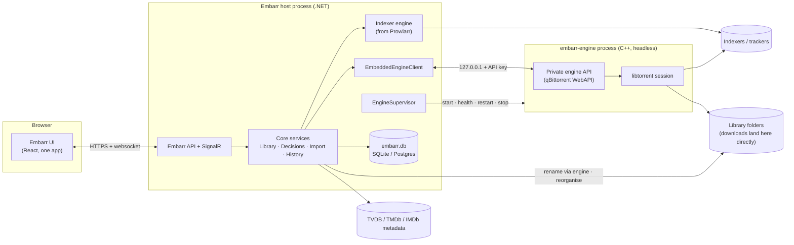

# Embarr — Architecture & Roadmap

> Status: **Phase 0 — design proposal.** No code has changed yet. This document is the agreed starting point for the work that follows; update it as decisions change.

Embarr is a single application that combines four upstream projects:

| Repo | Upstream | Role in Embarr |
| --- | --- | --- |
| **Embarr** (formerly EmbarrPre1) | Sonarr | **Home repo.** Base host, data layer, frontend, TV support |
| EmbarrPre2 | Radarr | Source of movie support (ported in) |
| EmbarrPre4 | Prowlarr | Source of the indexer engine (ported in) |
| EmbarrPre3 | qBittorrent | Source of the built-in torrent engine (forked, headless) |

Path references: `Embarr:path` is this repo; `Pre2:`, `Pre3:` and `Pre4:` are EmbarrPre2–4.

---

## 1. Vision and UX principles

Embarr is **one app with one mental model**, not four tools sharing a browser tab.

1. **One library.** Movies and series live in the same Library. Media type is a filter, not a separate app.
2. **One queue.** The download queue *is* the download client. There is no separate "client" view, no "open in qBittorrent" link, no second list of torrents.
3. **One search.** Searching indexers, grabbing a release and linking it to a library item happen in one flow.
4. **One settings tree.** Each setting exists once. Nothing is "synced" between components (no Prowlarr → Sonarr app sync, no download-client connection settings).
5. **No outbound UIs.** No page links to or embeds another tool's interface.
6. **Torrent-only.** Usenet indexers and Usenet download clients are removed.
7. **State is always true.** Every fact has exactly one owner (§4.4). Torrents are never lost or seeding out of sight.
8. **Download straight to the final place.** No download folder, no import copy (§4.8).
9. **Only video and subtitle files ever reach disk** (§4.8).
10. **The library is flat and consistently named.** No torrent folders are left behind (§4.11).
11. **Seeding is optional and never costs you a file** (§4.10).

What the user should never have to think about: which component owns a setting, remote path mappings, API keys between components, categories that tell a download client which app a torrent belongs to.

---

## 2. Source map

### Kept as the base (Embarr / Sonarr)

- Host and infrastructure: `Embarr:src/NzbDrone.Host`, `Embarr:src/NzbDrone.Common`, `Embarr:src/NzbDrone.SignalR`, `Embarr:src/Sonarr.Http`
- Core services: `Embarr:src/NzbDrone.Core/Datastore`, `Embarr:src/NzbDrone.Core/Messaging`, `Embarr:src/NzbDrone.Core/Jobs`, `Embarr:src/NzbDrone.Core/ThingiProvider`
- Shared domain (becomes media-type aware): `Embarr:src/NzbDrone.Core/Profiles`, `Embarr:src/NzbDrone.Core/CustomFormats`, `Embarr:src/NzbDrone.Core/Qualities`, `Embarr:src/NzbDrone.Core/Queue`, `Embarr:src/NzbDrone.Core/History`, `Embarr:src/NzbDrone.Core/Blocklisting`, `Embarr:src/NzbDrone.Core/RootFolders`, `Embarr:src/NzbDrone.Core/Tags`, `Embarr:src/NzbDrone.Core/Notifications`, `Embarr:src/NzbDrone.Core/ImportLists`
- TV domain: `Embarr:src/NzbDrone.Core/Tv`, `Embarr:src/NzbDrone.Core/SeriesStats`
- Download pipeline (kept, but made media-type-aware in Phase 4 — today it is episode-only: `TrackedDownload` holds a `RemoteEpisode` and completion calls `IDownloadedEpisodesImportService`): `Embarr:src/NzbDrone.Core/Download/TrackedDownloads`, `Embarr:src/NzbDrone.Core/Download/CompletedDownloadService.cs`, `Embarr:src/NzbDrone.Core/Download/FailedDownloadService.cs`, `Embarr:src/NzbDrone.Core/Download/Pending`
- API: `Embarr:src/Sonarr.Api.V5` is the pattern for the Embarr API
- Frontend: `Embarr:frontend` (Vite, TypeScript, Zustand, TanStack Query, React Router 7, lucide icons)

### Ported in from EmbarrPre2 / Radarr

- Movie domain: `Pre2:src/NzbDrone.Core/Movies` (incl. `Movies/Collections`, `Movies/Credits`, `Movies/AlternativeTitles`, `Movies/Translations`), `Pre2:src/NzbDrone.Core/MovieStats`
- Movie-specific parts of: `Pre2:src/NzbDrone.Core/MediaFiles`, `Pre2:src/NzbDrone.Core/Organizer`, `Pre2:src/NzbDrone.Core/DecisionEngine`, `Pre2:src/NzbDrone.Core/ImportLists`, `Pre2:src/NzbDrone.Core/MetadataSource`, `Pre2:src/NzbDrone.Core/Parser`
- Screens to **rebuild** (not copy) on Embarr's frontend patterns: `Pre2:frontend/src/Movie`, `Pre2:frontend/src/AddMovie`, `Pre2:frontend/src/Collection`, `Pre2:frontend/src/DiscoverMovie`

### Ported in from EmbarrPre4 / Prowlarr

- Indexer engine: `Pre4:src/NzbDrone.Core/Indexers` (incl. `Indexers/Definitions` and `Indexers/Definitions/Cardigann`)
- `Pre4:src/NzbDrone.Core/IndexerProxies` (FlareSolverr, HTTP, SOCKS4/5)
- `Pre4:src/NzbDrone.Core/IndexerSearch`, `Pre4:src/NzbDrone.Core/IndexerStats`, `Pre4:src/NzbDrone.Core/IndexerVersions`
- **Dropped:** `Pre4:src/NzbDrone.Core/Applications` (app sync). The indexers run inside Embarr, so there's nothing to sync to.
- **Dropped:** Usenet definitions such as `Pre4:src/NzbDrone.Core/Indexers/Definitions/Newznab`, `Pre4:src/NzbDrone.Core/Indexers/Definitions/NzbIndex.cs`, `Pre4:src/NzbDrone.Core/Indexers/Definitions/BinSearch.cs`

### Forked from EmbarrPre3 / qBittorrent

- **Kept:** `Pre3:src/base/bittorrent` (libtorrent session), `Pre3:src/base` support code, `Pre3:src/webui/api` controllers (becomes the private engine API), `Pre3:src/app` (process entry point)
- **Removed:** `Pre3:src/gui` (Qt desktop UI), `Pre3:src/webui/www` (web UI), `Pre3:src/base/rss` (RSS auto-downloader; Embarr does RSS sync), `Pre3:src/base/search` and `Pre3:src/searchengine` (Python search plugins; replaced by the indexer engine), the Lua plugin engine (`PLUGINS` CMake option)

---

## 3. System architecture



### Engine lifecycle (`EngineSupervisor`)

- **Start:** Embarr starts `embarr-engine` as a child process at boot:
  `embarr-engine --profile=<AppData>/engine --webui-port=<random free port>`. The API key is generated by Embarr on first run, written into the engine profile and sent on every request as `X-API-Key` (qBittorrent already supports this, see `Pre3:src/webui/webapplication.cpp`).
- **Binding:** the engine API listens on `127.0.0.1` only. It's never exposed to the network, so the user never sees a second port or login.
- **Health:** poll `app/version` every few seconds. Report status in System → Status and as a health check.
- **Restart:** on crash or failed health checks, restart with backoff (1s, 2s, 4s … max 60s) and raise a health warning after repeated failures.
- **Shutdown:** on Embarr shutdown call `app/shutdown`, wait for resume data to flush, then kill after a timeout.
- **Docker:** one container, one image. Both processes run in it; the supervisor is the only thing that starts the engine.

### Licensing and naming

- Sonarr, Radarr and Prowlarr are GPLv3. qBittorrent is GPLv2-or-later with an OpenSSL exception. The combined distribution is **GPLv3**. The engine stays a separate executable, which keeps its licence boundary clear.
- Keep all upstream copyright notices. Don't use the Sonarr, Radarr, Prowlarr or qBittorrent names or logos in the product, only in attribution.

---

## 4. Backend merge design

### 4.1 Media types

- Add `MediaType { Series, Movie }` to shared entities: History, Blocklist, TrackedDownload / Queue items, PendingRelease and RootFolder.
- Quality profiles, custom formats, delay profiles, release profiles, tags and notifications are **shared** across media types. A profile can be used by a series or a movie.
- **Series/Episode and Movie stay as separate tables.** Their shapes are too different to merge usefully.
- A **`LibraryItem` read model** (database view or query projection) returns both as one list with common fields (title, year, poster, monitored, status, size on disk, quality profile, tags, root folder, added date). The merged Library page reads from it.
- **Calendar and Wanted can't use `LibraryItem`.** They list individual episodes and movie releases, and one series can have many calendar events and episodes in different Wanted states. Add an episode + movie-release projection for Calendar and an episode + movie projection for Wanted. `LibraryItem` only supplies the parent metadata (title, poster, profile).
- **Version slots** (see §4.9):
  - Today an episode or movie has exactly one file: `Episode.EpisodeFileId` (`Embarr:src/NzbDrone.Core/Tv/Episode.cs`) and `Movie.MovieFileId` (`Pre2:src/NzbDrone.Core/Movies/Movie.cs`).
  - Add a `VersionSlot`: Id, owner (series or movie), Label (e.g. "4K", "HD", "Remastered"), quality profile, custom-format rules, monitored.
  - Files link to (episode or movie, slot) instead of the single file id.
  - Every series and movie gets a default slot, so single-version users notice nothing.
  - Wanted, cutoff and upgrades are worked out per slot.
  - Editions (Remastered, Director's Cut, …) come from Radarr's parser (`Pre2:src/NzbDrone.Core/Parser/Parser.cs`).

### 4.2 Parsing and decisions

- Keep both parsers (`Embarr:src/NzbDrone.Core/Parser`, `Pre2:src/NzbDrone.Core/Parser`). Rename them by domain (e.g. `SeriesParser`, `MovieParser`).
- **Searches** know their media type, so they use the right parser directly.
- **RSS sync** doesn't know the media type. Try series matching first, then movies, then mark the release as unmatched.
- **DecisionEngine:** shared specifications (quality, custom format score, size, blocklist, seeders, delay) run for both. Type-specific specifications (season packs, episode numbering, movie availability) are registered per media type.

### 4.3 Indexers

- Prowlarr's indexer engine replaces Sonarr's own indexer module (`Embarr:src/NzbDrone.Core/Indexers`).
- An adapter maps Sonarr search criteria (series, season, episode, anime) and Radarr search criteria (movie, IMDb/TMDb id) to Prowlarr's TV and movie search criteria. Results come back as Embarr release models.
- Indexer health, rate limits and stats come from Prowlarr's existing services.
- **Indexer definitions:** Prowlarr downloads Cardigann definitions from Prowlarr's servers (`Pre4:src/NzbDrone.Core/IndexerVersions/IndexerDefinitionUpdateService.cs`). Embarr needs its own fork of the definitions repository and its own update source (see §8).

### 4.4 Engine integration and single source of truth

**Why.** Today's Sonarr/Radarr ↔ qBittorrent state bugs come from two apps each keeping their own state, joined by categories, path mappings and polling. Merging removes that join. The engine is still a separate process with its own state, so these rules are required:

1. **The info-hash is the only key.** Never match on name or path.
2. **Embarr owns intent; the engine owns facts.** Intent: linked item, version slot, seeding rule. Facts: progress, state, files.
3. **Reconcile at startup and on every poll.**
   - A torrent in the engine with no Embarr record is adopted as **Unlinked** and shown in Downloads.
   - An Embarr record whose torrent is gone is shown as **Missing from engine**, with **Re-add** (sends the stored release back to the engine, which re-checks any data already at the target) and **Dismiss** (records the grab as ignored; nothing is deleted).
4. **Reconcile never deletes anything.** It only flags.
5. **Link intent is also stored next to the engine's state.** At grab time Embarr writes a small sidecar file per torrent in the engine profile (`<AppData>/engine/embarr/<info-hash>.json`). It holds the media type, the item's **external ids** (TVDB/TMDb, not database ids), season and episode numbers, slot label and seeding rule. If Embarr's database is restored from a backup taken before a grab, reconcile rebuilds the record from the sidecar instead of leaving the torrent Unlinked. Torrents with no sidecar (added by hand, or from before the sidecar existed) are adopted as Unlinked. This recovery guarantee covers only what the sidecar holds. The slot label and seeding rule fields are added with §4.9 and §4.10; until then the sidecar holds the media type, TVDB id, season and episode numbers, release title and indexer.

**Visibility is separate from processing.** Today `DownloadMonitoringService.DownloadIsTrackable` drops Imported, Failed and Ignored downloads, so a torrent that is still seeding disappears from the queue. In Embarr, every engine torrent is always listed. Only automatic import and failure handling are limited to eligible downloads.

**Media-type-aware pipeline.** Tracking, completion and failure handling dispatch on `MediaType`: a series handler (the existing code) and a movie handler (ported from Radarr). Done in Phase 4.

**Download clients:**
- Remove every external download client and the Usenet client base: `Embarr:src/NzbDrone.Core/Download/Clients` (except the qBittorrent code it starts from), `Embarr:src/NzbDrone.Core/Download/UsenetClientBase.cs`, `Embarr:src/NzbDrone.Core/Download/NzbValidationService.cs`.
- Add **`EmbeddedEngineClient`**, a single non-configurable `IDownloadClient`. Start it from `Embarr:src/NzbDrone.Core/Download/Clients/QBittorrent/QBittorrentProxyV2.cs`, which already speaks the qBittorrent WebAPI.
- **No categories for routing.** Links live in Embarr's database, backed up by the engine tag (rule 5).
- **No remote path mappings.** The engine and Embarr share a filesystem, so `Embarr:src/NzbDrone.Core/RemotePathMappings` is removed.
- Built so far (2h-1):
  - **Removed clients.** Every external download client is removed (`Download/Clients/*` except qBittorrent, which the engine uses). Saved definitions for removed clients are deleted on the next start, by the existing missing-implementation cleanup.
  - **Engine only.** Embarr only ever loads its built-in engine's client. Any other definition left in the database, such as a user's own qBittorrent, is never loaded or touched, so a user's own clients and Embarr don't interact.
  - **No adding clients.** Adding a download client is refused (v3 and v5 `POST downloadclient`). The settings page no longer offers Add or Clone.
- Built so far (2h-2):
  - **Removed Usenet code.** The Usenet indexers (Newznab, Fanzub) and the Usenet client code (`UsenetClientBase`, `NzbValidationService`) are removed. Saved Usenet indexer definitions are deleted on the next start, as with the removed clients.
  - **Kept for Torznab.** Newznab's shared capabilities, request and parsing code stays, because Torznab uses it.
  - **Leftovers.** The `Usenet` protocol value and Usenet settings, such as delay profile delays, remain until the indexer engine replaces indexers (Phase 3). With no Usenet indexer or client they never apply.
- Built so far (2h-3):
  - **What's removed.** Remote path mappings are removed: the service, the v3 and v5 APIs, the health check and the settings section. The engine's paths are used as they are.
  - **What stays.** The `RemotePathMappings` table stays in the database, because migrations don't change, but nothing reads it.

### 4.5 Database

- Start a **fresh Embarr migration chain**. Migration 1 creates the merged schema (Sonarr's current schema + movie tables + indexer tables + `MediaType` columns) instead of replaying three upstream histories (Sonarr is at migration 240, see `Embarr:src/NzbDrone.Core/Datastore/Migration`).
- Both SQLite and Postgres stay supported.
- Importers from existing Sonarr, Radarr and Prowlarr databases, and from a qBittorrent `BT_backup` folder (to keep seeding torrents), come in Phase 6.

### 4.6 API

- One Embarr API (`/api/v1`) built on `Embarr:src/Sonarr.Api.V5` patterns. Series, movie, library, queue, indexer, search and engine resources all live under one API and one API key.
- Remove `Embarr:src/Sonarr.Api.V3` from the Embarr build once the frontend no longer uses it.
- **Optional, later:** Sonarr v3 and Radarr v3 compatibility shims so request tools (Overseerr, Jellyseerr) can talk to Embarr as if it were Sonarr and Radarr.

### 4.7 Naming in code

- Keep the `NzbDrone.*` namespaces and project names during Phases 1–4. That keeps cherry-picking upstream fixes from Sonarr, Radarr and Prowlarr possible while the merge is under way.
- Rename user-visible strings and the product name in Phase 1. Phase 1c did most of this, but the brand text in the page header and sidebar (`frontend/src/Components/Page/Header/PageHeader.tsx`, `frontend/src/Components/Page/Sidebar/PageSidebar.tsx`) still renders "Sonarr" and remains outstanding Phase 1 work.
- **External contracts keep their Sonarr names until Phase 7**, where one migration renames them together (see Phase 7). External contracts are the database file, AppData folder, service and binary names, default port, `SONARR__` environment variables and custom-script variables. This timing rule covers branding-related contracts only. The `/api/v3` surface is governed by §4.6 instead: it is removed once the frontend no longer uses it, and compatibility shims stay optional (Phase 7).

### 4.8 Downloading to the final location

There is no separate download folder and no import copy. Each file is written straight to its final library path.

**Flow for every grab:**
1. Add the torrent with the engine's `MetadataReceived` stop condition (`Pre3:src/base/bittorrent/torrent.h`). A magnet fetches its metadata, then stops before any file data is downloaded. A `.torrent` file already has metadata, so it is added stopped.
2. Apply the file whitelist (below). Every other file gets priority 0 and is never downloaded.
3. Run the pre-download checks (below).
4. Map each kept file to its library target and version slot (§4.11).
5. Set the torrent's save path to the lowest common library folder (the series, season or movie folder).
6. `renameFile` each kept file to a hidden **pending name** next to its final path, e.g. `.{final name}.pending`. This also flattens any folders inside the torrent.
7. Start the torrent.

**File whitelist.**
- Video: `mkv`, `mp4`, `m4v`, `avi`, `ts`, `m2ts`, `webm`.
- Subtitles: `srt`, `ass`, `ssa`, `vtt`, `sub`, `idx`, `sup`.
- Only the real final extension counts, so `movie.mkv.exe` is excluded.
- A torrent with no video file, or only archives (`rar`, `zip`, …), is rejected, blocklisted, and searched again.

**Import is per file, after validation.** While a file downloads it has its hidden pending name plus the engine's `.!qB` suffix, so media servers never see it. When the engine reports that one file is complete, Embarr runs a **per-file import** for it straight away, without waiting for the rest of the torrent:
1. Run the post-completion checks (below) on that file.
2. If they pass, `renameFile` the file from its pending name to its final name. This is an instant rename in the same folder, and the engine keeps seeding.
3. Record the file against its episode or movie and slot, and emit the normal import events (history, notifications, media-server refresh).

This per-file import is idempotent. It's keyed by info-hash plus the file's index in the torrent, so a repeated completion event or a restart never imports a file twice. A season pack's episodes therefore appear in the library one by one, and each one only after it has been checked. This is new work in Phase 2. Today's completion handler (`Embarr:src/NzbDrone.Core/Download/CompletedDownloadService.cs`) waits for the whole torrent.

**Checks:**
- **Before any data downloads** (from metadata only): file names, extensions, file sizes, a sample check by name and size only, and the parsed episode or movie matching the target.
- **After each video file completes:** media info (resolution, codecs, languages, runtime) and the full runtime-based sample check. That check reuses `Embarr:src/NzbDrone.Core/MediaFiles/EpisodeImport/DetectSample.cs`, which needs the file's runtime, so it can only run once the file is on disk.
- **On video rejection:** delete that file (it was never published under its final name), blocklist the release, search again.

**Subtitles are validated separately.** They have no resolution or runtime, and `DetectSample` would treat a zero runtime as a sample, so the video checks never run on them.
- **Subtitle checks:** extension, a sensible size, text subtitles parse as text, and the language and forced/SDH flags read from the file name.
- **Registration:** a subtitle is attached to the video it belongs to, in the same slot, and renamed to match that video's final name (§4.11). If the video hasn't been imported yet, the subtitle stays under its pending name until it is. If the video is rejected, its subtitles are deleted with it.
- **On subtitle rejection:** only that subtitle is discarded. A bad subtitle never blocklists the release.

**Name already taken.** For an upgrade in the same slot, the new file waits under its pending name. When it passes its checks it replaces the old file, and the old file is removed from its own torrent using the steps in §4.10. Old files and their subtitles go through the recycle bin, as any upgrade does: they are kept there when a recycle bin is configured (Media Management) and deleted outright when none is. A torrent left with no videos is removed from the engine without its data.

**Part files.** libtorrent stores pieces that overlap unwanted files in a hidden `.parts` file in the save folder. The engine deletes it when the torrent is removed (`delete_partfile`), and orphan cleanup (§4.13) catches leftovers. The engine's "unwanted folder" option is forced off.

**Optional staging folder.** One setting (Settings → Download Clients → Staging Folder) turns it on. Each torrent then downloads into `<root>/.embarr-staging/<torrent>/` in the root folder that holds its series, and each file moves into place when it passes its checks. The torrent saves into the root folder, so the move is a rename inside the same torrent. A file whose final folder is on a different drive from its root folder (a mount inside the root) is not staged, so the move is always an instant rename and never a copy. The staging folder is hidden from library scans and Library Import, and each torrent's folder is removed once it is empty. Use it if writing torrents directly to slow hard drives hurts performance. A per-root-folder toggle can come with the root folder settings in Phase 4.

### 4.9 Versions and concurrent sources

**Version slots** (data model in §4.1). Each series or movie can hold several named versions at once, e.g. "4K" + "HD", or "Original" + "Remastered". Each slot has its own quality profile, custom formats, Wanted state and upgrades. The slot label goes into the file name (§4.11), which is what Emby's version switcher reads. Search offers **Download another version** into an existing slot or a new one.

**Race mode** grabs several releases for the same file and keeps the first good copy.
- Up to *N* releases target the same file, in the same slot. Each writes to its own unique pending name.
- The **winner is the first copy that completes, passes the post-completion checks and is imported** (§4.8). A copy that completes but fails its checks (a sample, a mislabelled release) is rejected and blocklisted, and the race continues with the others.
- Losers are only cancelled after the winner has been imported. A losing copy may be partial (`.pending.!qB`) or may already have finished (`.pending`) while the winner was being checked. Either way, its file is deleted at the path the engine currently reports for it. If the losing torrent still has other wanted files, use the single-file removal steps in §4.10. Otherwise the losing torrent is removed from the engine along with its data.
- Races are decided **per file**. A series pack can race single-episode torrents, and each episode goes to whichever source first delivers a valid copy.
- Losers are not blocklisted. They were valid releases, just slower.
- Settings: maximum concurrent sources per file, and "race allowed" per indexer. Race is off by default on private trackers (see §8).

### 4.10 Seeding rules (per file)

**Seeding is optional.** The global default can be "don't seed". Video and subtitle files are always kept after seeding ends.

**Which rule applies.** The most specific rule wins:
1. Episode or file
2. Season
3. Series or movie (with an optional per-slot override)
4. Tracker minimum — a floor. Embarr warns if a rule is set lower than a private tracker's hit-and-run requirement.
5. Global default

**Rule format.** Seed for *n* hours, days, weeks or months (sent to the engine as minutes), or until ratio *n*. Modes: time only, ratio only, whichever comes first, or both.

**Limits, stated honestly:**
- libtorrent counts upload per torrent, not per file.
- Per-file **time** runs from when that file completed.
- Per-file **ratio** is approximated from the torrent's ratio.
- A torrent keeps seeding until every file still in it has met its goal.
- The strictest remaining goal is also written to the engine's own per-torrent share limits, so limits still apply if Embarr is down.

**Removing one file from a torrent that's still seeding** (an upgrade, a deletion, or a race loser):
1. Set the file's priority to 0.
2. Delete or replace the file.
3. Force a recheck, so the torrent stops offering those pieces instead of erroring.

**When the goal is met.** Remove the torrent from the engine and **keep the files**. A video is never deleted because of seeding.

**Built so far (2e-1).** The global goal (Settings → Download Clients → Seeding; default: ratio 1 or 14 days, whichever comes first) and the tracker minimum, both of which must be met. The engine's share limits are written when the goals amount to a single "time or ratio" goal; otherwise the torrent is left unlimited and Embarr removes it, since the engine stops at whichever limit comes first. Series, season and episode goals (2e-2) are stored on the series (its seasons) and episodes and set through `PUT /api/v5/seeding/series/{id}`, `…/series/{id}/season/{n}` and `…/episode/{id}` (`GET /api/v5/seeding/series/{id}` lists them); the series page sets them for the series (toolbar → Seeding Goal) and each season (season menu → Seeding Goal); an episode's goal is set through the API until the item pages (Phase 4) give episodes their own view.

**Visibility.** The Downloads page and each item page show every file's goal, where the goal came from (e.g. "14 days, from series") and progress toward it. A health check flags any torrent still active past its goal.

### 4.11 Library layout and naming

The library is flat and consistently named. Torrent folders are never kept.

```
TV Shows/{Series} ({Year})/Season {ss}/{Series}.S{ss}E{ee}/{Series}.S{ss}E{ee} - {Episode Title} - {Version}.{ext}
Movies/{Movie} ({Year})/{Movie} ({Year}) - {Version}.{ext}
```

- `{Version}` is the version slot's label, e.g. `2160p`, `HD`, `Remastered`.
- The movie format, where every file name starts with the folder name, is what Emby's version switcher expects.
- **Subtitles** use the video's base name plus `.{lang}[.forced|.sdh].{ext}`, e.g. `….en.forced.srt`. When several subtitles share a language and tags, a copy number goes first (`….1.en.srt`, `….2.en.srt`). The language comes from the subtitle's file name, or its folder (`Subs/English/…`).
- **Multi-episode files** use `S01E01-E02`. **Specials** go in `Season 00`.
- Reuse Sonarr's file-name builder (`Embarr:src/NzbDrone.Core/Organizer`) for templates and for cleaning up characters that aren't allowed in file names.
- Emby, Jellyfin and Plex each handle multiple versions of an **episode** differently. Verify this in Phase 5 before naming is locked.

### 4.12 Library reorganisation tool

A one-off job for an existing, messy library. It runs on a root folder or on any folder.

1. **Scan.** Reuse `Embarr:src/NzbDrone.Core/MediaFiles/DiskScanService.cs`.
2. **Identify.** Parse each file name and look up the metadata (§4.14). Anything that can't be identified goes to the Manual Import review (`Embarr:src/Sonarr.Api.V5/ManualImport`).
3. **Plan.**
   - Work out each file's target path with §4.11.
   - Duplicates become version slots, or are flagged for a decision.
   - Files that aren't video or subtitles are listed for **opt-in** deletion.
   - Folders left empty are removed.
4. **Preview.** Show every planned change using the `Embarr:frontend/src/Organize` preview modal pattern.
5. **Execute.**
   - Moves on the same drive are instant renames.
   - Moves across drives copy, verify, then delete the original.
   - Files that belong to an engine torrent are renamed through the engine, so seeding continues.

Reuse `Embarr:src/NzbDrone.Core/MediaFiles/RenameEpisodeFileService.cs` and `Pre2:src/NzbDrone.Core/MediaFiles/RenameMovieFileService.cs`. Every run writes a journal that can be undone. The tool never deletes a video file without explicit approval.

### 4.13 Orphan cleanup

A scheduled task deletes leftover partial downloads. It only touches `.!qB`, `.parts` and hidden `.pending` files (§4.8), and only when **all** of these are true:
- no torrent in the engine owns the file,
- the file is older than the grace period (default 7 days),
- the file is inside a root folder or staging folder.

The first run is a dry run that lists the files for approval. Nothing else is ever deleted by this task.

Built so far (2f-1, backend):
- **Which files.** Only Embarr's own partial files are considered: hidden pending files (`.{name}.{8 hex}.pending`, with or without `.!qB`) and libtorrent part files (`.{info-hash}.parts`). Each carries its torrent's id in its name. Any other `.!qB` file (from another client) is left alone, because its owner can't be known.
- **Who owns them.** Ownership is checked against every id the engine reports for its torrents: the hash, `infohash_v1` and `infohash_v2`. This also covers hybrid and v2-only torrents, whose part files are named by the v2 hash.
- **When nothing is decided.** If the engine isn't running or can't list its torrents, nothing is called an orphan.
- **Unfinished downloads.** Files of the engine's unfinished downloads aren't orphans, even when the engine no longer has them (they can be re-added). That covers downloads in the queue and unfinished grabs in history, so it holds across a restart. A hybrid torrent's v2 hash is recorded in its link when it is prepared, because libtorrent names its part file after it. A re-grab keeps the recorded hash. Links prepared earlier get theirs from the engine during import, with the other link writes, while the engine still has the torrent. Orphan cleanup itself never writes links. While any unfinished download's v2 hash is still unknown, no part file named by a v2 hash is deleted.
- **Category set.** If the engine's client has a category set, it can't list every torrent, so nothing is called an orphan.
- **Links.** The scan doesn't follow links (symlinks, junctions), so every file it lists is physically inside a root folder.
- **Just before deleting.** Ownership, age and existence are checked again for each file. Deletion takes turns with torrent adds (`EngineAddGate`) and doesn't run within 5 minutes of an add: the engine may not list a newly added torrent yet, and that torrent may own old files.
- **Scheduled task.** `EngineOrphanCleanupCommand` runs daily. It only lists the files, and a health notice says how many are waiting, until a list is approved (`EngineOrphanCleanupApproved`). After that it deletes orphans itself. The grace period is `EngineOrphanGraceDays` (7).
- **API.** `GET /api/v5/engine/orphans` scans now. `POST /api/v5/engine/orphans/delete` with `{paths, deleteAutomatically}` deletes the listed files that are still orphans on a fresh scan, then sets automatic deletion. Empty per-torrent staging folders go with their files.
- **Review screen (2f-2).** Settings → Download Clients has a **Leftover Partial Files** section:
  - the grace period (`engineOrphanGraceDays`, at least 1 day), also in the v3 and v5 download client settings;
  - whether **Delete Automatically** is on, with a button to turn it off (`GET /api/v5/engine/orphans/status`, `POST .../stop`). Only approving a list turns it on, so it isn't a download client setting;
  - **Review Leftover Files**, which scans now and lists each file's path, size and last write;
  - **Delete**, which approves the list and can turn on automatic deletion at the same time.

### 4.14 Metadata sources

| Source | Used for |
| --- | --- |
| **TVDB** | TV series, seasons, episodes and episode ordering |
| **TMDb** | Movies, collections, and extra TV artwork and data |
| **IMDb** | IDs and ratings, via TMDb's external IDs. IMDb's non-commercial datasets are optional. IMDb has no free official API. |

- These replace Sonarr's Skyhook service and Radarr's metadata proxy (§8).
- Scene name mappings currently come from Sonarr's services (`Embarr:src/NzbDrone.Core/DataAugmentation/Scene`). Switch to TheXEM directly (`Embarr:src/NzbDrone.Core/DataAugmentation/Xem`) plus Embarr's own mapping list.
- Needs a TVDB v4 project API key (check its licence terms) and a TMDb API key (attribution required).

---

## 5. Engine fork design (EmbarrPre3)

| Area | Change |
| --- | --- |
| Build | Build only `qbittorrent-nox`: `cmake -DGUI=OFF -DWEBUI=ON -DPLUGINS=OFF`. Rename the binary to `embarr-engine`. |
| Removed code | `src/gui`, `src/webui/www`, `src/base/rss`, `src/base/search`, `src/searchengine`, update checker, legal-notice prompt (Embarr shows it once at first run) |
| API | Keep `src/webui/api` controllers as the private engine API. Remove endpoints Embarr won't use (RSS, search, torrent creator at first). |
| Auth | API key only, set by Embarr. Disable username/password login, CSRF and host-header checks that only matter for a browser UI. |
| Binding | Force `127.0.0.1`. Refuse to start if asked to bind elsewhere. |
| Preferences | **Embarr owns all preferences.** It writes them through `app/setPreferences` at start-up and when the user saves Settings → Downloads. The engine's own config file isn't edited by hand. |
| Updates to Embarr | Embarr polls `sync/maindata` (already incremental) every 1–2s while the Downloads page is open and every ~30s otherwise. **Later:** add a push channel (websocket or server-sent events) to the engine so Embarr gets changes instantly. |
| Logs | Engine log file lives under `<AppData>/engine/logs` and is shown in System → Logs alongside Embarr's log. |
| Backups | Embarr backups include the engine profile (resume data and settings). |
| Forced preferences | `.!qB` extension for incomplete files on (`AddExtensionToIncompleteFiles`, `Pre3:src/base/bittorrent/common.h`). Unwanted folder off (`UseUnwantedFolder`). Torrents are added with the `MetadataReceived` stop condition (magnets) or stopped (`.torrent` files) until Embarr has set file priorities and names (§4.8). Content layout `NoSubfolder` (`Pre3:src/base/bittorrent/torrentcontentlayout.h`). |
| API Embarr relies on | File priority, `renameFile`, `renameFolder`, `setLocation`, per-torrent share limits (`ratioLimit`, `seedingTimeLimit`, `shareLimitAction`) and tags. All already exist in `Pre3:src/webui/api/torrentscontroller.cpp`. |
| CI builds | Qt 6 + libtorrent 2.0.x (`Pre3:CMakeLists.txt` requires ≥ 2.0.10). Targets: linux-x64, linux-arm64, win-x64, macOS (x64 + arm64). Prefer static libtorrent/OpenSSL builds so the engine ships as one binary per platform. |

Keep the fork's diff small and isolated (feature flags or `#ifdef EMBARR` where needed) so upstream qBittorrent and libtorrent fixes can still be merged.

---

## 6. Information architecture and UI

### 6.1 Navigation

The sidebar replaces Sonarr's (`Embarr:frontend/src/Components/Page/Sidebar/PageSidebar.tsx`) and routes replace `Embarr:frontend/src/App/AppRoutes.tsx`.

| Page | What it is | Merges |
| --- | --- | --- |
| **Library** | Every movie and series in one grid/table/overview. Filter chips: All · Movies · Series. Shared sort, filters, bulk edit. Item pages stay type-specific (series → seasons/episodes; movie → files, collection, credits) and show version slots and seeding status per file. Library menu has **Reorganise…** (§4.12). | Sonarr Series, Radarr Movies |
| **Add** | One search box that searches TV and movie metadata together and shows mixed results with a type badge. Tabs: Search · Discover (popular/upcoming, from Radarr Discover, extended to TV) · Import existing folders. | Sonarr Add Series, Radarr Add Movie, Radarr Discover |
| **Calendar** | Episodes and movie releases (cinema, digital, physical) in one calendar and one iCal feed. | Both calendars |
| **Wanted** | Missing and Cutoff Unmet, for both types, with a type filter. | Both Wanted pages |
| **Downloads** | The queue *and* the download client. See §6.2. | Sonarr/Radarr Activity → Queue, qBittorrent UI |
| **Search** | Free-text search across all indexers (Prowlarr's search page). Grab sends to the engine; optionally link the grab to a library item. | Prowlarr Search, Sonarr/Radarr Interactive Search |
| **Activity** | History (all types, plus indexer queries and grabs) and Blocklist. | Sonarr/Radarr History + Blocklist, Prowlarr History |
| **Settings** | One tree. See §6.3. | All four apps' settings |
| **System** | Status (incl. engine health, version, disk space), Tasks, Backup, Updates, Events, Logs (Embarr + engine). | All four |

### 6.2 Downloads page (queue = client)

```
┌ Downloads ─────────────────────────────────────────── ↓ 12.4 MB/s  ↑ 1.1 MB/s  [🐢 Alt speed] [⏸ Pause all] ┐
│ [All 23] [Downloading 4] [Verifying 1] [Seeding 15] [Stalled 1] [Unlinked 2]   Type: [All ▾]  🔍 filter   │
├──────────────────────────────────────────────────────────────────────────────────────────────────────────────┤
│ ☐ Name                       Linked to              Status        Progress     ↓ / ↑        ETA    Ratio │
│ ☐ Show.S02E05.1080p…         Show · S02E05          Downloading   ███████░ 81% 4.2 MB/s     3m     0.1   │
│ ☐ Film.2024.2160p…           Film (2024)            Verifying     ████████ 100%  —          —      0.3   │
│ ☐ Some.Linux.ISO             — [Link…]              Seeding       ████████ 100%  ↑ 300 KB/s —      2.4   │
└──────────────────────────────────────────────────────────────────────────────────────────────────────────────┘
  ▸ Detail drawer for the selected row:  Overview · Files (priorities) · Trackers · Peers · Import log
```

- **One row per torrent.** No split between "queue" and "client". The status column covers both worlds: Queued · Downloading · Stalled · Paused · Verifying (checks after a file completes) · Needs review (manual import) · Seeding · Completed · Failed · Missing from engine.
- **Linked to** shows the library item (series + episodes, or movie). Unlinked torrents can be linked or manually imported from here.
- **Row actions:** pause/resume, force start, change priority, set speed limit, set share limit, re-check, remove (with options: keep files / delete files / blocklist and search again), manual import.
- **Header controls:** live global speeds, alternative speed toggle, pause/resume all. These are always visible in the page header, and the global speed also shows in the sidebar status area.
- **Add torrent** button (magnet or `.torrent` file), with an optional "link to library item" step.
- Updates arrive over SignalR, so the list moves without refreshing.
- **Rows expand to show each file:** library target path, status, seed goal, where that goal came from (e.g. "14 days, from series"), and progress toward it.
- **Race groups** (§4.9) are shown together as one row, e.g. "Racing 3 sources", with the leader highlighted.
- **Unlinked** and **Missing from engine** rows come from the reconcile rules in §4.4. Nothing is ever hidden.
- There is no "Importing" wait for seeding to finish. A file is in the library as soon as it completes (§4.8).

Built so far (2g-1):
- **Queue rows for built-in engine downloads expand to show each file.** The details come from `GET /api/v5/engine/downloads/{downloadId}/files` and refresh every 10s while open. Each video is followed by its subtitles. Each file shows:
  - its library path;
  - its state: downloading, publishing, in library, rejected or replaced;
  - its download progress;
  - each seeding goal with where it came from, for example "14 days or ratio 1, from series", marked when it is met;
  - how long it has seeded and the torrent's ratio.
- **Re-add.** Downloads missing from the engine have a **Re-add** button (`POST /api/v5/queue/readd/{id}`). Removing them is the existing remove action.
- **Queue resource.** The v5 queue resource now has `isEngineDownload` and `isMissingFromEngine`.

Built so far (2g-2):
- **Header controls on the Downloads page.** These appear only while the engine answers:
  - live download and upload speeds (`GET /api/v5/engine/status`, every 3s);
  - an **Alternative Speed** toggle (`PUT /api/v5/engine/altspeed?enabled=`);
  - **Pause All** and **Resume All** (`POST /api/v5/engine/pause|resume`). Resume All leaves torrents still being prepared alone.
- **Per-download controls in the expanded file panel:** **Pause/Resume**, **Force Start** and **Re-check** (`POST /api/v5/engine/downloads/{id}/pause|resume|forcestart?enabled=|recheck`). A torrent still being prepared (§4.8) is never resumed or force-started, because it would download files the whitelist hasn't excluded yet. Preparation starts it.
- **Engine endpoints these rely on:** `transfer/info`, `transfer/speedLimitsMode`, `transfer/toggleSpeedLimitsMode`, `torrents/stop`, `torrents/start` and `torrents/recheck`. They were checked against the engine build (API 2.17). Phase 2i's API trim must keep them.

Built so far (2g-3):
- **Status tabs** above the queue: All, Downloading, Seeding, Paused, Unlinked and Missing from Engine. They are also predefined filters.
  - The status tabs use the queue's `status` filter.
  - Unlinked and Missing from Engine use two new queue filters, `unlinked` and `missingFromEngine`.
  - The v5 queue resource now has `isUnlinked`.
- **Add Torrent** in the header takes a magnet link (`POST /api/v5/engine/torrents`) or a `.torrent` file (`POST /api/v5/engine/torrents/file`, up to 10 MB).
  - The torrent is added held and tagged `embarr-manual`, taking turns with orphan cleanup (`EngineAddGate`).
  - Preparation then downloads only its video and subtitle files, into the engine's folder. If it has none, it isn't started.
  - It is listed as **Unlinked** until Manual Import links it.
  - A "link to library item" step at add time is left for later; Manual Import covers it now.

### 6.3 Settings tree

| Section | Contents |
| --- | --- |
| Media Management | Naming templates (§4.11), default version slots, file management, root folders (each tagged Series or Movie, with an optional staging folder) |
| Profiles | Quality profiles, custom formats, release profiles, delay profiles, quality definitions (shared) |
| Indexers | Indexers (from Prowlarr, torrent only), indexer proxies, tags-based indexer routing, sync limits/rate limits, flaresolverr |
| Downloads | Built-in engine: listening port and UPnP/NAT-PMP, network interface binding (VPN), global and alternative speed limits, speed scheduler, queueing limits, default seeding rule (§4.10), race defaults (§4.9), file whitelist (view only), orphan cleanup grace period, privacy (DHT, PeX, LSD, encryption, anonymous mode), disk (pre-allocation) |
| Import Lists | Series and movie lists in one list, each with its media type |
| Connect | Notifications (shared) |
| Metadata | Kodi/Emby/etc. metadata for series and movies |
| Tags | Shared tags |
| General | Host, security, proxy, logging, analytics (off), updates, backups |
| UI | Theme, calendar, dates, language |

**Removed from the UI:** Download Clients page, Remote Path Mappings page, Prowlarr Apps page, Prowlarr download-client page, Usenet settings, the qBittorrent web UI.

### 6.4 Frontend approach

- Use Embarr's existing (Sonarr) frontend stack and patterns everywhere: Zustand stores, TanStack Query for API data, React Router 7, CSS modules and existing `Components/`.
- Radarr and Prowlarr frontends use Redux + React Router 5 (`Pre2:frontend/src/Store`, `Pre4:frontend/src/Store`). **Rebuild** their screens on Embarr's patterns rather than copying them, so the app has one state model and one look.
- Shared components for media cards, posters, status badges and queue rows work for both media types.

---

## 7. Phased roadmap

Each phase ends in a working, shippable build.

### Phase 1 — Rebrand and shell (Embarr)

- Product name and logos → Embarr. AppData folder, default port, service and binary names, database file, environment variables and custom-script variables are **not** renamed here; they move together in Phase 7 (§4.7).
- Replace upstream `AGENTS.md`, `CONTRIBUTING.md`, PR template and issue templates with Embarr's own.
- Disable calls to Sonarr's own services: analytics (`Embarr:src/NzbDrone.Core/Analytics`), Sonarr update channel, Sonarr cloud endpoints except metadata (until Phase 4 replaces it, §4.14).
- New sidebar labels and routes from §6.1. Labels point at the **existing** screens (series list → Library, queue → Downloads) until Phases 2 and 4 replace them. New pages with no existing screen (Search) are hidden until their phase.
- CI builds and tests Embarr from this repo.
- **Exit:** Embarr runs as a working TV-only app with the new navigation; nothing references Sonarr in the UI.

### Phase 2 — Built-in engine (EmbarrPre3 + Embarr)

- Fork qBittorrent per §5; CI produces `embarr-engine` binaries.
- `EngineSupervisor` + `EmbeddedEngineClient`; Settings → Downloads.
- Reconcile rules and the visibility/processing split (§4.4).
- Direct-to-final downloads with the file whitelist, per-file validated import (pending name → final name) and optional staging folder (§4.8).
- Per-file seeding rules (§4.10) and orphan cleanup (§4.13).
- Downloads page per §6.2.
- Remove external download clients, Usenet clients, Usenet indexers and remote path mappings.
- **Exit:** grab → download into the library → seed works end-to-end with no external client. No torrent is ever lost or seeding out of sight, and the Downloads page is the only download UI.
- **Status:** done.
  - Embarr #7–#30 and EmbarrPre3 #1–#2.
  - The CI-built `embarr-engine` binaries move to Phase 7 (packaging), because Actions don't run on these forks.
  - Race groups on the Downloads page come with race mode (Phase 5).
  - Per-row priority, speed and share limits on the Downloads page are left for later.

### Phase 3 — Indexer engine (EmbarrPre4 → Embarr)

- Port Prowlarr's indexer engine, proxies, stats and definition updates.
- Replace Sonarr's indexer module with the adapter in §4.3.
- Search page; Settings → Indexers; indexer queries in Activity.
- **Exit:** every Prowlarr torrent indexer can be added in Embarr and used by RSS sync, automatic search and manual search.

**Plan (decided with the owner).** Build the engine first, then the UI. Each step is one PR that builds and passes tests.

- **Namespace.** Prowlarr's code goes under `NzbDrone.Core.IndexerEngine.*` (`Embarr:src/NzbDrone.Core/IndexerEngine`), with only the namespace changed. Its `Indexers`, `IndexerSearch` and `Parser` names otherwise collide with Sonarr's (36 files overlap), and keeping the code unchanged lets Prowlarr fixes still be cherry-picked.
- **Adapter (§4.3).** One Sonarr-side indexer, `EngineIndexer`, wraps each engine indexer. It:
  - maps Sonarr's season, episode, daily and anime criteria to Prowlarr's `TvSearchCriteria`;
  - maps results back to Sonarr's `ReleaseInfo` and `TorrentInfo`.

  RSS sync, search, decisions, indexer status and the release API keep using Sonarr's `IIndexerFactory` unchanged.
- **Definitions.**
  - Cardigann definitions come from the owner's fork of Prowlarr/Indexers on GitHub (`flintstrike-nz/Indexers`, `definitions/v12`), read from its raw files.
  - A snapshot is bundled with each release as the fallback, used offline or when the fork can't be reached.
  - Nothing is fetched from Prowlarr's own servers.

| Step | What |
| --- | --- |
| 3a-1 | Engine core under `IndexerEngine`: definitions table, status, limits, HTTP client, capabilities, search criteria, release models, and the Torznab indexer. Backend only, with tests. |
| 3a-2 | Cardigann runtime, the definition version store, and the updater (fork plus bundled fallback). |
| 3b-1 | Existing indexers run on the engine's HTTP stack (proxies, rate limits, Cloudflare handling); the proxies table; saved indexers Embarr can't run are kept, switched off and flagged. |
| 3b-2 | Cardigann adapter: criteria and release mappers, file downloads through the engine, start-up and daily definition update. |
| 3c | Prowlarr's native torrent indexers; Sonarr's native indexer classes retire as each has an engine equivalent. |
| 3d | Indexer proxies (FlareSolverr, HTTP, SOCKS). |
| 3e | Indexer stats and query history. These show in Activity. |
| 3f | Settings → Indexers on the engine: add from definitions, test, flags. |
| 3g | Search page. |

Built so far (3a-1):
- **Code.** Prowlarr's indexer core, Cardigann files, Torznab/Newznab base code, proxies, history, search criteria and parser helpers are in `NzbDrone.Core.IndexerEngine`. They compile, but nothing uses them yet.
- **Inert on purpose.**
  - The engine's two start-up handlers are switched off (marked `EMBARR`).
  - The definition updater never contacts Prowlarr's servers; Embarr's source comes in 3a-2.
  - The default app profile waits for the engine's tables in 3b.
  - Proxy tests use a neutral host in place of Prowlarr's cloud service.
- **Style.** `IndexerEngine/.editorconfig` relaxes style-only rules for the folder, so the ported files stay as close to Prowlarr's as possible.
- **Name clashes.** Where a ported class has the same name as an Embarr class (such as `TorznabSettings`), name lookups in `FindTypeByName` prefer Embarr's own. This ends when 3b removes Sonarr's native indexers.
- **Shared code.** These were added, with existing behaviour unchanged:
  - on `HttpRequest`: `Encoding`, `ProxySettings` and `GetContent`;
  - on `HttpResponse`: `ElapsedTime` and `RedirectUrl`;
  - on `HttpHeader`: `ContentEncoding`, `Vary` and `UserAgent`;
  - on `HttpRequestBuilder`: `SetHeaders`, `SetEncoding` and the cookie flags;
  - `CookieUtil`, `UrlEncode`/`UrlDecode` with an encoding, `IsAllDigits`, `IsValidDate`/`IsFutureDate`, `SelectOption.ParentValue`, the config settings `HistoryCleanupDays` and `LogIndexerResponse`, and overridable `ProviderFactory.All()`/`Get()`.
- **Left out.** The Usenet indexer (Newznab) and its base class.

Built so far (3a-2):
- **Definitions are read from disk.** `IndexerDefinitionUpdateService` lists and loads Cardigann definitions from `<AppData>/Definitions` (plus `Definitions/Custom`). The two web lookups to `indexers.prowlarr.com` are gone, and an unknown definition now means it isn't on disk.
- **Update.** The `IndexerDefinitionUpdateCommand` downloads one zip from `IndexerDefinitionsUrl` and extracts the definitions from it.
  - The default source is the owner's fork, `https://github.com/flintstrike-nz/Indexers/archive/refs/heads/master.zip`. It can be changed in the config, and it never defaults to Prowlarr's servers.
  - For each indexer it keeps the file from the highest `definitions/v{n}` up to `v12`, as Prowlarr's server does when it builds its package.
  - Definitions that have become native C# indexers (the blocklist) are skipped.
  - Only validated file names are used, never a path from the zip.
  - A failed or empty download keeps what is on disk. With nothing on disk, a snapshot shipped in `<app>/Definitions` is used.
- **Still off.** The start-up update and the daily schedule switch on in 3b, so Embarr doesn't download definitions for an engine nothing uses yet.
- **Needs the fork.** The download fails (and is logged) until `flintstrike-nz/Indexers` exists. The release packaging step bundles the snapshot.
- **Tests.** 103 of Prowlarr's tests for the parser, Cardigann templates, capabilities and Torznab, plus tests for the shared-code additions.

### Phase 4 — Movies and the merged library (EmbarrPre2 → Embarr)

- Port the movie domain, movie metadata, parser, decisions, naming, import and import lists.
- Make tracking, completion and failure handling media-type-aware (§4.4).
- Add `MediaType`, the `LibraryItem` read model, and the Calendar and Wanted projections (§4.1).
- Switch metadata to TVDB, TMDb and IMDb (§4.14).
- Merged Library, Add, Calendar, Wanted and Activity pages; movie detail and collection pages.
- **Exit:** a user can manage movies and series side by side with shared profiles, one queue and one history, with no dependency on Sonarr's or Radarr's services.

### Phase 5 — Versions and concurrent sources

- Version slots schema, per-slot Wanted/cutoff/upgrades, and naming with `{Version}` (§4.1, §4.11).
- "Download another version" from Search.
- Race mode, including packs racing single episodes (§4.9).
- Verify how Emby, Jellyfin and Plex handle multiple versions before naming is locked.
- **Exit:** a user can hold 4K + HD (or Original + Remastered) of the same item and race several sources for one file, with only the winner kept.

### Phase 6 — Reorganise and migrate

- Library reorganisation tool (§4.12).
- Importers: Sonarr DB, Radarr DB, Prowlarr DB, qBittorrent `BT_backup` (keep seeding without re-downloading).
- Review every setting for duplication and wording.
- **Exit:** an existing Sonarr + Radarr + Prowlarr + qBittorrent user can move to Embarr and bring a messy library into the §4.11 layout in one guided, undoable run.

### Phase 7 — Packaging and ecosystem

- Single Docker image; Windows installer and service; macOS app; Linux packages.
- Embarr update channel and updater (`Embarr:src/NzbDrone.Update`).
- **External contracts migration.** One change renames the contracts listed in §4.7 together, so existing installs, scripts and tools move once. Prerequisite: the final product name is decided first (open decision 8). The migration must:
  - **Never touch an independent Sonarr install.** A Sonarr-named AppData folder or Windows service does not prove the install is Embarr's: a real Sonarr on the same machine uses the same default names. Embarr therefore writes an ownership marker into a data folder it manages (from the first release that can, ahead of Phase 7). The marker is written automatically only for a folder Embarr newly creates. For an existing folder, including the shared default `Sonarr` one, it is written only after the user explicitly confirms the folder is Embarr's, because the same folder may belong to an independent Sonarr. The migration acts only on a marked folder or one the user explicitly selects. Anything else is left untouched, and existing Sonarr users are pointed to the Phase 6 importer instead. This protection is needed **before Phase 7**, not only in the migration: until the names change, Embarr's startup opens and migrates the shared default `Sonarr` data folder, and on macOS `AppFolderFactory.MigrateAppDataFolder` copies and then deletes `~/.config/Sonarr`, even when `-data` is set. Earlier releases therefore require ownership confirmation before any startup write or legacy migration touches a folder that is not newly created, and when ownership is unconfirmed they require a separate data path.
  - **AppData folder:** for a verified Embarr folder in the default location, move or copy it to the new location, keeping the old one as a backup that is **not** left at the default `Sonarr` path (a Sonarr installed later would open it as live data and could modify the only rollback copy). Keep it in an archive or a separate backup path and restore it explicitly. Never leave a user with an empty new folder next to a full old one.
  - **Explicit data paths:** `-data` (including the packaged systemd service) and Docker mounts can point anywhere, so a Sonarr-named folder search can miss existing data. When a custom path is set, keep it and migrate its contents in place (rename files, not the directory). If a directory must move, update the launch configuration and mounts too (service files, Docker run/compose guidance), and say so in the release notes.
  - **Database file (SQLite):** take a consistent snapshot before copying or renaming. On Windows and Linux the database runs in WAL mode (`ConnectionStringFactory`), so committed changes can still be in the `-wal` file. Stop writers and checkpoint, or use the SQLite backup API, and close all connections before switching file names; never copy only the main file while writes continue. Keep backup restore working for backups made before and after the rename.
  - **PostgreSQL:** the databases default to `sonarr-main` and `sonarr-log`, so a separate Embarr folder can still point at an independent Sonarr's databases. Apply the same ownership check, give new installs distinct defaults, and record a verified upgrade's database identity (host, port and the database names, including values that came from implicit defaults) before any rename. Record only non-secret settings: the `Postgres*` credentials are read without persisting (`persist: false`) and may come only from environment variables, and `BackupService` puts `config.xml` into backup archives, so secrets are never copied into the config or the migration record. Because `BackupService.Restore` replaces `config.xml`, a config backup taken before the migration holds no record of implicit defaults and could point the new defaults at different databases after a restore; restore therefore consults the migration's identity record (kept outside `config.xml`) before applying defaults. Config backups also contain no PostgreSQL data. `BackupService` does not back these databases up, so the migration needs its own dump step and an explicit restore path for rollback.
  - **Service and binary names:** a data-folder marker does not prove who owns a service or its binaries, so each is checked on its own. The Windows installer replaces the old service only if its recorded executable path and install directory are verified as Embarr's, and otherwise installs the new one alongside. Docker and macOS packages document the change.
  - **Installer identity (Windows):** `distribution/windows/setup/sonarr.iss` currently reuses Sonarr's `AppId` and installs into `{commonappdata}\Sonarr\bin`, and the installer removes its target directory. Embarr gets a distinct `AppId`, install location and service name, so it can sit beside an independent Sonarr without replacing it, and an upgrade of an existing Embarr install is matched through the ownership checks above.
  - **systemd (Linux):** the packaged unit runs `/opt/Sonarr/Sonarr` (`distribution/debian/sonarr.service`, `install.sh`). The package installs or updates the unit for the new executable path and reloads systemd, or keeps a compatible executable path in place. This applies even when the data directory stays where it is.
  - **Environment variables:** accept both the old `SONARR__` and the new prefix for at least one release, with a log warning for the old one. If both are set, the new one wins.
  - **Custom-script variables:** export both the old (`sonarr_*`) and new variable names for at least one release.
  - **Default port:** the default is 8989 (`ConfigFileProvider`), which an independent Sonarr on the same machine also uses, so a fresh side-by-side install cannot start. Give new installs a distinct default port, or pick a free one at first run. The same applies to the HTTPS port: `ConfigFileProvider` and `Bootstrap` both default `SslPort` to 9898, so two installs with SSL enabled would collide. Upgrades keep their configured HTTP and HTTPS ports.
  - **Rollback:** the migration must be reversible for the first release after it ships. Old data is kept, not deleted, in the archive or backup location above, and rolling back is an explicit restore (including a PostgreSQL restore) rather than a rename back. Restoring the pre-migration snapshot discards everything added after the upgrade: library changes, torrents and their sidecars in the engine profile, and PostgreSQL rows. The rollback flow warns about this loss window and first archives the current application, engine and PostgreSQL state, so it stays available for recovery.
- Optional Sonarr/Radarr v3 API shims for request tools.
- User documentation.

---

## 8. Risks and external dependencies

| Risk | Detail | Mitigation |
| --- | --- | --- |
| **TV metadata** | Sonarr gets series data through Sonarr's own service (Skyhook), see `Embarr:src/NzbDrone.Common/Cloud/SonarrCloudRequestBuilder.cs`. It's run by the Sonarr team for Sonarr. | Switch to TVDB directly in Phase 4 (§4.14). Until then, don't ship publicly. |
| **Movie metadata** | Radarr uses Radarr's own TMDb proxy, see `Pre2:src/NzbDrone.Common/Cloud/RadarrCloudRequestBuilder.cs`. | Use TMDb directly with Embarr's own key (§4.14). |
| **Metadata licences** | TVDB v4 needs a project key and has licence terms; TMDb needs attribution; IMDb data is non-commercial only. | Check terms before any public release. |
| **Scene mappings** | Sonarr's scene mappings come from Sonarr's services (`Embarr:src/NzbDrone.Core/DataAugmentation/Scene`). | TheXEM directly plus Embarr's own list (§4.14). |
| **Race mode on private trackers** | Abandoning a partly downloaded torrent can count as a hit-and-run. | Race only on indexers marked race-safe; off by default for private trackers (§4.9). |
| **Race bandwidth** | Racing downloads the same file several times over. | Cap concurrent sources per file. |
| **Per-file ratio** | libtorrent tracks upload per torrent, so per-file ratio is an approximation. | Say so in the UI; time-based goals are exact (§4.10). |
| **Writing straight to hard drives** | Torrents write in small random chunks, which is slow and fragments files on spinning disks. | Optional same-drive staging folder (§4.8). |
| **Multiple episode versions** | Emby, Jellyfin and Plex handle episode versions differently. | Verify in Phase 5 before naming is locked (§4.11). |
| **Indexer definitions** | Prowlarr pulls Cardigann definitions from Prowlarr's servers (`Pre4:src/NzbDrone.Core/IndexerVersions/IndexerDefinitionUpdateService.cs`). | Fork the definitions repository and serve updates from an Embarr-controlled location. |
| **Upstream drift** | Sonarr, Radarr, Prowlarr and qBittorrent keep changing. | Keep `NzbDrone.*` namespaces during the merge; keep Pre2/3/4 tracking upstream; cherry-pick fixes on a schedule. |
| **Native builds** | Qt 6 + libtorrent + OpenSSL on five platforms is the hardest part of CI. | Build the engine in its own CI pipeline in EmbarrPre3 and consume released binaries in Embarr. |
| **Translations** | Each upstream has its own Weblate project and string keys. | Merge string files per phase; start an Embarr translation project once Phase 4 is done. |
| **Scope** | Merging four mature apps is large. | Ship each phase as a working build; don't start Phase 4 until Phases 2–3 are stable. |
| **Legal** | Torrent clients are legally sensitive in some places. | Keep qBittorrent's legal notice (shown once at first run) and don't bundle any indexer credentials. |

---

## 9. Open decisions

1. **When to rename namespaces** from `NzbDrone.*` to `Embarr.*`. Proposal: after Phase 4, once upstream cherry-picks are rare.
2. **v3 API compatibility shims** for Overseerr/Jellyseerr. Proposal: yes, in Phase 7, read-mostly.
3. **Optional external torrent client.** Some users may want to keep an existing client. Proposal: not supported for now; revisit after Phase 7.
4. **Engine push channel** (websocket/SSE in the engine vs. polling). Proposal: polling in Phase 2, push later if needed.
5. **How a race winner is chosen.** Every option requires the winner to pass its post-completion checks and be imported before losers are cancelled (§4.9). Proposal: the first copy to do so. Alternative: rank by projected finish time and keep only the top two running, which saves bandwidth.
6. **Maximum version slots per item.** Proposal: no hard limit; warn above 3.
7. **Plex multi-version naming.** Plex uses a different convention from Emby. Proposal: Emby format by default (§4.11), Plex as an optional template in Phase 5.
8. **Candidate future name: JellyBarr.** Not a commitment and not part of the current plan. Embarr stays the working name until this is decided.
   - **Trigger:** only once Jellyfin is the implemented target server (Addendum A). Until then, Emby remains the stated target in §4.9 and §4.11.
   - **Contract migration:** the external contracts are renamed once, in Phase 7 (§4.7). The final name must be decided before that migration is built, so the contracts are renamed once and not twice. If Embarr's names ship first, a later rename needs a second migration.
   - **Addenda:** A and B use "Embarr" throughout and would need updating, as would the roadmap title.
   - **Trademark, not copyright.** Names are not protected by copyright; the risk is a confusingly similar trademark for related goods. This is a risk assessment, not legal advice, and no register has been searched yet.
   - **Known near-match:** a Mac app called "JellyBar" (one r) that customises the app bar. The spelling differs by one letter and sounds identical, which is weak differentiation on its own. The goods differ (a Mac customisation utility versus a media library manager), which counts in JellyBarr's favour. Whether JellyBar holds a registered mark is unknown.
   - **"Jelly" prefix:** it evokes Jellyfin. The community uses "Jelly…" names widely (Jellyseerr, Jellystat), but Jellyfin has brand guidelines, and a name suggesting official affiliation is the usual route to trouble.
   - **Risk estimate:** negligible for personal use; small to moderate for public distribution.
   - **Before any public release, research:**
     - trademark registers: NZ IPONZ, plus WIPO Global Brand Database, USPTO and EUIPO if distributing abroad, in software classes 9 and 42;
     - GitHub, app stores and domain availability;
     - the Jellyfin project's trademark policy.
   - **Fallbacks:** keep Embarr (already distinct), or choose a name without "Jelly" that keeps the "-arr" convention.

Decided since the first draft: metadata comes from TVDB, TMDb and IMDb (§4.14); video files are always kept after seeding (§4.10); downloads go straight to the final location with an optional same-drive staging folder (§4.8).

---

## Addendum A — Jellyfin + webOS integration (future, not part of the current plan)

> Status: **idea, not scheduled.** Nothing in Phases 1–7 depends on this, and no phase should be delayed or reshaped for it. It is recorded here so that decisions made in the main plan don't accidentally close the door.

### A.1 Goal

Browse shows and movies from an LG **webOS** TV and add them to Embarr without leaving the TV. Android TV / Google TV is **out of scope** for now.

### A.2 Why Jellyfin instead of Emby

- Jellyfin is open source and split into a server plus separate client apps, much like Emby (it was forked from Emby 3.5.2 in 2018). Emby's TV apps can't be given custom screens or buttons; Jellyfin's can.
- The Jellyfin webOS app is a thin wrapper that loads `jellyfin-web` from the user's own server. Anything added to the web interface therefore also appears on the TV, including real buttons, dialogs and pickers.
- Emby's closed-source SDK changes between major versions. Jellyfin's code is public.
- This means **Jellyfin becomes the primary media server target** in this addendum. The main plan still mentions Emby in §4.9, §4.11 and the risk and open-decision lists; those stay as written until this addendum is scheduled.

### A.3 Approach: use stock Jellyfin and extend it

Do **not** fork the Jellyfin server. Build:

1. **A Jellyfin server plugin** (C# / .NET), kept in its own repository. It:
   - stores the Embarr URL and API key in its dashboard settings page;
   - decides which Jellyfin users may add items (for example admins only, or an allow-list), because Embarr has a single API key and no users;
   - exposes small authenticated endpoints under the Jellyfin server that the web interface calls, so the Embarr API key never reaches the TV or browser;
   - records who requested what.
2. **A web interface layer** that adds a *Discover* area and an **Add to Embarr** action, with options such as quality profile and version slot. Start with injected JavaScript and CSS delivered by the plugin. Only fork `jellyfin-web` if injection can't do the job.
3. **The stock `jellyfin-webos` app**, unmodified, installed from the LG Content Store and pointed at the user's server. Updating the web layer needs no reinstall on the TV.

### A.4 What Embarr must provide

All of this already fits the planned single `/api/v1` and API key (§4.6):

- Lookup and search endpoints for series and movies.
- Add series / add movie endpoints with sensible defaults, plus optional quality profile, version slot and monitoring options.
- A discover-lists endpoint (trending, popular, upcoming) so the plugin doesn't need its own TMDb / TVDB keys.
- A way to report whether an item is already in Embarr, so the TV can show "Requested" / "In library".
- Version slots (Phase 5) must exist before an *Add as 4K* style option makes sense.

### A.5 Constraints and risks

| Item | Detail |
| --- | --- |
| **Remote control input** | Typing on a TV remote is slow. Favour curated lists and short search flows over free-text search. |
| **Reachability** | The Jellyfin server must be able to reach Embarr. Run them on the same machine or network. Do not expose Embarr's API to the internet for this. |
| **Plugin API drift** | Jellyfin plugins are built against a specific server version. Expect to rebuild for each Jellyfin release. |
| **Web injection fragility** | Injected scripts depend on `jellyfin-web` internals, which can change between releases. Keep selectors and hooks in one place. |
| **webOS installation** | The stock app is installed from the LG Content Store, which needs no sideloading. Developer Mode (periodic renewal) or the community Homebrew Channel is only needed if `jellyfin-webos` itself is later modified or a build not in the store is wanted. |
| **Licensing** | The Jellyfin server and web are GPL-2.0, which is compatible with Embarr's licence if anything derived from them is shared. Check the `jellyfin-webos` licence before modifying that app. |
| **Reference implementation** | Seerr (Jellyseerr / Overseerr) already does browse, request and send-to-Sonarr/Radarr, and is a useful model for request flows and permissions. It also relates to open decision 2 (v3 API compatibility shims). |

### A.6 Suggested order, once scheduled

1. Confirm Embarr's lookup, discover and add endpoints are stable (after Phase 4, ideally after Phase 5).
2. Build the Jellyfin plugin with settings, the user allow-list and proxy endpoints.
3. Build the *Discover* and *Add to Embarr* web layer.
4. Test on a webOS TV, including remote-only navigation.
5. Release as a separate repository so it can track Jellyfin releases independently of Embarr.

### A.7 Open questions

- Does script injection give enough control, or is a small `jellyfin-webos` / `jellyfin-web` fork needed?
- Should requests from non-admin Jellyfin users need approval before Embarr acts on them?
- Does the Jellyfin multi-version naming match what Phase 5 locks in (§4.11)? Verify as already planned.

---

## Addendum B — Remote requests via a Vercel relay (future, not part of the current plan)

> Status: **idea, not scheduled.** Nothing in Phases 1–7 depends on this. **Single-user, personal use only** for now: one person, one phone, one home server.

### B.1 Goal

Browse shows and movies on a phone and queue "add this" requests while away from home. The home Embarr instance picks the requests up later and adds them to the library, without any inbound port being opened on the home network.

### B.2 Shape

```
Phone (APK) ──HTTPS──▶ Vercel relay ◀──HTTPS poll── Home Embarr
  browse + request       queue + cache              claims, executes, reports back
```

- **The home server always connects outward.** It polls the relay on an interval. Embarr's own API and API key never leave the home network and are never stored on Vercel.
- **The relay is a mailbox.** It stores requests and the latest library status snapshot, and optionally proxies and caches TMDb / TVDB lookups so the phone can browse without the home server. It never calls Embarr.
- **Requests are a closed set of commands**, for example `add_series { tvdbId, options }` and `add_movie { tmdbId, options }`. The relay cannot carry arbitrary Embarr API calls. The home server validates every request against a schema and ignores anything else, so a compromised relay can do no more than queue adds.
- **Each request has an ID and a status**: pending, claimed, done, failed. The phone generates the ID so retries don't create duplicates. The home server claims a request, runs it, then reports the result.
- **Status flows back.** After each poll the home server sends a compact snapshot of what is in the library, queued or missing, so the phone can show "In library" and "Requested" without reaching the house.

### B.3 Components

| Component | Where | Notes |
| --- | --- | --- |
| **Relay** | Vercel, separate repository | Serverless functions plus a marketplace database (Neon Postgres or Upstash Redis). Functions keep no state of their own. |
| **Relay client** | Inside Embarr (new background service) | Polls, validates, calls Embarr's own `/api/v1`, reports back. Off by default. |
| **Phone app** | Android APK | A trimmed Embarr UI (Discover, Requests, Library status) with its API layer pointed at the relay. A Capacitor wrapper is the simplest route. Not the full admin UI. |

### B.4 Shared contract with Addendum A

Addendum A (Jellyfin + webOS) and this addendum need the same thing from Embarr: a stable "add this item with these options" command, plus an "already in Embarr" status. Define that contract once on the Embarr side; the Jellyfin plugin and the relay client are then two thin callers of it. This also fits the planned single `/api/v1` and API key (§4.6) and the version slots from Phase 5.

### B.5 Security

It is a public URL even for one user.

- Two separate, individually revocable credentials: one for the phone, one for the home server. Store only hashes of them on the relay.
- Sign requests, rate-limit the relay, and expire unclaimed requests.
- Keep Embarr's API key, qBittorrent settings and indexer credentials off Vercel entirely.
- The TMDb / TVDB keys, if proxied, live on the relay only.
- The relay holds no personal data beyond the request queue and library snapshot. Keep the snapshot minimal (titles and IDs, not file paths).

### B.6 Constraints and risks

| Item | Detail |
| --- | --- |
| **Latency** | Polling every 30–60 seconds is enough for "add this show". Polling is the baseline. A push-style wake-up would need a receiving bridge on the home side: FCM targets mobile and web clients, not a background service like the relay client, so it would need extra infrastructure (for example a small companion app or a long-lived connection such as SSE or a websocket from the relay). Not needed to start. |
| **Home server offline** | Requests wait in the queue. The phone should show how long ago the home server last checked in. |
| **Vercel plan** | The Hobby plan is for personal, non-commercial use, which matches single-user scope. Check the terms again if the scope ever widens. |
| **Metadata licences** | If the relay proxies TMDb / TVDB, the same terms apply as in §4.14 and §8 (attribution, project keys). |
| **APK upkeep** | Android tooling and the relay API need maintaining alongside Embarr releases. Keep the app small. |
| **Alternative** | A mesh VPN (for example Tailscale) would let the phone reach Embarr directly with nothing to build or host. It offers no queue when the home server is off and needs the VPN app on the phone. The relay is worth it only if the queue and a purpose-built phone UI matter. |

### B.7 Suggested order, once scheduled

1. Settle the add-request contract and the "already in Embarr" status on Embarr's `/api/v1` (shared with Addendum A).
2. Build the relay client in Embarr (off by default), with a local mock relay for testing.
3. Build the Vercel relay: queue, auth, status snapshot, optional metadata proxy.
4. Build the APK: Discover, Requests, Library status.
5. Harden: key rotation, expiry, rate limits, offline indicators.

### B.8 Open questions

- Should the relay proxy TMDb / TVDB, or should the APK call them directly?
- Poll only, or add a push-style wake-up later? FCM is not a direct option for the home relay client (see B.6), so this would mean a supported bridge or a long-lived connection.
- Should the home server ever push richer status (download progress), or only library and request state?
- If multi-user support is wanted later, should it reuse Jellyfin identities (Addendum A) or have its own accounts?

Built so far (3b-1):

- **Engine HTTP for every saved indexer.** `HttpIndexerBase` now sends requests through the engine's `IIndexerHttpClient` (`ExecuteProxiedAsync`), so proxies chosen by tag, FlareSolverr and the engine's rate limiting apply to Torznab, IPTorrents, FileList, HDBits, BroadcastheNet, Nyaa, Torrentleech and TorrentRss. Their search tiers, parsing and settings are unchanged, so nothing needs migrating and nothing can be lost.
- **One status store.** `EngineIndexerStatusService` gives the engine the status service it expects, backed by Embarr's own indexer status (back-off and Health). Session cookies live in memory only.
- **Proxies table.** Migration 242 and a table mapping for the engine's proxy definitions. The Settings screen for them is 3d.
- **Nothing is deleted.** `IndexerFactory` no longer removes saved indexers whose implementation is gone (for example old Usenet ones). It switches them off, the API still lists them, and a Health warning (`IndexerUnsupportedCheck`) names them.
- **Decision.** The earlier idea of replacing Sonarr's request generators with the engine's would change Sonarr's tiered search (IDs first, then scene titles) for no gain, so those classes stay until 3c. The engine's own search is used for Cardigann and the native indexers, which Embarr doesn't have today.

Built so far (3b-2):

- **`Cardigann` indexer.** A normal Embarr indexer (`Indexers/Cardigann`) whose search, login and parsing are done by the engine's Cardigann. Its settings hold the definition file name, the base URL, the login fields a definition asks for (`ExtraFieldData`) and the usual torrent settings (minimum seeders, seed criteria, fail-downloads, languages).
- **Search mapping.** `EngineSearchCriteriaMapper` turns each Embarr search into tiers of engine queries and keeps Sonarr's rules: IDs first, scene titles only as a fallback, only IDs the site supports, daily shows as year plus month/day, anime by absolute number with the anime category, specials by episode title. The first tier that finds releases wins.
- **Release mapping.** `EngineReleaseMapper` converts engine releases (and their free-leech, scene and similar flags) to Embarr's release model.
- **Downloads.** Indexers that need a session to fetch a torrent implement `IIndexerFileDownloader`; `TorrentClientBase` then asks the engine for the file instead of making a plain web request.
- **Definitions stay current.** The first start fetches them when the folder is empty, and a daily scheduled task refreshes them.
- **Not yet reachable.** The generic "Cardigann" entry is hidden from the Add Indexer list. Adding an indexer from the 580 definitions, with its own login form, is 3f.
