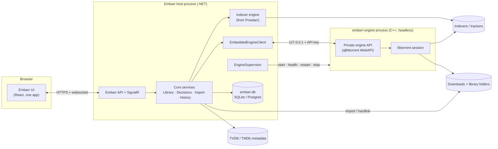

# Embarr — Architecture & Roadmap

> Status: **Phase 0 — design proposal.** No code has changed yet. This document is the agreed starting point for the work that follows; update it as decisions change.

Embarr is a single application that combines four upstream projects:

| Repo | Upstream | Role in Embarr |
| --- | --- | --- |
| **EmbarrPre1** | Sonarr | **Home repo.** Base host, data layer, frontend, TV support |
| EmbarrPre2 | Radarr | Source of movie support (ported in) |
| EmbarrPre4 | Prowlarr | Source of the indexer engine (ported in) |
| EmbarrPre3 | qBittorrent | Source of the built-in torrent engine (forked, headless) |

Path references in this document use the form `PreN:path/in/repo`.

---

## 1. Vision and UX principles

Embarr is **one app with one mental model**, not four tools sharing a browser tab.

1. **One library.** Movies and series live in the same Library. Media type is a filter, not a separate app.
2. **One queue.** The download queue *is* the download client. There is no separate "client" view, no "open in qBittorrent" link, no second list of torrents.
3. **One search.** Searching indexers, grabbing a release and linking it to a library item happen in one flow.
4. **One settings tree.** Each setting exists once. Nothing is "synced" between components (no Prowlarr → Sonarr app sync, no download-client connection settings).
5. **No outbound UIs.** No page links to or embeds another tool's interface.
6. **Torrent-only.** Usenet indexers and Usenet download clients are removed.

What the user should never have to think about: which component owns a setting, remote path mappings, API keys between components, categories that tell a download client which app a torrent belongs to.

---

## 2. Source map

### Kept as the base (EmbarrPre1 / Sonarr)

- Host and infrastructure: `Pre1:src/NzbDrone.Host`, `Pre1:src/NzbDrone.Common`, `Pre1:src/NzbDrone.SignalR`, `Pre1:src/Sonarr.Http`
- Core services: `Pre1:src/NzbDrone.Core/Datastore`, `Pre1:src/NzbDrone.Core/Messaging`, `Pre1:src/NzbDrone.Core/Jobs`, `Pre1:src/NzbDrone.Core/ThingiProvider`
- Shared domain (becomes media-type aware): `Pre1:src/NzbDrone.Core/Profiles`, `Pre1:src/NzbDrone.Core/CustomFormats`, `Pre1:src/NzbDrone.Core/Qualities`, `Pre1:src/NzbDrone.Core/Queue`, `Pre1:src/NzbDrone.Core/History`, `Pre1:src/NzbDrone.Core/Blocklisting`, `Pre1:src/NzbDrone.Core/RootFolders`, `Pre1:src/NzbDrone.Core/Tags`, `Pre1:src/NzbDrone.Core/Notifications`, `Pre1:src/NzbDrone.Core/ImportLists`
- TV domain: `Pre1:src/NzbDrone.Core/Tv`, `Pre1:src/NzbDrone.Core/SeriesStats`
- Download pipeline (reused as-is): `Pre1:src/NzbDrone.Core/Download/TrackedDownloads`, `Pre1:src/NzbDrone.Core/Download/CompletedDownloadService.cs`, `Pre1:src/NzbDrone.Core/Download/FailedDownloadService.cs`, `Pre1:src/NzbDrone.Core/Download/Pending`
- API: `Pre1:src/Sonarr.Api.V5` is the pattern for the Embarr API
- Frontend: `Pre1:frontend` (Vite, TypeScript, Zustand, TanStack Query, React Router 7, lucide icons)

### Ported in from EmbarrPre2 / Radarr

- Movie domain: `Pre2:src/NzbDrone.Core/Movies` (incl. `Movies/Collections`, `Movies/Credits`, `Movies/AlternativeTitles`, `Movies/Translations`), `Pre2:src/NzbDrone.Core/MovieStats`
- Movie-specific parts of: `Pre2:src/NzbDrone.Core/MediaFiles`, `Pre2:src/NzbDrone.Core/Organizer`, `Pre2:src/NzbDrone.Core/DecisionEngine`, `Pre2:src/NzbDrone.Core/ImportLists`, `Pre2:src/NzbDrone.Core/MetadataSource`, `Pre2:src/NzbDrone.Core/Parser`
- Screens to **rebuild** (not copy) on Pre1 patterns: `Pre2:frontend/src/Movie`, `Pre2:frontend/src/AddMovie`, `Pre2:frontend/src/Collection`, `Pre2:frontend/src/DiscoverMovie`

### Ported in from EmbarrPre4 / Prowlarr

- Indexer engine: `Pre4:src/NzbDrone.Core/Indexers` (incl. `Indexers/Definitions` and `Indexers/Definitions/Cardigann`)
- `Pre4:src/NzbDrone.Core/IndexerProxies` (FlareSolverr, HTTP, SOCKS4/5)
- `Pre4:src/NzbDrone.Core/IndexerSearch`, `Pre4:src/NzbDrone.Core/IndexerStats`, `Pre4:src/NzbDrone.Core/IndexerVersions`
- **Dropped:** `Pre4:src/NzbDrone.Core/Applications` (app sync). The indexers run inside Embarr, so there's nothing to sync to.
- **Dropped:** Usenet definitions such as `Pre4:src/NzbDrone.Core/Indexers/Definitions/Newznab`, `Pre4:src/NzbDrone.Core/Indexers/Definitions/NzbIndex.cs`, `Pre4:src/NzbDrone.Core/Indexers/Definitions/BinSearch.cs`

### Forked from EmbarrPre3 / qBittorrent

- **Kept:** `Pre3:src/base/bittorrent` (libtorrent session), `Pre3:src/base` support code, `Pre3:src/webui/api` controllers (becomes the private engine API), `Pre3:src/app` (process entry point)
- **Removed:** `Pre3:src/gui` (Qt desktop UI), `Pre3:src/webui/www` (web UI), `Pre3:src/base/rss` (RSS auto-downloader; Embarr does RSS sync), `Pre3:src/base/search` and `Pre3:src/searchengine` (Python search plugins; replaced by the indexer engine), the Lua plugin engine (`PLUGINS` CMake option)

---

## 3. System architecture



### Engine lifecycle (`EngineSupervisor`)

- **Start:** Embarr starts `embarr-engine` as a child process at boot:
  `embarr-engine --profile=<AppData>/engine --webui-port=<random free port>`. The API key is generated by Embarr on first run, written into the engine profile and sent on every request as `X-API-Key` (qBittorrent already supports this, see `Pre3:src/webui/webapplication.cpp`).
- **Binding:** the engine API listens on `127.0.0.1` only. It's never exposed to the network, so the user never sees a second port or login.
- **Health:** poll `app/version` every few seconds. Report status in System → Status and as a health check.
- **Restart:** on crash or failed health checks, restart with backoff (1s, 2s, 4s … max 60s) and raise a health warning after repeated failures.
- **Shutdown:** on Embarr shutdown call `app/shutdown`, wait for resume data to flush, then kill after a timeout.
- **Docker:** one container, one image. Both processes run in it; the supervisor is the only thing that starts the engine.

### Licensing and naming

- Sonarr, Radarr and Prowlarr are GPLv3. qBittorrent is GPLv2-or-later with an OpenSSL exception. The combined distribution is **GPLv3**. The engine stays a separate executable, which keeps its licence boundary clear.
- Keep all upstream copyright notices. Don't use the Sonarr, Radarr, Prowlarr or qBittorrent names or logos in the product, only in attribution.

---

## 4. Backend merge design

### 4.1 Media types

- Add `MediaType { Series, Movie }` to shared entities: History, Blocklist, TrackedDownload / Queue items, PendingRelease and RootFolder.
- Quality profiles, custom formats, delay profiles, release profiles, tags and notifications are **shared** across media types. A profile can be used by a series or a movie.
- **Series/Episode and Movie stay as separate tables.** Their shapes are too different to merge usefully.
- A **`LibraryItem` read model** (database view or query projection) returns both as one list with common fields (title, year, poster, monitored, status, size on disk, quality profile, tags, root folder, added date). The merged Library page, Calendar and Wanted pages read from it.

### 4.2 Parsing and decisions

- Keep both parsers (`Pre1:src/NzbDrone.Core/Parser`, `Pre2:src/NzbDrone.Core/Parser`). Rename them by domain (e.g. `SeriesParser`, `MovieParser`).
- **Searches** know their media type, so they use the right parser directly.
- **RSS sync** doesn't know the media type. Try series matching first, then movies, then mark the release as unmatched.
- **DecisionEngine:** shared specifications (quality, custom format score, size, blocklist, seeders, delay) run for both. Type-specific specifications (season packs, episode numbering, movie availability) are registered per media type.

### 4.3 Indexers

- Prowlarr's indexer engine replaces Sonarr's own indexer module (`Pre1:src/NzbDrone.Core/Indexers`).
- An adapter maps Sonarr search criteria (series, season, episode, anime) and Radarr search criteria (movie, IMDb/TMDb id) to Prowlarr's TV and movie search criteria. Results come back as Embarr release models.
- Indexer health, rate limits and stats come from Prowlarr's existing services.
- **Indexer definitions:** Prowlarr downloads Cardigann definitions from Prowlarr's servers (`Pre4:src/NzbDrone.Core/IndexerVersions/IndexerDefinitionUpdateService.cs`). Embarr needs its own fork of the definitions repository and its own update source (see §8).

### 4.4 Download client → built-in engine

- Remove every external download client and the Usenet client base: `Pre1:src/NzbDrone.Core/Download/Clients` (except the qBittorrent code it starts from), `Pre1:src/NzbDrone.Core/Download/UsenetClientBase.cs`, `Pre1:src/NzbDrone.Core/Download/NzbValidationService.cs`.
- Add **`EmbeddedEngineClient`**, a single non-configurable `IDownloadClient`. Start it from `Pre1:src/NzbDrone.Core/Download/Clients/QBittorrent/QBittorrentProxyV2.cs`, which already speaks the qBittorrent WebAPI.
- The tracked-download pipeline (`TrackedDownloadService`, `CompletedDownloadService`, `FailedDownloadService`) stays.
- **Every torrent in the engine appears in the queue**, including ones added by hand that aren't linked to a library item. The user can link them to a series or movie later.
- **No categories for routing.** Each torrent stores its Embarr download id and media type in Embarr's database, not as a qBittorrent category.
- **No remote path mappings.** The engine and Embarr share a filesystem, so `Pre1:src/NzbDrone.Core/RemotePathMappings` is removed.

### 4.5 Database

- Start a **fresh Embarr migration chain**. Migration 1 creates the merged schema (Sonarr's current schema + movie tables + indexer tables + `MediaType` columns) instead of replaying three upstream histories (Sonarr is at migration 240, see `Pre1:src/NzbDrone.Core/Datastore/Migration`).
- Both SQLite and Postgres stay supported.
- Importers from existing Sonarr, Radarr and Prowlarr databases, and from a qBittorrent `BT_backup` folder (to keep seeding torrents), come in Phase 5.

### 4.6 API

- One Embarr API (`/api/v1`) built on `Pre1:src/Sonarr.Api.V5` patterns. Series, movie, library, queue, indexer, search and engine resources all live under one API and one API key.
- Remove `Pre1:src/Sonarr.Api.V3` from the Embarr build once the frontend no longer uses it.
- **Optional, later:** Sonarr v3 and Radarr v3 compatibility shims so request tools (Overseerr, Jellyseerr) can talk to Embarr as if it were Sonarr and Radarr.

### 4.7 Naming in code

- Keep the `NzbDrone.*` namespaces and project names during Phases 1–4. That keeps cherry-picking upstream fixes from Sonarr, Radarr and Prowlarr possible while the merge is under way.
- Rename user-visible strings, product name, AppData folder, default port, service names and binaries in Phase 1.

---

## 5. Engine fork design (EmbarrPre3)

| Area | Change |
| --- | --- |
| Build | Build only `qbittorrent-nox`: `cmake -DGUI=OFF -DWEBUI=ON -DPLUGINS=OFF`. Rename the binary to `embarr-engine`. |
| Removed code | `src/gui`, `src/webui/www`, `src/base/rss`, `src/base/search`, `src/searchengine`, update checker, legal-notice prompt (Embarr shows it once at first run) |
| API | Keep `src/webui/api` controllers as the private engine API. Remove endpoints Embarr won't use (RSS, search, torrent creator at first). |
| Auth | API key only, set by Embarr. Disable username/password login, CSRF and host-header checks that only matter for a browser UI. |
| Binding | Force `127.0.0.1`. Refuse to start if asked to bind elsewhere. |
| Preferences | **Embarr owns all preferences.** It writes them through `app/setPreferences` at start-up and when the user saves Settings → Downloads. The engine's own config file isn't edited by hand. |
| Updates to Embarr | Embarr polls `sync/maindata` (already incremental) every 1–2s while the Downloads page is open and every ~30s otherwise. **Later:** add a push channel (websocket or server-sent events) to the engine so Embarr gets changes instantly. |
| Logs | Engine log file lives under `<AppData>/engine/logs` and is shown in System → Logs alongside Embarr's log. |
| Backups | Embarr backups include the engine profile (resume data and settings). |
| CI builds | Qt 6 + libtorrent 2.0.x (`Pre3:CMakeLists.txt` requires ≥ 2.0.10). Targets: linux-x64, linux-arm64, win-x64, macOS (x64 + arm64). Prefer static libtorrent/OpenSSL builds so the engine ships as one binary per platform. |

Keep the fork's diff small and isolated (feature flags or `#ifdef EMBARR` where needed) so upstream qBittorrent and libtorrent fixes can still be merged.

---

## 6. Information architecture and UI

### 6.1 Navigation

The sidebar replaces Sonarr's (`Pre1:frontend/src/Components/Page/Sidebar/PageSidebar.tsx`) and routes replace `Pre1:frontend/src/App/AppRoutes.tsx`.

| Page | What it is | Merges |
| --- | --- | --- |
| **Library** | Every movie and series in one grid/table/overview. Filter chips: All · Movies · Series. Shared sort, filters, bulk edit. Item pages stay type-specific (series → seasons/episodes; movie → files, collection, credits). | Sonarr Series, Radarr Movies |
| **Add** | One search box that searches TV and movie metadata together and shows mixed results with a type badge. Tabs: Search · Discover (popular/upcoming, from Radarr Discover, extended to TV) · Import existing folders. | Sonarr Add Series, Radarr Add Movie, Radarr Discover |
| **Calendar** | Episodes and movie releases (cinema, digital, physical) in one calendar and one iCal feed. | Both calendars |
| **Wanted** | Missing and Cutoff Unmet, for both types, with a type filter. | Both Wanted pages |
| **Downloads** | The queue *and* the download client. See §6.2. | Sonarr/Radarr Activity → Queue, qBittorrent UI |
| **Search** | Free-text search across all indexers (Prowlarr's search page). Grab sends to the engine; optionally link the grab to a library item. | Prowlarr Search, Sonarr/Radarr Interactive Search |
| **Activity** | History (all types, plus indexer queries and grabs) and Blocklist. | Sonarr/Radarr History + Blocklist, Prowlarr History |
| **Settings** | One tree. See §6.3. | All four apps' settings |
| **System** | Status (incl. engine health, version, disk space), Tasks, Backup, Updates, Events, Logs (Embarr + engine). | All four |

### 6.2 Downloads page (queue = client)

```
┌ Downloads ─────────────────────────────────────────── ↓ 12.4 MB/s  ↑ 1.1 MB/s  [🐢 Alt speed] [⏸ Pause all] ┐
│ [All 23] [Downloading 4] [Importing 1] [Seeding 15] [Stalled 1] [Unlinked 2]   Type: [All ▾]  🔍 filter   │
├──────────────────────────────────────────────────────────────────────────────────────────────────────────────┤
│ ☐ Name                       Linked to              Status        Progress     ↓ / ↑        ETA    Ratio │
│ ☐ Show.S02E05.1080p…         Show · S02E05          Downloading   ███████░ 81% 4.2 MB/s     3m     0.1   │
│ ☐ Film.2024.2160p…           Film (2024)            Importing     ████████ 100%  —          —      0.3   │
│ ☐ Some.Linux.ISO             — [Link…]              Seeding       ████████ 100%  ↑ 300 KB/s —      2.4   │
└──────────────────────────────────────────────────────────────────────────────────────────────────────────────┘
  ▸ Detail drawer for the selected row:  Overview · Files (priorities) · Trackers · Peers · Import log
```

- **One row per torrent.** No split between "queue" and "client". The status column covers both worlds: Queued · Downloading · Stalled · Paused · Importing · Import pending (needs manual import) · Seeding · Completed · Failed.
- **Linked to** shows the library item (series + episodes, or movie). Unlinked torrents can be linked or manually imported from here.
- **Row actions:** pause/resume, force start, change priority, set speed limit, set share limit, re-check, remove (with options: keep files / delete files / blocklist and search again), manual import.
- **Header controls:** live global speeds, alternative speed toggle, pause/resume all. These are always visible in the page header, and the global speed also shows in the sidebar status area.
- **Add torrent** button (magnet or `.torrent` file), with an optional "link to library item" step.
- Updates arrive over SignalR, so the list moves without refreshing.

### 6.3 Settings tree

| Section | Contents |
| --- | --- |
| Media Management | Naming (series and movie formats), folders, importing (hardlinks, extra files), file management, root folders (each tagged Series or Movie) |
| Profiles | Quality profiles, custom formats, release profiles, delay profiles, quality definitions (shared) |
| Indexers | Indexers (from Prowlarr, torrent only), indexer proxies, tags-based indexer routing, sync limits/rate limits, flaresolverr |
| Downloads | Built-in engine: listening port and UPnP/NAT-PMP, network interface binding (VPN), global and alternative speed limits, speed scheduler, queueing limits, seeding goals (ratio/time per media type and per indexer), privacy (DHT, PeX, LSD, encryption, anonymous mode), disk (pre-allocation, incomplete folder), completed download handling |
| Import Lists | Series and movie lists in one list, each with its media type |
| Connect | Notifications (shared) |
| Metadata | Kodi/Emby/etc. metadata for series and movies |
| Tags | Shared tags |
| General | Host, security, proxy, logging, analytics (off), updates, backups |
| UI | Theme, calendar, dates, language |

**Removed from the UI:** Download Clients page, Remote Path Mappings page, Prowlarr Apps page, Prowlarr download-client page, Usenet settings, the qBittorrent web UI.

### 6.4 Frontend approach

- Use Pre1's frontend stack and patterns everywhere: Zustand stores, TanStack Query for API data, React Router 7, CSS modules and existing `Components/`.
- Radarr and Prowlarr frontends use Redux + React Router 5 (`Pre2:frontend/src/Store`, `Pre4:frontend/src/Store`). **Rebuild** their screens on Pre1 patterns rather than copying them, so the app has one state model and one look.
- Shared components for media cards, posters, status badges and queue rows work for both media types.

---

## 7. Phased roadmap

Each phase ends in a working, shippable build.

### Phase 1 — Rebrand and shell (EmbarrPre1)

- Product name, logos, AppData folder, default port, service and binary names → Embarr.
- Replace upstream `AGENTS.md`, `CONTRIBUTING.md`, PR template and issue templates with Embarr's own.
- Disable calls to Sonarr's own services: analytics (`Pre1:src/NzbDrone.Core/Analytics`), Sonarr update channel, Sonarr cloud endpoints except metadata (until §8 is resolved).
- New sidebar and routes from §6.1, with placeholder pages for Downloads, Search and the merged Library.
- CI builds and tests Embarr from this repo.
- **Exit:** Embarr runs as a TV-only app with the new navigation; nothing references Sonarr in the UI.

### Phase 2 — Built-in engine (EmbarrPre3 + EmbarrPre1)

- Fork qBittorrent per §5; CI produces `embarr-engine` binaries.
- `EngineSupervisor` + `EmbeddedEngineClient`; Settings → Downloads.
- Downloads page per §6.2.
- Remove external download clients, Usenet clients, Usenet indexers and remote path mappings.
- **Exit:** grab → download → import → seed works end-to-end with no external client, and the Downloads page is the only download UI.

### Phase 3 — Indexer engine (EmbarrPre4 → EmbarrPre1)

- Port Prowlarr's indexer engine, proxies, stats and definition updates.
- Replace Sonarr's indexer module with the adapter in §4.3.
- Search page; Settings → Indexers; indexer queries in Activity.
- **Exit:** every Prowlarr torrent indexer can be added in Embarr and used by RSS sync, automatic search and manual search.

### Phase 4 — Movies and the merged library (EmbarrPre2 → EmbarrPre1)

- Port the movie domain, movie metadata, parser, decisions, naming, import and import lists.
- Add `MediaType` and the `LibraryItem` read model.
- Merged Library, Add, Calendar, Wanted and Activity pages; movie detail and collection pages.
- **Exit:** a user can manage movies and series side by side with shared profiles, one queue and one history.

### Phase 5 — Settings polish and migration from existing installs

- Review every setting for duplication and wording.
- Importers: Sonarr DB, Radarr DB, Prowlarr DB, qBittorrent `BT_backup` (keep seeding without re-downloading).
- **Exit:** an existing Sonarr + Radarr + Prowlarr + qBittorrent user can move to Embarr in one guided step.

### Phase 6 — Packaging and ecosystem

- Single Docker image; Windows installer and service; macOS app; Linux packages.
- Embarr update channel and updater (`Pre1:src/NzbDrone.Update`).
- Optional Sonarr/Radarr v3 API shims for request tools.
- User documentation.

---

## 8. Risks and external dependencies

| Risk | Detail | Mitigation |
| --- | --- | --- |
| **TV metadata** | Sonarr gets series data through Sonarr's own service (Skyhook), see `Pre1:src/NzbDrone.Common/Cloud/SonarrCloudRequestBuilder.cs`. It's run by the Sonarr team for Sonarr. | Use TVDB directly with Embarr's own API key, or run a small Embarr metadata proxy. Decide before Phase 1 ships publicly. |
| **Movie metadata** | Radarr uses Radarr's own TMDb proxy, see `Pre2:src/NzbDrone.Common/Cloud/RadarrCloudRequestBuilder.cs`. | Use TMDb directly with Embarr's own key, or the same Embarr proxy. |
| **Indexer definitions** | Prowlarr pulls Cardigann definitions from Prowlarr's servers (`Pre4:src/NzbDrone.Core/IndexerVersions/IndexerDefinitionUpdateService.cs`). | Fork the definitions repository and serve updates from an Embarr-controlled location. |
| **Upstream drift** | Sonarr, Radarr, Prowlarr and qBittorrent keep changing. | Keep `NzbDrone.*` namespaces during the merge; keep Pre2/3/4 tracking upstream; cherry-pick fixes on a schedule. |
| **Native builds** | Qt 6 + libtorrent + OpenSSL on five platforms is the hardest part of CI. | Build the engine in its own CI pipeline in EmbarrPre3 and consume released binaries in EmbarrPre1. |
| **Translations** | Each upstream has its own Weblate project and string keys. | Merge string files per phase; start an Embarr translation project once Phase 4 is done. |
| **Scope** | Merging four mature apps is large. | Ship each phase as a working build; don't start Phase 4 until Phases 2–3 are stable. |
| **Legal** | Torrent clients are legally sensitive in some places. | Keep qBittorrent's legal notice (shown once at first run) and don't bundle any indexer credentials. |

---

## 9. Open decisions

1. **When to rename namespaces** from `NzbDrone.*` to `Embarr.*`. Proposal: after Phase 4, once upstream cherry-picks are rare.
2. **v3 API compatibility shims** for Overseerr/Jellyseerr. Proposal: yes, in Phase 6, read-mostly.
3. **Optional external torrent client.** Some users may want to keep an existing client. Proposal: not supported for now; revisit after Phase 6.
4. **Metadata source** for TV and movies (§8). Needs a decision before any public release.
5. **Engine push channel** (websocket/SSE in the engine vs. polling). Proposal: polling in Phase 2, push later if needed.
