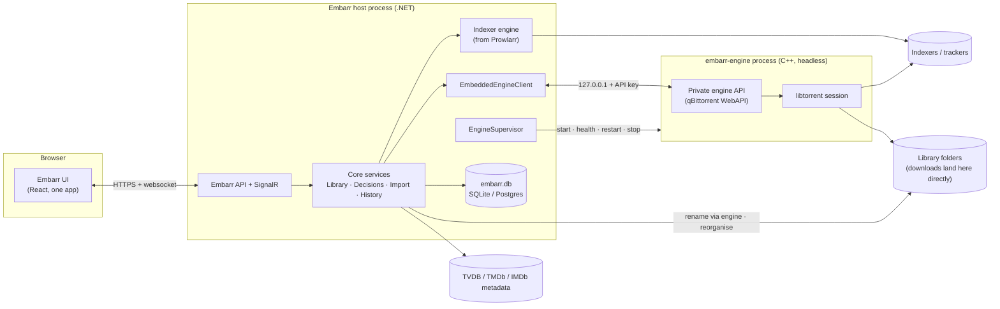

# Embarr — Architecture & Roadmap

> Status: **Phase 0 — design proposal.** No code has changed yet. This document is the agreed starting point for the work that follows; update it as decisions change.

Embarr is a single application that combines four upstream projects:

| Repo | Upstream | Role in Embarr |
| --- | --- | --- |
| **Embarr** (formerly EmbarrPre1) | Sonarr | **Home repo.** Base host, data layer, frontend, TV support |
| EmbarrPre2 | Radarr | Source of movie support (ported in) |
| EmbarrPre4 | Prowlarr | Source of the indexer engine (ported in) |
| EmbarrPre3 | qBittorrent | Source of the built-in torrent engine (forked, headless) |

Path references: `Embarr:path` is this repo; `Pre2:`, `Pre3:` and `Pre4:` are EmbarrPre2–4.

---

## 1. Vision and UX principles

Embarr is **one app with one mental model**, not four tools sharing a browser tab.

1. **One library.** Movies and series live in the same Library. Media type is a filter, not a separate app.
2. **One queue.** The download queue *is* the download client. There is no separate "client" view, no "open in qBittorrent" link, no second list of torrents.
3. **One search.** Searching indexers, grabbing a release and linking it to a library item happen in one flow.
4. **One settings tree.** Each setting exists once. Nothing is "synced" between components (no Prowlarr → Sonarr app sync, no download-client connection settings).
5. **No outbound UIs.** No page links to or embeds another tool's interface.
6. **Torrent-only.** Usenet indexers and Usenet download clients are removed.
7. **State is always true.** Every fact has exactly one owner (§4.4). Torrents are never lost or seeding out of sight.
8. **Download straight to the final place.** No download folder, no import copy (§4.8).
9. **Only video and subtitle files ever reach disk** (§4.8).
10. **The library is flat and consistently named.** No torrent folders are left behind (§4.11).
11. **Seeding is optional and never costs you a file** (§4.10).

What the user should never have to think about: which component owns a setting, remote path mappings, API keys between components, categories that tell a download client which app a torrent belongs to.

---

## 2. Source map

### Kept as the base (Embarr / Sonarr)

- Host and infrastructure: `Embarr:src/NzbDrone.Host`, `Embarr:src/NzbDrone.Common`, `Embarr:src/NzbDrone.SignalR`, `Embarr:src/Sonarr.Http`
- Core services: `Embarr:src/NzbDrone.Core/Datastore`, `Embarr:src/NzbDrone.Core/Messaging`, `Embarr:src/NzbDrone.Core/Jobs`, `Embarr:src/NzbDrone.Core/ThingiProvider`
- Shared domain (becomes media-type aware): `Embarr:src/NzbDrone.Core/Profiles`, `Embarr:src/NzbDrone.Core/CustomFormats`, `Embarr:src/NzbDrone.Core/Qualities`, `Embarr:src/NzbDrone.Core/Queue`, `Embarr:src/NzbDrone.Core/History`, `Embarr:src/NzbDrone.Core/Blocklisting`, `Embarr:src/NzbDrone.Core/RootFolders`, `Embarr:src/NzbDrone.Core/Tags`, `Embarr:src/NzbDrone.Core/Notifications`, `Embarr:src/NzbDrone.Core/ImportLists`
- TV domain: `Embarr:src/NzbDrone.Core/Tv`, `Embarr:src/NzbDrone.Core/SeriesStats`
- Download pipeline (kept, but made media-type-aware in Phase 4 — today it is episode-only: `TrackedDownload` holds a `RemoteEpisode` and completion calls `IDownloadedEpisodesImportService`): `Embarr:src/NzbDrone.Core/Download/TrackedDownloads`, `Embarr:src/NzbDrone.Core/Download/CompletedDownloadService.cs`, `Embarr:src/NzbDrone.Core/Download/FailedDownloadService.cs`, `Embarr:src/NzbDrone.Core/Download/Pending`
- API: `Embarr:src/Sonarr.Api.V5` is the pattern for the Embarr API
- Frontend: `Embarr:frontend` (Vite, TypeScript, Zustand, TanStack Query, React Router 7, lucide icons)

### Ported in from EmbarrPre2 / Radarr

- Movie domain: `Pre2:src/NzbDrone.Core/Movies` (incl. `Movies/Collections`, `Movies/Credits`, `Movies/AlternativeTitles`, `Movies/Translations`), `Pre2:src/NzbDrone.Core/MovieStats`
- Movie-specific parts of: `Pre2:src/NzbDrone.Core/MediaFiles`, `Pre2:src/NzbDrone.Core/Organizer`, `Pre2:src/NzbDrone.Core/DecisionEngine`, `Pre2:src/NzbDrone.Core/ImportLists`, `Pre2:src/NzbDrone.Core/MetadataSource`, `Pre2:src/NzbDrone.Core/Parser`
- Screens to **rebuild** (not copy) on Embarr's frontend patterns: `Pre2:frontend/src/Movie`, `Pre2:frontend/src/AddMovie`, `Pre2:frontend/src/Collection`, `Pre2:frontend/src/DiscoverMovie`

### Ported in from EmbarrPre4 / Prowlarr

- Indexer engine: `Pre4:src/NzbDrone.Core/Indexers` (incl. `Indexers/Definitions` and `Indexers/Definitions/Cardigann`)
- `Pre4:src/NzbDrone.Core/IndexerProxies` (FlareSolverr, HTTP, SOCKS4/5)
- `Pre4:src/NzbDrone.Core/IndexerSearch`, `Pre4:src/NzbDrone.Core/IndexerStats`, `Pre4:src/NzbDrone.Core/IndexerVersions`
- **Dropped:** `Pre4:src/NzbDrone.Core/Applications` (app sync). The indexers run inside Embarr, so there's nothing to sync to.
- **Dropped:** Usenet definitions such as `Pre4:src/NzbDrone.Core/Indexers/Definitions/Newznab`, `Pre4:src/NzbDrone.Core/Indexers/Definitions/NzbIndex.cs`, `Pre4:src/NzbDrone.Core/Indexers/Definitions/BinSearch.cs`

### Forked from EmbarrPre3 / qBittorrent

- **Kept:** `Pre3:src/base/bittorrent` (libtorrent session), `Pre3:src/base` support code, `Pre3:src/webui/api` controllers (becomes the private engine API), `Pre3:src/app` (process entry point)
- **Removed:** `Pre3:src/gui` (Qt desktop UI), `Pre3:src/webui/www` (web UI), `Pre3:src/base/rss` (RSS auto-downloader; Embarr does RSS sync), `Pre3:src/base/search` and `Pre3:src/searchengine` (Python search plugins; replaced by the indexer engine), the Lua plugin engine (`PLUGINS` CMake option)

---

## 3. System architecture



### Engine lifecycle (`EngineSupervisor`)

- **Start:** Embarr starts `embarr-engine` as a child process at boot:
  `embarr-engine --profile=<AppData>/engine --webui-port=<random free port>`. The API key is generated by Embarr on first run, written into the engine profile and sent on every request as `X-API-Key` (qBittorrent already supports this, see `Pre3:src/webui/webapplication.cpp`).
- **Binding:** the engine API listens on `127.0.0.1` only. It's never exposed to the network, so the user never sees a second port or login.
- **Health:** poll `app/version` every few seconds. Report status in System → Status and as a health check.
- **Restart:** on crash or failed health checks, restart with backoff (1s, 2s, 4s … max 60s) and raise a health warning after repeated failures.
- **Shutdown:** on Embarr shutdown call `app/shutdown`, wait for resume data to flush, then kill after a timeout.
- **Docker:** one container, one image. Both processes run in it; the supervisor is the only thing that starts the engine.

### Licensing and naming

- Sonarr, Radarr and Prowlarr are GPLv3. qBittorrent is GPLv2-or-later with an OpenSSL exception. The combined distribution is **GPLv3**. The engine stays a separate executable, which keeps its licence boundary clear.
- Keep all upstream copyright notices. Don't use the Sonarr, Radarr, Prowlarr or qBittorrent names or logos in the product, only in attribution.

---

## 4. Backend merge design

### 4.1 Media types

- Add `MediaType { Series, Movie }` to shared entities: History, Blocklist, TrackedDownload / Queue items, PendingRelease and RootFolder.
- Quality profiles, custom formats, delay profiles, release profiles, tags and notifications are **shared** across media types. A profile can be used by a series or a movie.
- **Series/Episode and Movie stay as separate tables.** Their shapes are too different to merge usefully.
- A **`LibraryItem` read model** (database view or query projection) returns both as one list with common fields (title, year, poster, monitored, status, size on disk, quality profile, tags, root folder, added date). The merged Library page reads from it.
- **Calendar and Wanted can't use `LibraryItem`.** They list individual episodes and movie releases, and one series can have many calendar events and episodes in different Wanted states. Add an episode + movie-release projection for Calendar and an episode + movie projection for Wanted. `LibraryItem` only supplies the parent metadata (title, poster, profile).
- **Version slots** (see §4.9):
  - Today an episode or movie has exactly one file: `Episode.EpisodeFileId` (`Embarr:src/NzbDrone.Core/Tv/Episode.cs`) and `Movie.MovieFileId` (`Pre2:src/NzbDrone.Core/Movies/Movie.cs`).
  - Add a `VersionSlot`: Id, owner (series or movie), Label (e.g. "4K", "HD", "Remastered"), quality profile, custom-format rules, monitored.
  - Files link to (episode or movie, slot) instead of the single file id.
  - Every series and movie gets a default slot, so single-version users notice nothing.
  - Wanted, cutoff and upgrades are worked out per slot.
  - Editions (Remastered, Director's Cut, …) come from Radarr's parser (`Pre2:src/NzbDrone.Core/Parser/Parser.cs`).

### 4.2 Parsing and decisions

- Keep both parsers (`Embarr:src/NzbDrone.Core/Parser`, `Pre2:src/NzbDrone.Core/Parser`). Rename them by domain (e.g. `SeriesParser`, `MovieParser`).
- **Searches** know their media type, so they use the right parser directly.
- **RSS sync** doesn't know the media type. Try series matching first, then movies, then mark the release as unmatched.
- **DecisionEngine:** shared specifications (quality, custom format score, size, blocklist, seeders, delay) run for both. Type-specific specifications (season packs, episode numbering, movie availability) are registered per media type.

### 4.3 Indexers

- Prowlarr's indexer engine replaces Sonarr's own indexer module (`Embarr:src/NzbDrone.Core/Indexers`).
- An adapter maps Sonarr search criteria (series, season, episode, anime) and Radarr search criteria (movie, IMDb/TMDb id) to Prowlarr's TV and movie search criteria. Results come back as Embarr release models.
- Indexer health, rate limits and stats come from Prowlarr's existing services.
- **Indexer definitions:** Prowlarr downloads Cardigann definitions from Prowlarr's servers (`Pre4:src/NzbDrone.Core/IndexerVersions/IndexerDefinitionUpdateService.cs`). Embarr needs its own fork of the definitions repository and its own update source (see §8).

### 4.4 Engine integration and single source of truth

**Why.** Today's Sonarr/Radarr ↔ qBittorrent state bugs come from two apps each keeping their own state, joined by categories, path mappings and polling. Merging removes that join. The engine is still a separate process with its own state, so these rules are required:

1. **The info-hash is the only key.** Never match on name or path.
2. **Embarr owns intent; the engine owns facts.** Intent: linked item, version slot, seeding rule. Facts: progress, state, files.
3. **Reconcile at startup and on every poll.**
   - A torrent in the engine with no Embarr record is adopted as **Unlinked** and shown in Downloads.
   - An Embarr record whose torrent is gone is shown as **Missing from engine**, with Re-add and Re-check actions.
4. **Reconcile never deletes anything.** It only flags.
5. **Embarr writes its download id into each torrent as an engine tag**, so links can be rebuilt after an Embarr database restore.

**Visibility is separate from processing.** Today `DownloadMonitoringService.DownloadIsTrackable` drops Imported, Failed and Ignored downloads, so a torrent that is still seeding disappears from the queue. In Embarr, every engine torrent is always listed. Only automatic import and failure handling are limited to eligible downloads.

**Media-type-aware pipeline.** Tracking, completion and failure handling dispatch on `MediaType`: a series handler (the existing code) and a movie handler (ported from Radarr). Done in Phase 4.

**Download clients:**
- Remove every external download client and the Usenet client base: `Embarr:src/NzbDrone.Core/Download/Clients` (except the qBittorrent code it starts from), `Embarr:src/NzbDrone.Core/Download/UsenetClientBase.cs`, `Embarr:src/NzbDrone.Core/Download/NzbValidationService.cs`.
- Add **`EmbeddedEngineClient`**, a single non-configurable `IDownloadClient`. Start it from `Embarr:src/NzbDrone.Core/Download/Clients/QBittorrent/QBittorrentProxyV2.cs`, which already speaks the qBittorrent WebAPI.
- **No categories for routing.** Links live in Embarr's database, backed up by the engine tag (rule 5).
- **No remote path mappings.** The engine and Embarr share a filesystem, so `Embarr:src/NzbDrone.Core/RemotePathMappings` is removed.

### 4.5 Database

- Start a **fresh Embarr migration chain**. Migration 1 creates the merged schema (Sonarr's current schema + movie tables + indexer tables + `MediaType` columns) instead of replaying three upstream histories (Sonarr is at migration 240, see `Embarr:src/NzbDrone.Core/Datastore/Migration`).
- Both SQLite and Postgres stay supported.
- Importers from existing Sonarr, Radarr and Prowlarr databases, and from a qBittorrent `BT_backup` folder (to keep seeding torrents), come in Phase 6.

### 4.6 API

- One Embarr API (`/api/v1`) built on `Embarr:src/Sonarr.Api.V5` patterns. Series, movie, library, queue, indexer, search and engine resources all live under one API and one API key.
- Remove `Embarr:src/Sonarr.Api.V3` from the Embarr build once the frontend no longer uses it.
- **Optional, later:** Sonarr v3 and Radarr v3 compatibility shims so request tools (Overseerr, Jellyseerr) can talk to Embarr as if it were Sonarr and Radarr.

### 4.7 Naming in code

- Keep the `NzbDrone.*` namespaces and project names during Phases 1–4. That keeps cherry-picking upstream fixes from Sonarr, Radarr and Prowlarr possible while the merge is under way.
- Rename user-visible strings, product name, AppData folder, default port, service names and binaries in Phase 1.

### 4.8 Downloading to the final location

There is no separate download folder and no import copy. Each file is written straight to its final library path.

**Flow for every grab:**
1. Add the torrent to the engine **stopped**.
2. Wait for metadata (needed for magnets).
3. Apply the file whitelist (below). Every other file gets priority 0 and is never downloaded.
4. Map each kept file to its library target and version slot (§4.11).
5. Set the torrent's save path to the lowest common library folder (the series, season or movie folder).
6. `renameFile` each kept file to its final relative path. This also flattens any folders inside the torrent.
7. Start the torrent.

**File whitelist.**
- Video: `mkv`, `mp4`, `m4v`, `avi`, `ts`, `m2ts`, `webm`.
- Subtitles: `srt`, `ass`, `ssa`, `vtt`, `sub`, `idx`, `sup`.
- Only the real final extension counts, so `movie.mkv.exe` is excluded.
- A torrent with no video file, or only archives (`rar`, `zip`, …), is rejected, blocklisted, and searched again.

**Import is per file.** With the engine's `.!qB` option on, each file keeps the `.!qB` suffix until that file is complete. Removing the suffix *is* the import, so a season pack's episodes appear in the library one by one as they finish. Media servers ignore `.!qB` files, so they never see partial video.

**Checks:**
- **Before any data downloads:** file names, file sizes, sample detection (reuse `Embarr:src/NzbDrone.Core/MediaFiles/EpisodeImport/DetectSample.cs`), and the parsed episode or movie matching the target.
- **After each file completes:** media info (resolution, codecs, languages, runtime).
- **On rejection:** delete that file, blocklist the release, search again.

**Name already taken.** For an upgrade in the same slot, the new file downloads under a unique temporary name. When it completes it replaces the old file, and the old file is removed from its own torrent using the steps in §4.10.

**Part files.** libtorrent stores pieces that overlap unwanted files in a hidden `.parts` file in the save folder. The engine deletes it when the torrent is removed (`delete_partfile`), and orphan cleanup (§4.13) catches leftovers. The engine's "unwanted folder" option is forced off.

**Optional staging folder.** This can be set per root folder, e.g. `<root>/.embarr-staging`. Files download there, then move into place when complete. Settings refuse a staging path on a different filesystem, so the move is always an instant rename and never a copy. Use it if writing torrents directly to slow hard drives hurts performance.

### 4.9 Versions and concurrent sources

**Version slots** (data model in §4.1). Each series or movie can hold several named versions at once, e.g. "4K" + "HD", or "Original" + "Remastered". Each slot has its own quality profile, custom formats, Wanted state and upgrades. The slot label goes into the file name (§4.11), which is what Emby's version switcher reads. Search offers **Download another version** into an existing slot or a new one.

**Race mode** grabs several releases for the same file and keeps whichever finishes first.
- Up to *N* releases target the same file, in the same slot. Each writes to its own unique temporary name.
- The **first copy of the file to complete wins** and is renamed into place.
- For each losing torrent, that file is set to priority 0 and its partial `.!qB` is deleted. A losing torrent with no wanted files left is removed from the engine.
- Races are decided **per file**. A series pack can race single-episode torrents, and each episode goes to whichever source finishes it first.
- Losers are not blocklisted. They were valid releases, just slower.
- Settings: maximum concurrent sources per file, and "race allowed" per indexer. Race is off by default on private trackers (see §8).

### 4.10 Seeding rules (per file)

**Seeding is optional.** The global default can be "don't seed". Video and subtitle files are always kept after seeding ends.

**Which rule applies.** The most specific rule wins:
1. Episode or file
2. Season
3. Series or movie (with an optional per-slot override)
4. Tracker minimum — a floor. Embarr warns if a rule is set lower than a private tracker's hit-and-run requirement.
5. Global default

**Rule format.** Seed for *n* hours, days, weeks or months (sent to the engine as minutes), or until ratio *n*. Modes: time only, ratio only, whichever comes first, or both.

**Limits, stated honestly:**
- libtorrent counts upload per torrent, not per file.
- Per-file **time** runs from when that file completed.
- Per-file **ratio** is approximated from the torrent's ratio.
- A torrent keeps seeding until every file still in it has met its goal.
- The strictest remaining goal is also written to the engine's own per-torrent share limits, so limits still apply if Embarr is down.

**Removing one file from a torrent that's still seeding** (an upgrade, a deletion, or a race loser):
1. Set the file's priority to 0.
2. Delete or replace the file.
3. Force a recheck, so the torrent stops offering those pieces instead of erroring.

**When the goal is met.** Remove the torrent from the engine and **keep the files**. A video is never deleted because of seeding.

**Visibility.** The Downloads page and each item page show every file's goal, where the goal came from (e.g. "14 days, from series") and progress toward it. A health check flags any torrent still active past its goal.

### 4.11 Library layout and naming

The library is flat and consistently named. Torrent folders are never kept.

```
TV Shows/{Series} ({Year})/Season {ss}/{Series}.S{ss}E{ee}/{Series}.S{ss}E{ee} - {Episode Title} - {Version}.{ext}
Movies/{Movie} ({Year})/{Movie} ({Year}) - {Version}.{ext}
```

- `{Version}` is the version slot's label, e.g. `2160p`, `HD`, `Remastered`.
- The movie format, where every file name starts with the folder name, is what Emby's version switcher expects.
- **Subtitles** use the video's base name plus `.{lang}[.forced|.sdh].{ext}`, e.g. `….en.forced.srt`.
- **Multi-episode files** use `S01E01-E02`. **Specials** go in `Season 00`.
- Reuse Sonarr's file-name builder (`Embarr:src/NzbDrone.Core/Organizer`) for templates and for cleaning up characters that aren't allowed in file names.
- Emby, Jellyfin and Plex each handle multiple versions of an **episode** differently. Verify this in Phase 5 before naming is locked.

### 4.12 Library reorganisation tool

A one-off job for an existing, messy library. It runs on a root folder or on any folder.

1. **Scan.** Reuse `Embarr:src/NzbDrone.Core/MediaFiles/DiskScanService.cs`.
2. **Identify.** Parse each file name and look up the metadata (§4.14). Anything that can't be identified goes to the Manual Import review (`Embarr:src/Sonarr.Api.V5/ManualImport`).
3. **Plan.**
   - Work out each file's target path with §4.11.
   - Duplicates become version slots, or are flagged for a decision.
   - Files that aren't video or subtitles are listed for **opt-in** deletion.
   - Folders left empty are removed.
4. **Preview.** Show every planned change using the `Embarr:frontend/src/Organize` preview modal pattern.
5. **Execute.**
   - Moves on the same drive are instant renames.
   - Moves across drives copy, verify, then delete the original.
   - Files that belong to an engine torrent are renamed through the engine, so seeding continues.

Reuse `Embarr:src/NzbDrone.Core/MediaFiles/RenameEpisodeFileService.cs` and `Pre2:src/NzbDrone.Core/MediaFiles/RenameMovieFileService.cs`. Every run writes a journal that can be undone. The tool never deletes a video file without explicit approval.

### 4.13 Orphan cleanup

A scheduled task deletes leftover partial downloads. It only touches `.!qB` and `.parts` files, and only when **all** of these are true:
- no torrent in the engine owns the file,
- the file is older than the grace period (default 7 days),
- the file is inside a root folder or staging folder.

The first run is a dry run that lists the files for approval. Nothing else is ever deleted by this task.

### 4.14 Metadata sources

| Source | Used for |
| --- | --- |
| **TVDB** | TV series, seasons, episodes and episode ordering |
| **TMDb** | Movies, collections, and extra TV artwork and data |
| **IMDb** | IDs and ratings, via TMDb's external IDs. IMDb's non-commercial datasets are optional. IMDb has no free official API. |

- These replace Sonarr's Skyhook service and Radarr's metadata proxy (§8).
- Scene name mappings currently come from Sonarr's services (`Embarr:src/NzbDrone.Core/DataAugmentation/Scene`). Switch to TheXEM directly (`Embarr:src/NzbDrone.Core/DataAugmentation/Xem`) plus Embarr's own mapping list.
- Needs a TVDB v4 project API key (check its licence terms) and a TMDb API key (attribution required).

---

## 5. Engine fork design (EmbarrPre3)

| Area | Change |
| --- | --- |
| Build | Build only `qbittorrent-nox`: `cmake -DGUI=OFF -DWEBUI=ON -DPLUGINS=OFF`. Rename the binary to `embarr-engine`. |
| Removed code | `src/gui`, `src/webui/www`, `src/base/rss`, `src/base/search`, `src/searchengine`, update checker, legal-notice prompt (Embarr shows it once at first run) |
| API | Keep `src/webui/api` controllers as the private engine API. Remove endpoints Embarr won't use (RSS, search, torrent creator at first). |
| Auth | API key only, set by Embarr. Disable username/password login, CSRF and host-header checks that only matter for a browser UI. |
| Binding | Force `127.0.0.1`. Refuse to start if asked to bind elsewhere. |
| Preferences | **Embarr owns all preferences.** It writes them through `app/setPreferences` at start-up and when the user saves Settings → Downloads. The engine's own config file isn't edited by hand. |
| Updates to Embarr | Embarr polls `sync/maindata` (already incremental) every 1–2s while the Downloads page is open and every ~30s otherwise. **Later:** add a push channel (websocket or server-sent events) to the engine so Embarr gets changes instantly. |
| Logs | Engine log file lives under `<AppData>/engine/logs` and is shown in System → Logs alongside Embarr's log. |
| Backups | Embarr backups include the engine profile (resume data and settings). |
| Forced preferences | `.!qB` extension for incomplete files on (`AddExtensionToIncompleteFiles`, `Pre3:src/base/bittorrent/common.h`). Unwanted folder off (`UseUnwantedFolder`). Torrents added stopped until Embarr has set file priorities and names (§4.8). Content layout `NoSubfolder` (`Pre3:src/base/bittorrent/torrentcontentlayout.h`). |
| API Embarr relies on | File priority, `renameFile`, `renameFolder`, `setLocation`, per-torrent share limits (`ratioLimit`, `seedingTimeLimit`, `shareLimitAction`) and tags. All already exist in `Pre3:src/webui/api/torrentscontroller.cpp`. |
| CI builds | Qt 6 + libtorrent 2.0.x (`Pre3:CMakeLists.txt` requires ≥ 2.0.10). Targets: linux-x64, linux-arm64, win-x64, macOS (x64 + arm64). Prefer static libtorrent/OpenSSL builds so the engine ships as one binary per platform. |

Keep the fork's diff small and isolated (feature flags or `#ifdef EMBARR` where needed) so upstream qBittorrent and libtorrent fixes can still be merged.

---

## 6. Information architecture and UI

### 6.1 Navigation

The sidebar replaces Sonarr's (`Embarr:frontend/src/Components/Page/Sidebar/PageSidebar.tsx`) and routes replace `Embarr:frontend/src/App/AppRoutes.tsx`.

| Page | What it is | Merges |
| --- | --- | --- |
| **Library** | Every movie and series in one grid/table/overview. Filter chips: All · Movies · Series. Shared sort, filters, bulk edit. Item pages stay type-specific (series → seasons/episodes; movie → files, collection, credits) and show version slots and seeding status per file. Library menu has **Reorganise…** (§4.12). | Sonarr Series, Radarr Movies |
| **Add** | One search box that searches TV and movie metadata together and shows mixed results with a type badge. Tabs: Search · Discover (popular/upcoming, from Radarr Discover, extended to TV) · Import existing folders. | Sonarr Add Series, Radarr Add Movie, Radarr Discover |
| **Calendar** | Episodes and movie releases (cinema, digital, physical) in one calendar and one iCal feed. | Both calendars |
| **Wanted** | Missing and Cutoff Unmet, for both types, with a type filter. | Both Wanted pages |
| **Downloads** | The queue *and* the download client. See §6.2. | Sonarr/Radarr Activity → Queue, qBittorrent UI |
| **Search** | Free-text search across all indexers (Prowlarr's search page). Grab sends to the engine; optionally link the grab to a library item. | Prowlarr Search, Sonarr/Radarr Interactive Search |
| **Activity** | History (all types, plus indexer queries and grabs) and Blocklist. | Sonarr/Radarr History + Blocklist, Prowlarr History |
| **Settings** | One tree. See §6.3. | All four apps' settings |
| **System** | Status (incl. engine health, version, disk space), Tasks, Backup, Updates, Events, Logs (Embarr + engine). | All four |

### 6.2 Downloads page (queue = client)

```
┌ Downloads ─────────────────────────────────────────── ↓ 12.4 MB/s  ↑ 1.1 MB/s  [🐢 Alt speed] [⏸ Pause all] ┐
│ [All 23] [Downloading 4] [Verifying 1] [Seeding 15] [Stalled 1] [Unlinked 2]   Type: [All ▾]  🔍 filter   │
├──────────────────────────────────────────────────────────────────────────────────────────────────────────────┤
│ ☐ Name                       Linked to              Status        Progress     ↓ / ↑        ETA    Ratio │
│ ☐ Show.S02E05.1080p…         Show · S02E05          Downloading   ███████░ 81% 4.2 MB/s     3m     0.1   │
│ ☐ Film.2024.2160p…           Film (2024)            Verifying     ████████ 100%  —          —      0.3   │
│ ☐ Some.Linux.ISO             — [Link…]              Seeding       ████████ 100%  ↑ 300 KB/s —      2.4   │
└──────────────────────────────────────────────────────────────────────────────────────────────────────────────┘
  ▸ Detail drawer for the selected row:  Overview · Files (priorities) · Trackers · Peers · Import log
```

- **One row per torrent.** No split between "queue" and "client". The status column covers both worlds: Queued · Downloading · Stalled · Paused · Verifying (checks after a file completes) · Needs review (manual import) · Seeding · Completed · Failed · Missing from engine.
- **Linked to** shows the library item (series + episodes, or movie). Unlinked torrents can be linked or manually imported from here.
- **Row actions:** pause/resume, force start, change priority, set speed limit, set share limit, re-check, remove (with options: keep files / delete files / blocklist and search again), manual import.
- **Header controls:** live global speeds, alternative speed toggle, pause/resume all. These are always visible in the page header, and the global speed also shows in the sidebar status area.
- **Add torrent** button (magnet or `.torrent` file), with an optional "link to library item" step.
- Updates arrive over SignalR, so the list moves without refreshing.
- **Rows expand to show each file:** library target path, status, seed goal, where that goal came from (e.g. "14 days, from series"), and progress toward it.
- **Race groups** (§4.9) are shown together as one row, e.g. "Racing 3 sources", with the leader highlighted.
- **Unlinked** and **Missing from engine** rows come from the reconcile rules in §4.4. Nothing is ever hidden.
- There is no "Importing" wait for seeding to finish. A file is in the library as soon as it completes (§4.8).

### 6.3 Settings tree

| Section | Contents |
| --- | --- |
| Media Management | Naming templates (§4.11), default version slots, file management, root folders (each tagged Series or Movie, with an optional staging folder) |
| Profiles | Quality profiles, custom formats, release profiles, delay profiles, quality definitions (shared) |
| Indexers | Indexers (from Prowlarr, torrent only), indexer proxies, tags-based indexer routing, sync limits/rate limits, flaresolverr |
| Downloads | Built-in engine: listening port and UPnP/NAT-PMP, network interface binding (VPN), global and alternative speed limits, speed scheduler, queueing limits, default seeding rule (§4.10), race defaults (§4.9), file whitelist (view only), orphan cleanup grace period, privacy (DHT, PeX, LSD, encryption, anonymous mode), disk (pre-allocation) |
| Import Lists | Series and movie lists in one list, each with its media type |
| Connect | Notifications (shared) |
| Metadata | Kodi/Emby/etc. metadata for series and movies |
| Tags | Shared tags |
| General | Host, security, proxy, logging, analytics (off), updates, backups |
| UI | Theme, calendar, dates, language |

**Removed from the UI:** Download Clients page, Remote Path Mappings page, Prowlarr Apps page, Prowlarr download-client page, Usenet settings, the qBittorrent web UI.

### 6.4 Frontend approach

- Use Embarr's existing (Sonarr) frontend stack and patterns everywhere: Zustand stores, TanStack Query for API data, React Router 7, CSS modules and existing `Components/`.
- Radarr and Prowlarr frontends use Redux + React Router 5 (`Pre2:frontend/src/Store`, `Pre4:frontend/src/Store`). **Rebuild** their screens on Embarr's patterns rather than copying them, so the app has one state model and one look.
- Shared components for media cards, posters, status badges and queue rows work for both media types.

---

## 7. Phased roadmap

Each phase ends in a working, shippable build.

### Phase 1 — Rebrand and shell (Embarr)

- Product name, logos, AppData folder, default port, service and binary names → Embarr.
- Replace upstream `AGENTS.md`, `CONTRIBUTING.md`, PR template and issue templates with Embarr's own.
- Disable calls to Sonarr's own services: analytics (`Embarr:src/NzbDrone.Core/Analytics`), Sonarr update channel, Sonarr cloud endpoints except metadata (until Phase 4 replaces it, §4.14).
- New sidebar labels and routes from §6.1. Labels point at the **existing** screens (series list → Library, queue → Downloads) until Phases 2 and 4 replace them. New pages with no existing screen (Search) are hidden until their phase.
- CI builds and tests Embarr from this repo.
- **Exit:** Embarr runs as a working TV-only app with the new navigation; nothing references Sonarr in the UI.

### Phase 2 — Built-in engine (EmbarrPre3 + Embarr)

- Fork qBittorrent per §5; CI produces `embarr-engine` binaries.
- `EngineSupervisor` + `EmbeddedEngineClient`; Settings → Downloads.
- Reconcile rules and the visibility/processing split (§4.4).
- Direct-to-final downloads with the file whitelist and optional staging folder (§4.8).
- Per-file seeding rules (§4.10) and orphan cleanup (§4.13).
- Downloads page per §6.2.
- Remove external download clients, Usenet clients, Usenet indexers and remote path mappings.
- **Exit:** grab → download into the library → seed works end-to-end with no external client. No torrent is ever lost or seeding out of sight, and the Downloads page is the only download UI.

### Phase 3 — Indexer engine (EmbarrPre4 → Embarr)

- Port Prowlarr's indexer engine, proxies, stats and definition updates.
- Replace Sonarr's indexer module with the adapter in §4.3.
- Search page; Settings → Indexers; indexer queries in Activity.
- **Exit:** every Prowlarr torrent indexer can be added in Embarr and used by RSS sync, automatic search and manual search.

### Phase 4 — Movies and the merged library (EmbarrPre2 → Embarr)

- Port the movie domain, movie metadata, parser, decisions, naming, import and import lists.
- Make tracking, completion and failure handling media-type-aware (§4.4).
- Add `MediaType`, the `LibraryItem` read model, and the Calendar and Wanted projections (§4.1).
- Switch metadata to TVDB, TMDb and IMDb (§4.14).
- Merged Library, Add, Calendar, Wanted and Activity pages; movie detail and collection pages.
- **Exit:** a user can manage movies and series side by side with shared profiles, one queue and one history, with no dependency on Sonarr's or Radarr's services.

### Phase 5 — Versions and concurrent sources

- Version slots schema, per-slot Wanted/cutoff/upgrades, and naming with `{Version}` (§4.1, §4.11).
- "Download another version" from Search.
- Race mode, including packs racing single episodes (§4.9).
- Verify how Emby, Jellyfin and Plex handle multiple versions before naming is locked.
- **Exit:** a user can hold 4K + HD (or Original + Remastered) of the same item and race several sources for one file, with only the winner kept.

### Phase 6 — Reorganise and migrate

- Library reorganisation tool (§4.12).
- Importers: Sonarr DB, Radarr DB, Prowlarr DB, qBittorrent `BT_backup` (keep seeding without re-downloading).
- Review every setting for duplication and wording.
- **Exit:** an existing Sonarr + Radarr + Prowlarr + qBittorrent user can move to Embarr and bring a messy library into the §4.11 layout in one guided, undoable run.

### Phase 7 — Packaging and ecosystem

- Single Docker image; Windows installer and service; macOS app; Linux packages.
- Embarr update channel and updater (`Embarr:src/NzbDrone.Update`).
- Optional Sonarr/Radarr v3 API shims for request tools.
- User documentation.

---

## 8. Risks and external dependencies

| Risk | Detail | Mitigation |
| --- | --- | --- |
| **TV metadata** | Sonarr gets series data through Sonarr's own service (Skyhook), see `Embarr:src/NzbDrone.Common/Cloud/SonarrCloudRequestBuilder.cs`. It's run by the Sonarr team for Sonarr. | Switch to TVDB directly in Phase 4 (§4.14). Until then, don't ship publicly. |
| **Movie metadata** | Radarr uses Radarr's own TMDb proxy, see `Pre2:src/NzbDrone.Common/Cloud/RadarrCloudRequestBuilder.cs`. | Use TMDb directly with Embarr's own key (§4.14). |
| **Metadata licences** | TVDB v4 needs a project key and has licence terms; TMDb needs attribution; IMDb data is non-commercial only. | Check terms before any public release. |
| **Scene mappings** | Sonarr's scene mappings come from Sonarr's services (`Embarr:src/NzbDrone.Core/DataAugmentation/Scene`). | TheXEM directly plus Embarr's own list (§4.14). |
| **Race mode on private trackers** | Abandoning a partly downloaded torrent can count as a hit-and-run. | Race only on indexers marked race-safe; off by default for private trackers (§4.9). |
| **Race bandwidth** | Racing downloads the same file several times over. | Cap concurrent sources per file. |
| **Per-file ratio** | libtorrent tracks upload per torrent, so per-file ratio is an approximation. | Say so in the UI; time-based goals are exact (§4.10). |
| **Writing straight to hard drives** | Torrents write in small random chunks, which is slow and fragments files on spinning disks. | Optional same-drive staging folder (§4.8). |
| **Multiple episode versions** | Emby, Jellyfin and Plex handle episode versions differently. | Verify in Phase 5 before naming is locked (§4.11). |
| **Indexer definitions** | Prowlarr pulls Cardigann definitions from Prowlarr's servers (`Pre4:src/NzbDrone.Core/IndexerVersions/IndexerDefinitionUpdateService.cs`). | Fork the definitions repository and serve updates from an Embarr-controlled location. |
| **Upstream drift** | Sonarr, Radarr, Prowlarr and qBittorrent keep changing. | Keep `NzbDrone.*` namespaces during the merge; keep Pre2/3/4 tracking upstream; cherry-pick fixes on a schedule. |
| **Native builds** | Qt 6 + libtorrent + OpenSSL on five platforms is the hardest part of CI. | Build the engine in its own CI pipeline in EmbarrPre3 and consume released binaries in Embarr. |
| **Translations** | Each upstream has its own Weblate project and string keys. | Merge string files per phase; start an Embarr translation project once Phase 4 is done. |
| **Scope** | Merging four mature apps is large. | Ship each phase as a working build; don't start Phase 4 until Phases 2–3 are stable. |
| **Legal** | Torrent clients are legally sensitive in some places. | Keep qBittorrent's legal notice (shown once at first run) and don't bundle any indexer credentials. |

---

## 9. Open decisions

1. **When to rename namespaces** from `NzbDrone.*` to `Embarr.*`. Proposal: after Phase 4, once upstream cherry-picks are rare.
2. **v3 API compatibility shims** for Overseerr/Jellyseerr. Proposal: yes, in Phase 7, read-mostly.
3. **Optional external torrent client.** Some users may want to keep an existing client. Proposal: not supported for now; revisit after Phase 7.
4. **Engine push channel** (websocket/SSE in the engine vs. polling). Proposal: polling in Phase 2, push later if needed.
5. **How a race winner is chosen.** Proposal: first copy of the file to complete. Alternative: best projected finish time, which lets losers be cancelled earlier.
6. **Maximum version slots per item.** Proposal: no hard limit; warn above 3.
7. **Plex multi-version naming.** Plex uses a different convention from Emby. Proposal: Emby format by default (§4.11), Plex as an optional template in Phase 5.

Decided since the first draft: metadata comes from TVDB, TMDb and IMDb (§4.14); video files are always kept after seeding (§4.10); downloads go straight to the final location with an optional same-drive staging folder (§4.8).
